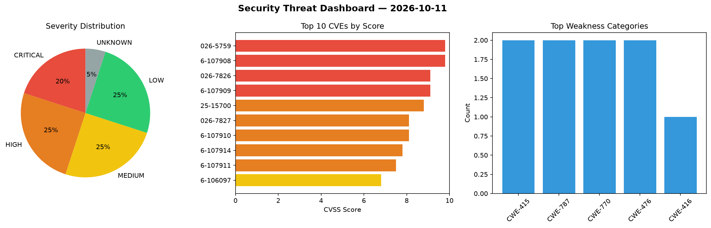
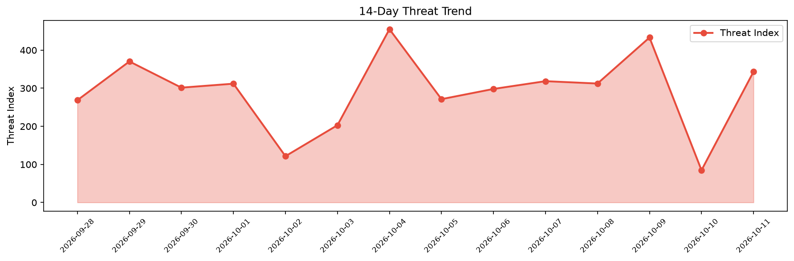

# Security Scan Report — 2026-10-11

**Scan ID:** `1892d292e7` | **CVEs:** 20 | **Threat Index:** 343.4

## Threat Overview

| Metric | Value |
|--------|-------|
| Threat Index | 343.4 |
| Critical CVEs | 4 |
| CRITICAL | 4 |
| HIGH | 5 |
| MEDIUM | 5 |
| LOW | 5 |
| UNKNOWN | 1 |

## Delta vs Yesterday

| Metric | Today | Yesterday | Change |
|--------|-------|-----------|--------|
| total_cves | 20 | 20 | ➡️ 0.0% |
| threat_index | 343.4 | 84.8 | 📈 305.0% |
| critical_count | 4 | 0 | ➡️ 0% |

## Top Weakness Categories

| CWE | Count |
|-----|-------|
| CWE-415 | 2 |
| CWE-787 | 2 |
| CWE-770 | 2 |
| CWE-476 | 2 |
| CWE-416 | 1 |

## CVE Details

| CVE ID | Score | Severity | Description |
|--------|-------|----------|-------------|
| CVE-2026-5759 | 9.8 | CRITICAL | A double free and use-after-free vulnerability in the RdbLoadDeletedNodes functi... |
| CVE-2026-107908 | 9.8 | CRITICAL | A heap-based out-of-bounds write in the BoltReadHandler function (src/bolt/bolt_... |
| CVE-2026-7826 | 9.1 | CRITICAL | A heap-based out-of-bounds read in the BufferSerializerIOv2_ReadBuffer function ... |
| CVE-2026-107909 | 9.1 | CRITICAL | A heap-based out-of-bounds write in the ws_read_frame function (src/bolt/ws.c) a... |
| CVE-2025-15700 | 8.8 | HIGH | The AWP Classifieds WordPress plugin before 4.4.9 does not validate the type of ... |
| CVE-2026-7827 | 8.1 | HIGH | A stack-based buffer overflow in the _RdbLoadEntity function of the RDB graph de... |
| CVE-2026-107910 | 8.1 | HIGH | An improper authentication vulnerability in the is_authenticated function (src/b... |
| CVE-2026-107914 | 7.8 | HIGH | Backdrop CMS 1.34 before 1.34.5 and 1.35 before 1.35.1 doesn't sufficiently prot... |
| CVE-2026-107911 | 7.5 | HIGH | A type confusion vulnerability in the _read_flags function (src/commands/cmd_dis... |
| CVE-2026-106097 | 6.8 | MEDIUM | The Code Snippets WordPress plugin before 3.10.0 does not sanitise and escape a ... |
| CVE-2026-107889 | 5.5 | MEDIUM | A flaw was found in the login theme rendering component of Keycloak. The issue o... |
| CVE-2026-87109 | 5.3 | MEDIUM | An authenticated Ops Manager organization member can retrieve another member's p... |
| CVE-2026-87110 | 5.3 | MEDIUM | An unauthenticated user with network access to the Ops Manager web port can repe... |
| CVE-2026-107888 | 5.1 | MEDIUM | OpenPrinting CUPS before 2.4.20 contains a NULL pointer dereference in cupsdChec... |
| CVE-2026-107885 | 3.3 | LOW | OpenPrinting CUPS through 2.4.20 contains a resource-exhaustion vulnerability in... |