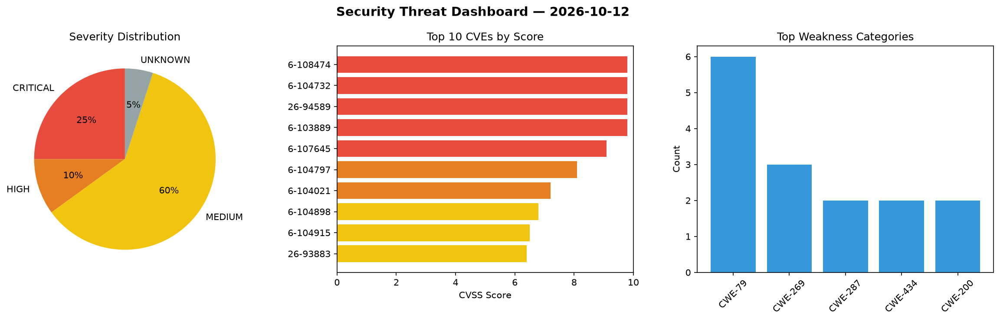
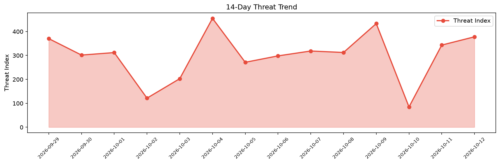

# Security Scan Report — 2026-10-12

**Scan ID:** `da053f991b` | **CVEs:** 20 | **Threat Index:** 377.9

## Threat Overview

| Metric | Value |
|--------|-------|
| Threat Index | 377.9 |
| Critical CVEs | 5 |
| CRITICAL | 5 |
| HIGH | 2 |
| MEDIUM | 12 |
| UNKNOWN | 1 |

## Delta vs Yesterday

| Metric | Today | Yesterday | Change |
|--------|-------|-----------|--------|
| total_cves | 20 | 20 | ➡️ 0.0% |
| threat_index | 377.9 | 343.4 | 📈 10.0% |
| critical_count | 5 | 4 | 📈 25.0% |

## Top Weakness Categories

| CWE | Count |
|-----|-------|
| CWE-79 | 6 |
| CWE-269 | 3 |
| CWE-287 | 2 |
| CWE-434 | 2 |
| CWE-200 | 2 |

## CVE Details

| CVE ID | Score | Severity | Description |
|--------|-------|----------|-------------|
| CVE-2026-108474 | 9.8 | CRITICAL | In JetBrains Exposed before 1.5.1 sQL injection was possible via unescaped strin... |
| CVE-2026-104732 | 9.8 | CRITICAL | The Advanced IP Blocker plugin for WordPress is vulnerable to Authentication Byp... |
| CVE-2026-94589 | 9.8 | CRITICAL | The Extensions For CF7 (Contact form 7 Database, Conditional Fields and Redirect... |
| CVE-2026-103889 | 9.8 | CRITICAL | The 3D Product configurator for WooCommerce plugin for WordPress is vulnerable t... |
| CVE-2026-107645 | 9.1 | CRITICAL | The Blocksy Companion plugin for WordPress is vulnerable to privilege escalation... |
| CVE-2026-104797 | 8.1 | HIGH | The Advanced Form Integration — Connect Forms to 300+ Apps plugin for WordPress ... |
| CVE-2026-104021 | 7.2 | HIGH | The Fastcache by Host.it plugin for WordPress is vulnerable to Code Injection in... |
| CVE-2026-104898 | 6.8 | MEDIUM | The Online Scheduling and Appointment Booking System – Bookly plugin for WordPre... |
| CVE-2026-104915 | 6.5 | MEDIUM | The Academy LMS – AI Course Builder, Quizzes, Certificates & eLearning plugin fo... |
| CVE-2026-93883 | 6.4 | MEDIUM | The Advanced Classifieds & Directory Pro plugin for WordPress is vulnerable to S... |
| CVE-2026-96743 | 6.4 | MEDIUM | The Table Field Add-on for ACF and SCF plugin for WordPress is vulnerable to Sto... |
| CVE-2026-102401 | 6.4 | MEDIUM | The Download Manager plugin for WordPress is vulnerable to Stored Cross-Site Scr... |
| CVE-2026-103998 | 6.1 | MEDIUM | The Form Maker by 10Web – Mobile-Friendly Drag & Drop Contact Form Builder plugi... |
| CVE-2026-108501 | 5.7 | MEDIUM | ZTE Z80 Ultra has a system interface permission verification defect. The interfa... |
| CVE-2026-104022 | 5.4 | MEDIUM | The Academy LMS – AI Course Builder, Quizzes, Certificates & eLearning plugin fo... |