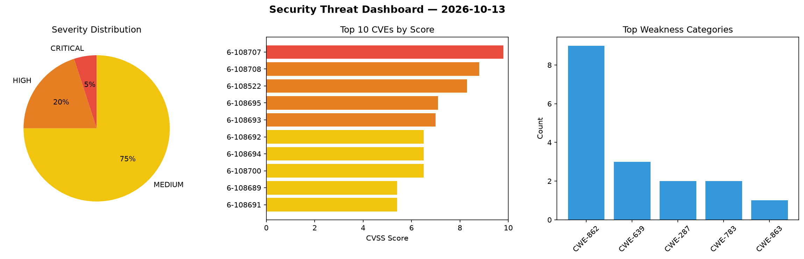
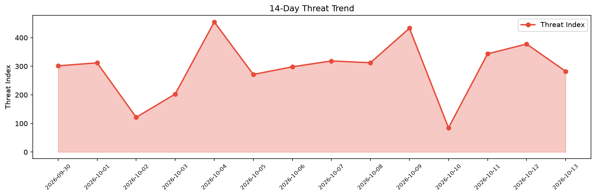

# Security Scan Report — 2026-10-13

**Scan ID:** `26ec87178d` | **CVEs:** 20 | **Threat Index:** 282.4

## Threat Overview

| Metric | Value |
|--------|-------|
| Threat Index | 282.4 |
| Critical CVEs | 1 |
| CRITICAL | 1 |
| HIGH | 4 |
| MEDIUM | 15 |

## Delta vs Yesterday

| Metric | Today | Yesterday | Change |
|--------|-------|-----------|--------|
| total_cves | 20 | 20 | ➡️ 0.0% |
| threat_index | 282.4 | 377.9 | 📉 -25.3% |
| critical_count | 1 | 5 | 📉 -80.0% |

## Top Weakness Categories

| CWE | Count |
|-----|-------|
| CWE-862 | 9 |
| CWE-639 | 3 |
| CWE-287 | 2 |
| CWE-783 | 2 |
| CWE-863 | 1 |

## CVE Details

| CVE ID | Score | Severity | Description |
|--------|-------|----------|-------------|
| CVE-2026-108707 | 9.8 | CRITICAL | Wukong_HRM through commit 186115e contains an authentication bypass vulnerabilit... |
| CVE-2026-108708 | 8.8 | HIGH | Wukong_HRM through commit 186115e contains a missing authorization vulnerability... |
| CVE-2026-108522 | 8.3 | HIGH | A vulnerability was found in Studio-Saelix Sencho up to 0.94.1. This affects an ... |
| CVE-2026-108695 | 7.1 | HIGH | MultiVendorX WordPress plugin through 5.0.19 contains an incorrect authorization... |
| CVE-2026-108693 | 7.0 | HIGH | ImageMagick on Windows through 7.1.2-33 and 6.9.13-58 contains an uncontrolled s... |
| CVE-2026-108692 | 6.5 | MEDIUM | 1Panel-dev CordysCRM from 1.9.0 before 1.9.2 contains a missing authorization vu... |
| CVE-2026-108694 | 6.5 | MEDIUM | ConvertX through 0.19.0 contains an arbitrary file read vulnerability that allow... |
| CVE-2026-108700 | 6.5 | MEDIUM | 1Panel-dev CordysCRM before 1.9.2 contains a missing authorization vulnerability... |
| CVE-2026-108689 | 5.4 | MEDIUM | Wukong AICRM through 20260610 contains a missing authorization vulnerability tha... |
| CVE-2026-108691 | 5.4 | MEDIUM | mall4j through 4.0 contains an improper authorization vulnerability that allows ... |
| CVE-2026-108703 | 5.4 | MEDIUM | CordysCRM through 1.9.3 contains a missing authorization vulnerability in POST /... |
| CVE-2026-108521 | 4.7 | MEDIUM | A vulnerability has been found in Studio-Saelix Sencho up to 0.97.1. Affected by... |
| CVE-2026-108688 | 4.3 | MEDIUM | Eladmin through 2.7 contains a missing authorization vulnerability in the LocalS... |
| CVE-2026-108690 | 4.3 | MEDIUM | mall4j through 4.0 contains an information disclosure vulnerability that allows ... |
| CVE-2026-108696 | 4.3 | MEDIUM | CoreShop through 1.5.5 contains an authorization bypass vulnerability in the Ord... |