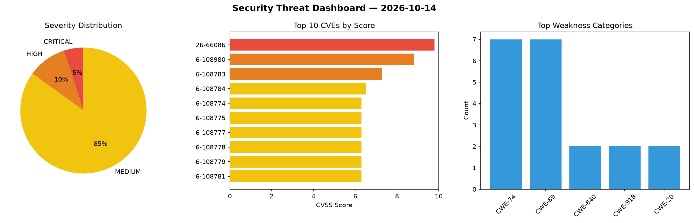
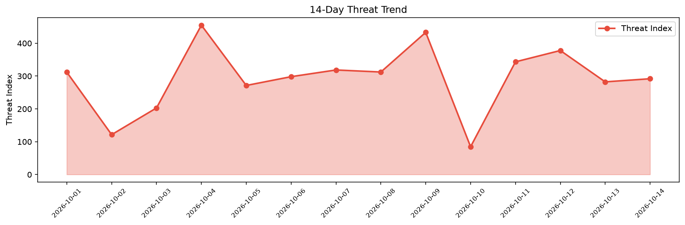

# Security Scan Report — 2026-10-14

**Scan ID:** `3d66a59086` | **CVEs:** 20 | **Threat Index:** 291.9

## Threat Overview

| Metric | Value |
|--------|-------|
| Threat Index | 291.9 |
| Critical CVEs | 1 |
| CRITICAL | 1 |
| HIGH | 2 |
| MEDIUM | 17 |

## Delta vs Yesterday

| Metric | Today | Yesterday | Change |
|--------|-------|-----------|--------|
| total_cves | 20 | 20 | ➡️ 0.0% |
| threat_index | 291.9 | 282.4 | 📈 3.4% |
| critical_count | 1 | 1 | ➡️ 0.0% |

## Top Weakness Categories

| CWE | Count |
|-----|-------|
| CWE-74 | 7 |
| CWE-89 | 7 |
| CWE-840 | 2 |
| CWE-918 | 2 |
| CWE-20 | 2 |

## CVE Details

| CVE ID | Score | Severity | Description |
|--------|-------|----------|-------------|
| CVE-2026-66086 | 9.8 | CRITICAL | In the modem OTA stack, there is a possible stack-based buffer overflow due to i... |
| CVE-2026-108980 | 8.8 | HIGH | Blinko through 1.8.8 allows directory traversal, overwriting startup files as ro... |
| CVE-2026-108783 | 7.3 | HIGH | A security vulnerability has been detected in PRVTPRO Amnezia-Web-Panel up to 1.... |
| CVE-2026-108784 | 6.5 | MEDIUM | A vulnerability was detected in macrozheng mall up to 1.0.3. This vulnerability ... |
| CVE-2026-108774 | 6.3 | MEDIUM | A flaw has been found in erzhongxmu JEEWMS up to 2026.09.27-W39. The affected el... |
| CVE-2026-108775 | 6.3 | MEDIUM | A vulnerability has been found in erzhongxmu JEEWMS up to 2026.09.27-W39. The im... |
| CVE-2026-108777 | 6.3 | MEDIUM | A vulnerability was found in erzhongxmu JEEWMS up to 2026.09.27-W39. This affect... |
| CVE-2026-108778 | 6.3 | MEDIUM | A vulnerability was determined in erzhongxmu JEEWMS up to 2026.09.27-W39. This i... |
| CVE-2026-108779 | 6.3 | MEDIUM | A vulnerability was identified in erzhongxmu JEEWMS up to 2026.09.27-W39. Affect... |
| CVE-2026-108781 | 6.3 | MEDIUM | A security flaw has been discovered in erzhongxmu JEEWMS up to 2026.09.27-W39. A... |
| CVE-2026-108782 | 6.3 | MEDIUM | A weakness has been identified in erzhongxmu JEEWMS up to 2026.09.27-W39. Affect... |
| CVE-2026-108785 | 6.3 | MEDIUM | A flaw has been found in macrozheng mall up to 1.0.3. This issue affects the fun... |
| CVE-2026-108786 | 6.3 | MEDIUM | A vulnerability has been found in houtini-ai seo-crawler-mcp up to 2.1.5. Impact... |
| CVE-2026-108787 | 6.3 | MEDIUM | A vulnerability was found in houtini-ai voice-analyser-mcp up to 2.1.1. The affe... |
| CVE-2026-107437 | 6.2 | MEDIUM | GV-E-Map
Server V18.2.0A contains a plaintext database password embedded within ... |