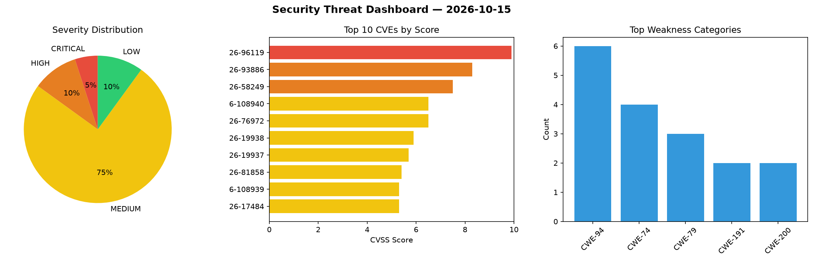
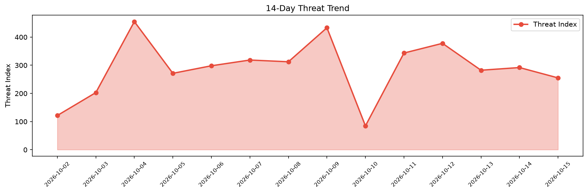

# Security Scan Report — 2026-10-15

**Scan ID:** `575efc3765` | **CVEs:** 20 | **Threat Index:** 255.2

## Threat Overview

| Metric | Value |
|--------|-------|
| Threat Index | 255.2 |
| Critical CVEs | 1 |
| CRITICAL | 1 |
| HIGH | 2 |
| MEDIUM | 15 |
| LOW | 2 |

## Delta vs Yesterday

| Metric | Today | Yesterday | Change |
|--------|-------|-----------|--------|
| total_cves | 20 | 20 | ➡️ 0.0% |
| threat_index | 255.2 | 291.9 | 📉 -12.6% |
| critical_count | 1 | 1 | ➡️ 0.0% |

## Top Weakness Categories

| CWE | Count |
|-----|-------|
| CWE-94 | 6 |
| CWE-74 | 4 |
| CWE-79 | 3 |
| CWE-191 | 2 |
| CWE-200 | 2 |

## CVE Details

| CVE ID | Score | Severity | Description |
|--------|-------|----------|-------------|
| CVE-2026-96119 | 9.9 | CRITICAL | IBM i 7.3, 7.4, 7.5, and 7.6 could allow a remote authenticated attacker to obta... |
| CVE-2026-93886 | 8.3 | HIGH | IBM i 7.3, 7.4, 7.5, and 7.6 could allow a remote authenticated attacker to exec... |
| CVE-2026-58249 | 7.5 | HIGH | SAP NetWeaver and SAP Web Dispatcher do not properly validate certain fields in ... |
| CVE-2026-108940 | 6.5 | MEDIUM | A vulnerability was found in EricLBuehler Mistral.rs up to 0.9.3. The affected e... |
| CVE-2026-76972 | 6.5 | MEDIUM | Due to a Cross-Site Scripting (XSS) vulnerability in SAP Manufacturing Integrati... |
| CVE-2026-19938 | 5.9 | MEDIUM | The Bluetooth host's ATT transmit path releases a buffer it does not own when si... |
| CVE-2026-19937 | 5.7 | MEDIUM | The Bluetooth Mesh Access layer delayable-message machinery in subsys/bluetooth/... |
| CVE-2026-81858 | 5.4 | MEDIUM | IBM i 7.3, 7.4, 7.5, and 7.6 could allow a remote authenticated attacker to caus... |
| CVE-2026-108939 | 5.3 | MEDIUM | A vulnerability has been found in EricLBuehler mistral.rs up to 0.9.3. Impacted ... |
| CVE-2026-17484 | 5.3 | MEDIUM | IBM i 7.3, 7.4, 7.5, and 7.6 could allow a local attacker to cause a denial of s... |
| CVE-2026-17487 | 5.3 | MEDIUM | IBM i 7.3, 7.4, 7.5, and 7.6 could allow a remote attacker to enumerate user pro... |
| CVE-2026-18318 | 5.3 | MEDIUM | IBM i 7.3, 7.4, 7.5, and 7.6 could allow a remote attacker to perform brute-forc... |
| CVE-2026-108943 | 5.3 | MEDIUM | A weakness has been identified in ModelTC LightX2V up to 0.5.0. Affected is the ... |
| CVE-2026-108945 | 5.3 | MEDIUM | A vulnerability was detected in iMoonLab yolov13 up to 73289949533efac82bb5f72ec... |
| CVE-2026-108941 | 4.8 | MEDIUM | A vulnerability was identified in Linketic CityGaussian up to 2.0. This affects ... |