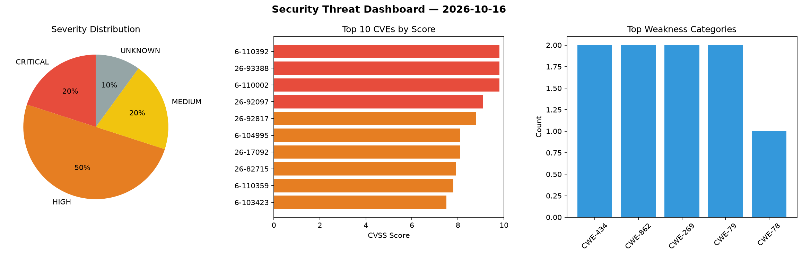
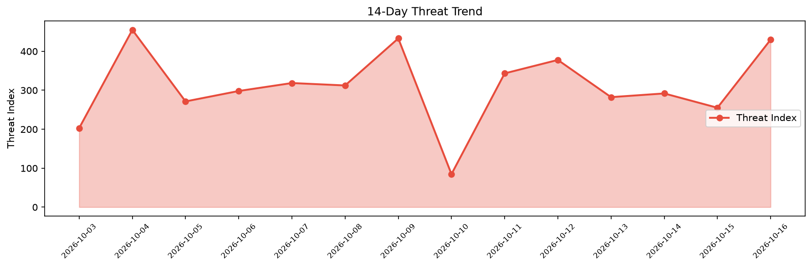

# Security Scan Report — 2026-10-16

**Scan ID:** `09317f3719` | **CVEs:** 20 | **Threat Index:** 429.9

## Threat Overview

| Metric | Value |
|--------|-------|
| Threat Index | 429.9 |
| Critical CVEs | 4 |
| CRITICAL | 4 |
| HIGH | 10 |
| MEDIUM | 4 |
| UNKNOWN | 2 |

## Delta vs Yesterday

| Metric | Today | Yesterday | Change |
|--------|-------|-----------|--------|
| total_cves | 20 | 20 | ➡️ 0.0% |
| threat_index | 429.9 | 255.2 | 📈 68.5% |
| critical_count | 4 | 1 | 📈 300.0% |

## Top Weakness Categories

| CWE | Count |
|-----|-------|
| CWE-434 | 2 |
| CWE-862 | 2 |
| CWE-269 | 2 |
| CWE-79 | 2 |
| CWE-78 | 1 |

## CVE Details

| CVE ID | Score | Severity | Description |
|--------|-------|----------|-------------|
| CVE-2026-110392 | 9.8 | CRITICAL | Improper neutralization of special elements used in an OS command ('OS command i... |
| CVE-2026-93388 | 9.8 | CRITICAL | The Printcart Store (PCDesigner / NB Designer) plugin for WooCommerce is vulnera... |
| CVE-2026-110002 | 9.8 | CRITICAL | The Snazzy Social Media Feed plugin for WordPress is vulnerable to Arbitrary Fil... |
| CVE-2026-92097 | 9.1 | CRITICAL | The Click to Chat for WhatsApp plugin for WordPress is vulnerable to Arbitrary S... |
| CVE-2026-92817 | 8.8 | HIGH | The Ignition Perspective module does not properly validate session privileges wh... |
| CVE-2026-104995 | 8.1 | HIGH | The BP Profile Search plugin for WordPress is vulnerable to Local File Inclusion... |
| CVE-2026-17092 | 8.1 | HIGH | The Directorist: AI-Powered Business Directory, Listings & Classified Ads plugin... |
| CVE-2026-82715 | 7.9 | HIGH | Insecure Temporary File vulnerability in Hitachi Disk Array Driver for AIX and H... |
| CVE-2026-110359 | 7.8 | HIGH | Hyland Desktop Host for Windows before 25.1.1 is vulnerable to local privilege e... |
| CVE-2026-103423 | 7.5 | HIGH | The Booking Package plugin for WordPress is vulnerable to authorization bypass i... |
| CVE-2026-104749 | 7.5 | HIGH | The Bit integrations – Form Integration, Webhook, Spreadsheets, CRM, LMS & Email... |
| CVE-2026-104767 | 7.5 | HIGH | The Membership & User Roles for WooCommerce (Automatic Role Changer) plugin for ... |
| CVE-2026-102251 | 7.5 | HIGH | The Abandoned Cart Pro for WooCommerce plugin for WordPress is vulnerable to gen... |
| CVE-2026-103422 | 7.2 | HIGH | The AnyComment plugin for WordPress is vulnerable to Stored Cross-Site Scripting... |
| CVE-2026-103425 | 6.4 | MEDIUM | The Booking Package plugin for WordPress is vulnerable to Stored Cross-Site Scri... |