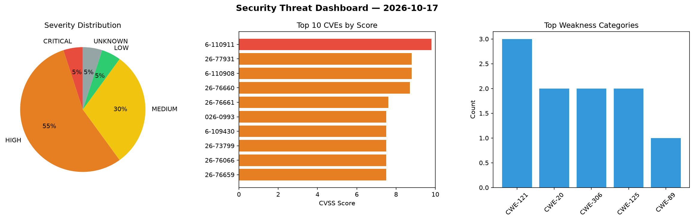
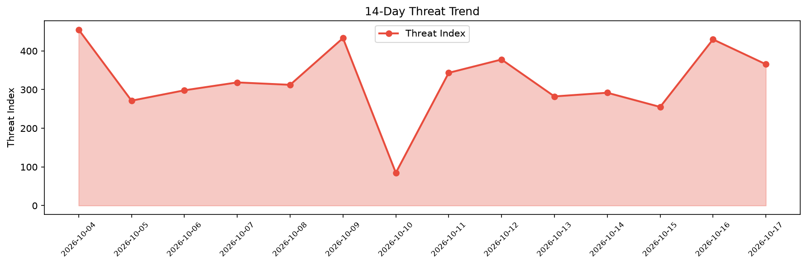

# Security Scan Report — 2026-10-17

**Scan ID:** `aaba8a9e0a` | **CVEs:** 20 | **Threat Index:** 365.6

## Threat Overview

| Metric | Value |
|--------|-------|
| Threat Index | 365.6 |
| Critical CVEs | 1 |
| CRITICAL | 1 |
| HIGH | 11 |
| MEDIUM | 6 |
| LOW | 1 |
| UNKNOWN | 1 |

## Delta vs Yesterday

| Metric | Today | Yesterday | Change |
|--------|-------|-----------|--------|
| total_cves | 20 | 20 | ➡️ 0.0% |
| threat_index | 365.6 | 429.9 | 📉 -15.0% |
| critical_count | 1 | 4 | 📉 -75.0% |

## Top Weakness Categories

| CWE | Count |
|-----|-------|
| CWE-121 | 3 |
| CWE-20 | 2 |
| CWE-306 | 2 |
| CWE-125 | 2 |
| CWE-89 | 1 |

## CVE Details

| CVE ID | Score | Severity | Description |
|--------|-------|----------|-------------|
| CVE-2026-110911 | 9.8 | CRITICAL | Wheels 1.1.8 through 4.1.1 allows SQL injection when caller-supplied quoted valu... |
| CVE-2026-77931 | 8.8 | HIGH | MoviePilot through 3.1.5 contains a command injection vulnerability that allows ... |
| CVE-2026-110908 | 8.8 | HIGH | Netgate pfSense FRR package (pfSense-pkg-frr) 2.0.2_1 and source revision 2.1.2_... |
| CVE-2026-76660 | 8.7 | HIGH | A vulnerability in HPE NonStop CIPSAM allows an out-of-bounds
  write that can c... |
| CVE-2026-76661 | 7.6 | HIGH | A vulnerability in HPE NonStop QIOMON allows an out-of-bounds write that can cor... |
| CVE-2026-0993 | 7.5 | HIGH | SODOLA SL902-SWTGW124AS firmware before 200.2.12 contains a buffer overflow vuln... |
| CVE-2026-109430 | 7.5 | HIGH | Ellucian WebAdvisor 3.2 contains an unauthenticated XML External Entity (XXE) in... |
| CVE-2026-73799 | 7.5 | HIGH | A security vulnerability in HPE NonStop SNMP Trap Multiplexer may cause memory c... |
| CVE-2026-76066 | 7.5 | HIGH | IntentKit through 2.6.3 contains an authorization bypass vulnerability where the... |
| CVE-2026-76659 | 7.5 | HIGH | A vulnerability in the finger daemon of HPE NonStop TCP/IP UTILITIES could allow... |
| CVE-2026-110907 | 7.5 | HIGH | Backdrop CMS Core 1.35.x before 1.35.2 and 1.34.x before 1.34.6 mishandles token... |
| CVE-2026-76663 | 7.5 | HIGH | A stack-based buffer overflow vulnerability in HPE NonStop TELSERV can cause mem... |
| CVE-2026-76664 | 6.4 | MEDIUM | A security vulnerability in HPE NonStop EXPAND may result in out-of-bounds memor... |
| CVE-2026-76662 | 5.9 | MEDIUM | A buffer overflow vulnerability in HPE NonStop TELSERV can cause memory corrupti... |
| CVE-2026-110904 | 5.3 | MEDIUM | ApostropheCMS before 4.33.0 allows authentication bypass for REST API page readi... |