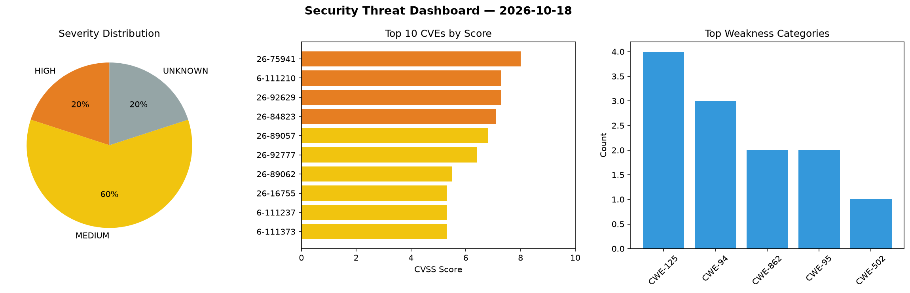
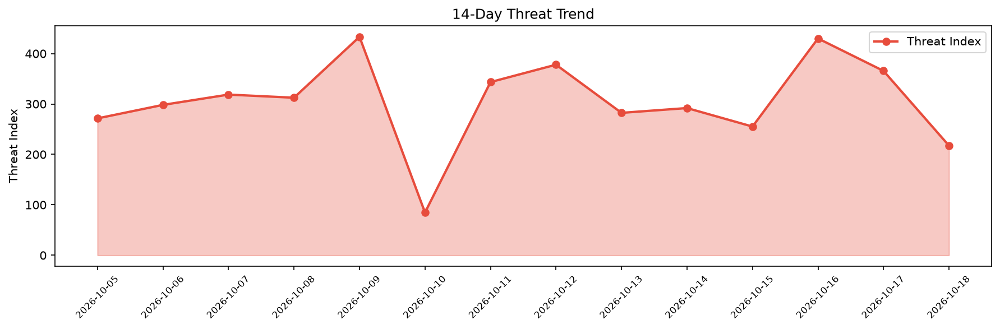

# Security Scan Report — 2026-10-18

**Scan ID:** `773e150411` | **CVEs:** 20 | **Threat Index:** 217.3

## Threat Overview

| Metric | Value |
|--------|-------|
| Threat Index | 217.3 |
| Critical CVEs | 0 |
| HIGH | 4 |
| MEDIUM | 12 |
| UNKNOWN | 4 |

## Delta vs Yesterday

| Metric | Today | Yesterday | Change |
|--------|-------|-----------|--------|
| total_cves | 20 | 20 | ➡️ 0.0% |
| threat_index | 217.3 | 365.6 | 📉 -40.6% |
| critical_count | 0 | 1 | 📉 -100.0% |

## Top Weakness Categories

| CWE | Count |
|-----|-------|
| CWE-125 | 4 |
| CWE-94 | 3 |
| CWE-862 | 2 |
| CWE-95 | 2 |
| CWE-502 | 1 |

## CVE Details

| CVE ID | Score | Severity | Description |
|--------|-------|----------|-------------|
| CVE-2026-75941 | 8.0 | HIGH | A potential vulnerability was reported in the Lenovo Legion Zone application, di... |
| CVE-2026-111210 | 7.3 | HIGH | A vulnerability was determined in bitcoinj up to 0.17. Affected is the function ... |
| CVE-2026-92629 | 7.3 | HIGH | A potential improper authorization vulnerability was reported in Lenovo Baiying ... |
| CVE-2026-84823 | 7.1 | HIGH | A flaw was found in WildFly. A user with the `Monitor` role, which is the lowest... |
| CVE-2026-89057 | 6.8 | MEDIUM | A potential authentication bypass vulnerability was reported in some Lenovo tabl... |
| CVE-2026-92777 | 6.4 | MEDIUM | A potential vulnerability was reported in some Lenovo Tablets that could allow a... |
| CVE-2026-89062 | 5.5 | MEDIUM | A potential out-of-bounds write vulnerability was reported in the Lenovo Energy ... |
| CVE-2026-16755 | 5.3 | MEDIUM | A potential vulnerability was reported in Lenovo Smart Camera C33, distributed e... |
| CVE-2026-111237 | 5.3 | MEDIUM | A weakness has been identified in Ultralytics FastSAM up to b4ed20c2fed75eadc5aa... |
| CVE-2026-111373 | 5.3 | MEDIUM | FreeRDP before 3.32.0 contains a NULL pointer dereference vulnerability in the w... |
| CVE-2026-111374 | 5.3 | MEDIUM | FreeRDP from 3.30.0 before 3.32.0 contains a resource exhaustion vulnerability i... |
| CVE-2026-111376 | 5.0 | MEDIUM | FreeRDP from 3.30.0 before 3.32.0 contains a heap out-of-bounds read vulnerabili... |
| CVE-2026-16754 | 4.8 | MEDIUM | A potential improper certificate validation vulnerability was reported in Lenovo... |
| CVE-2026-100159 | 4.8 | MEDIUM | The Popup Box plugin for WordPress is vulnerable to Arbitrary Shortcode Executio... |
| CVE-2026-111212 | 4.8 | MEDIUM | A security flaw has been discovered in ImprintLab Medical-SAM-Adapter 0.1.0-alph... |