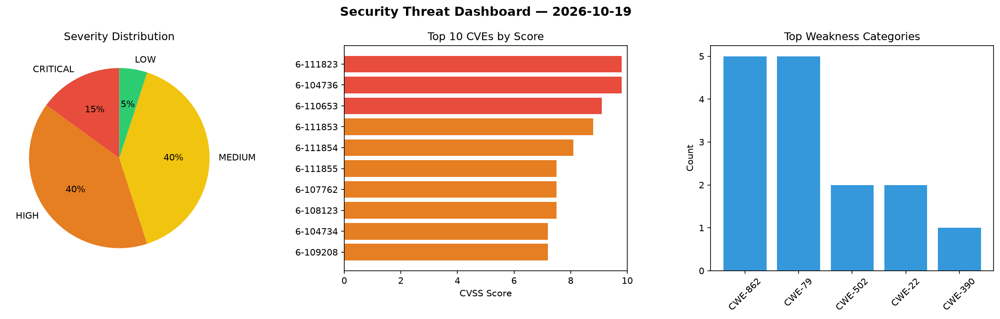
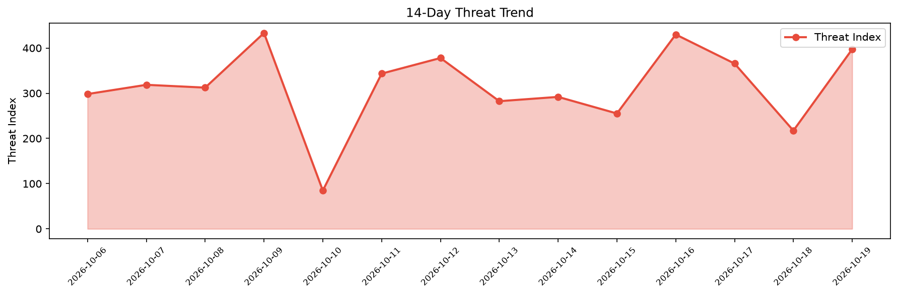

# Security Scan Report — 2026-10-19

**Scan ID:** `04779c0059` | **CVEs:** 20 | **Threat Index:** 397.3

## Threat Overview

| Metric | Value |
|--------|-------|
| Threat Index | 397.3 |
| Critical CVEs | 3 |
| CRITICAL | 3 |
| HIGH | 8 |
| MEDIUM | 8 |
| LOW | 1 |

## Delta vs Yesterday

| Metric | Today | Yesterday | Change |
|--------|-------|-----------|--------|
| total_cves | 20 | 20 | ➡️ 0.0% |
| threat_index | 397.3 | 217.3 | 📈 82.8% |
| critical_count | 3 | 0 | ➡️ 0% |

## Top Weakness Categories

| CWE | Count |
|-----|-------|
| CWE-862 | 5 |
| CWE-79 | 5 |
| CWE-502 | 2 |
| CWE-22 | 2 |
| CWE-390 | 1 |

## CVE Details

| CVE ID | Score | Severity | Description |
|--------|-------|----------|-------------|
| CVE-2026-111823 | 9.8 | CRITICAL | Mage OSS through 0.9.80 before 76c4f46 can proceed with session creation upon en... |
| CVE-2026-104736 | 9.8 | CRITICAL | The LearnPress plugin for WordPress is vulnerable to PHP Object Injection in ver... |
| CVE-2026-110653 | 9.1 | CRITICAL | The Appointment Booking Plugin – LatePoint / Calendar & Scheduling for WordPress... |
| CVE-2026-111853 | 8.8 | HIGH | An issue was discovered on Tektronix 3 Series MDO devices before 1.21.1. An OS c... |
| CVE-2026-111854 | 8.1 | HIGH | An issue was discovered on Tektronix 3 Series MDO devices before 1.21.1. A path ... |
| CVE-2026-111855 | 7.5 | HIGH | An issue was discovered on Tektronix 3 Series MDO devices before 1.21.1. A path ... |
| CVE-2026-107762 | 7.5 | HIGH | The Kirki – Freeform Page Builder, Website Builder & Customizer plugin for WordP... |
| CVE-2026-108123 | 7.5 | HIGH | The WP Booking System – Booking Calendar plugin for WordPress is vulnerable to a... |
| CVE-2026-104734 | 7.2 | HIGH | The Kirki – Freeform Page Builder, Website Builder & Customizer plugin for WordP... |
| CVE-2026-109208 | 7.2 | HIGH | The LearnPress – WordPress LMS Plugin for Create and Sell Online Courses plugin ... |
| CVE-2026-103899 | 7.2 | HIGH | The EU VAT Assistant for WooCommerce plugin for WordPress is vulnerable to Store... |
| CVE-2026-109369 | 6.8 | MEDIUM | The WP Booking System – Booking Calendar plugin for WordPress is vulnerable to a... |
| CVE-2026-107744 | 6.5 | MEDIUM | The LearnPress – WordPress LMS Plugin for Create and Sell Online Courses plugin ... |
| CVE-2026-109368 | 6.5 | MEDIUM | The WP Booking System – Booking Calendar plugin for WordPress is vulnerable to S... |
| CVE-2026-109985 | 6.4 | MEDIUM | The xSpeed Cache: AI-Powered Performance Hub with MCP, Caching & CDN plugin for ... |