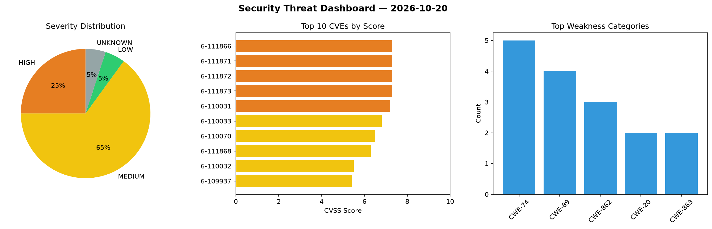
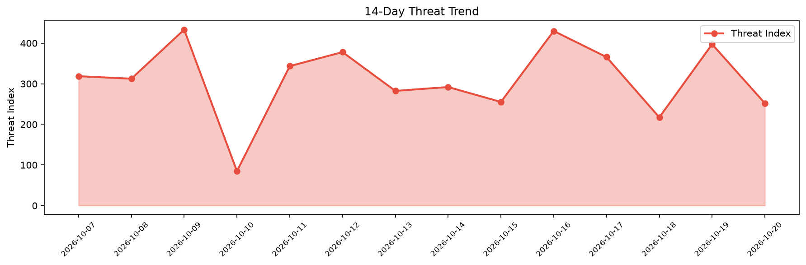

# Security Scan Report — 2026-10-20

**Scan ID:** `5df2df6fa3` | **CVEs:** 20 | **Threat Index:** 251.9

## Threat Overview

| Metric | Value |
|--------|-------|
| Threat Index | 251.9 |
| Critical CVEs | 0 |
| HIGH | 5 |
| MEDIUM | 13 |
| LOW | 1 |
| UNKNOWN | 1 |

## Delta vs Yesterday

| Metric | Today | Yesterday | Change |
|--------|-------|-----------|--------|
| total_cves | 20 | 20 | ➡️ 0.0% |
| threat_index | 251.9 | 397.3 | 📉 -36.6% |
| critical_count | 0 | 3 | 📉 -100.0% |

## Top Weakness Categories

| CWE | Count |
|-----|-------|
| CWE-74 | 5 |
| CWE-89 | 4 |
| CWE-862 | 3 |
| CWE-20 | 2 |
| CWE-863 | 2 |

## CVE Details

| CVE ID | Score | Severity | Description |
|--------|-------|----------|-------------|
| CVE-2026-111866 | 7.3 | HIGH | A weakness has been identified in nemoTyrant manong up to 7c9e5228e133b9267ad3a4... |
| CVE-2026-111871 | 7.3 | HIGH | A weakness has been identified in itsmeravitejak Online-Examination-System up to... |
| CVE-2026-111872 | 7.3 | HIGH | A security vulnerability has been detected in itsmeravitejak Online-Examination-... |
| CVE-2026-111873 | 7.3 | HIGH | A vulnerability was detected in itsmeravitejak Online-Examination-System up to e... |
| CVE-2026-110031 | 7.2 | HIGH | The Salon Booking System  WordPress plugin before 10.31.11 does not prevent user... |
| CVE-2026-110033 | 6.8 | MEDIUM | The Salon Booking System  WordPress plugin before 10.31.11 does not validate a u... |
| CVE-2026-110070 | 6.5 | MEDIUM | The Modern Events Calendar Lite WordPress plugin before 7.36.4 does not verify t... |
| CVE-2026-111868 | 6.3 | MEDIUM | A vulnerability was determined in datastax pulsar-jms up to 9.0.3. This issue af... |
| CVE-2026-110032 | 5.5 | MEDIUM | The Salon Booking System  WordPress plugin before 10.31.11 does not restrict whi... |
| CVE-2026-109937 | 5.4 | MEDIUM | The Otter Blocks  WordPress plugin before 3.2.3 does not validate that a user-su... |
| CVE-2026-111869 | 5.3 | MEDIUM | A vulnerability was identified in makeplane plane up to 1.4.2. Impacted is an un... |
| CVE-2026-111870 | 5.3 | MEDIUM | A security flaw has been discovered in itsmeravitejak Online-Examination-System ... |
| CVE-2026-111876 | 5.3 | MEDIUM | A vulnerability was found in alexpasmantier television up to 0.15.9. Affected by... |
| CVE-2026-110026 | 4.9 | MEDIUM | The Tasty Recipes Lite  WordPress plugin before 1.2.11 does not correctly check ... |
| CVE-2026-110976 | 4.9 | MEDIUM | The AI Engine  WordPress plugin before 3.7.9 does not check that the item passed... |