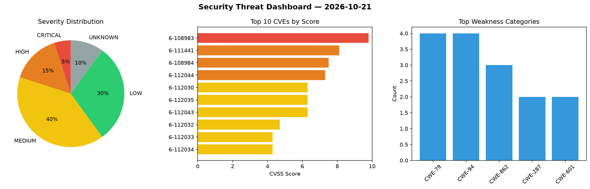
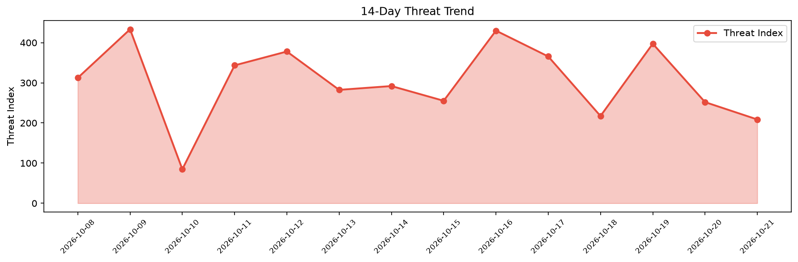

# Security Scan Report — 2026-10-21

**Scan ID:** `9c3af80ab2` | **CVEs:** 20 | **Threat Index:** 208.7

## Threat Overview

| Metric | Value |
|--------|-------|
| Threat Index | 208.7 |
| Critical CVEs | 1 |
| CRITICAL | 1 |
| HIGH | 3 |
| MEDIUM | 8 |
| LOW | 6 |
| UNKNOWN | 2 |

## Delta vs Yesterday

| Metric | Today | Yesterday | Change |
|--------|-------|-----------|--------|
| total_cves | 20 | 20 | ➡️ 0.0% |
| threat_index | 208.7 | 251.9 | 📉 -17.1% |
| critical_count | 1 | 0 | ➡️ 0% |

## Top Weakness Categories

| CWE | Count |
|-----|-------|
| CWE-79 | 4 |
| CWE-94 | 4 |
| CWE-862 | 3 |
| CWE-287 | 2 |
| CWE-601 | 2 |

## CVE Details

| CVE ID | Score | Severity | Description |
|--------|-------|----------|-------------|
| CVE-2026-108983 | 9.8 | CRITICAL | A vulnerability is in Web Server default connection ports under the process name... |
| CVE-2026-111441 | 8.1 | HIGH | 在 openGauss-server 的 src/gausskernel/cbb/utils/hll/hll.cpp 中，内置函数 HllObjectUnpac... |
| CVE-2026-108984 | 7.5 | HIGH | A vulnerability is in Web Server default connection ports under the process name... |
| CVE-2026-112044 | 7.3 | HIGH | A security vulnerability has been detected in dotnet eShop up to 913acea66708a59... |
| CVE-2026-112030 | 6.3 | MEDIUM | A vulnerability was found in diem-project diem up to 5.1.3. This vulnerability a... |
| CVE-2026-112035 | 6.3 | MEDIUM | A security vulnerability has been detected in aircheng-org iWebShop-5 up to 5.16... |
| CVE-2026-112043 | 6.3 | MEDIUM | A weakness has been identified in calcom cal.com and cal.diy up to 6.2.0. Impact... |
| CVE-2026-112032 | 4.7 | MEDIUM | A vulnerability was identified in aircheng-org iWebShop-5 up to 5.16. Impacted i... |
| CVE-2026-112033 | 4.3 | MEDIUM | A security flaw has been discovered in aircheng-org iWebShop-5 up to 5.16. The a... |
| CVE-2026-112034 | 4.3 | MEDIUM | A weakness has been identified in aircheng-org iWebShop-5 up to 5.16. The impact... |
| CVE-2026-112036 | 4.3 | MEDIUM | A vulnerability was detected in Artifex MuPDF up to 1.28.5. This impacts the fun... |
| CVE-2026-112040 | 4.3 | MEDIUM | A vulnerability was determined in diem-project diem up to 116974edfb9a5b8bd69cb1... |
| CVE-2026-112037 | 3.7 | LOW | A flaw has been found in diem-project diem up to 116974edfb9a5b8bd69cb13586dc62b... |
| CVE-2026-112041 | 3.7 | LOW | A vulnerability was identified in diem-project diem up to 116974edfb9a5b8bd69cb1... |
| CVE-2026-112031 | 3.5 | LOW | A vulnerability was determined in Chamilo LMS up to 1.11.40/2.0.3/3.0.1. This is... |