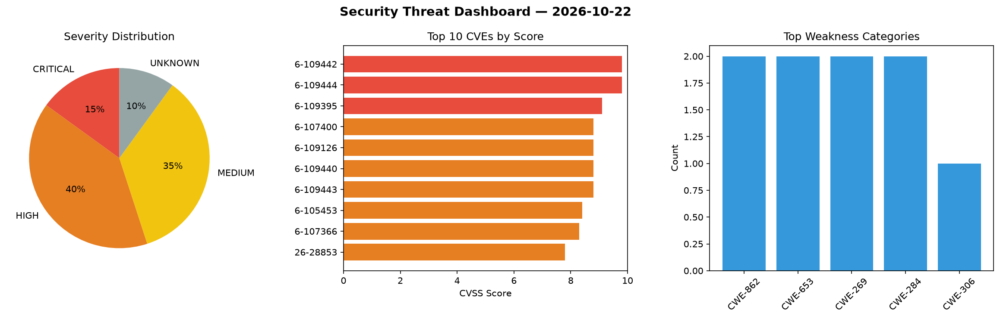
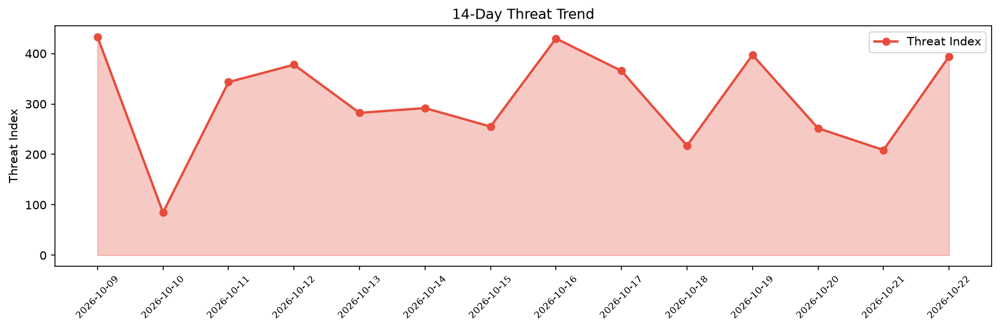

# Security Scan Report — 2026-10-22

**Scan ID:** `00cd6b9c71` | **CVEs:** 20 | **Threat Index:** 379.3

## Threat Overview

| Metric | Value |
|--------|-------|
| Threat Index | 379.3 |
| Critical CVEs | 2 |
| CRITICAL | 2 |
| HIGH | 9 |
| MEDIUM | 7 |
| UNKNOWN | 2 |

## Delta vs Yesterday

| Metric | Today | Yesterday | Change |
|--------|-------|-----------|--------|
| total_cves | 20 | 20 | ➡️ 0.0% |
| threat_index | 379.3 | 208.7 | 📈 81.7% |
| critical_count | 2 | 1 | 📈 100.0% |

## Top Weakness Categories

| CWE | Count |
|-----|-------|
| CWE-653 | 2 |
| CWE-862 | 2 |
| CWE-269 | 2 |
| CWE-284 | 2 |
| CWE-306 | 1 |

## CVE Details

| CVE ID | Score | Severity | Description |
|--------|-------|----------|-------------|
| CVE-2026-109442 | 9.8 | CRITICAL | piflow 2.0.0 through 2.0.1 contains a remote code execution vulnerability in its... |
| CVE-2026-109395 | 9.1 | CRITICAL | Ning compress-lzf before 1.2.0 contains an out-of-bounds memory access vulnerabi... |
| CVE-2026-107400 | 8.8 | HIGH | IBM TRIRIGA Application Platform 5.0.0 through 5.0.8 could allow a remote authen... |
| CVE-2026-109126 | 8.8 | HIGH | IBM Verify Identity Access 11.0.3.1 and IBM Security Verify Access 10.0.9.3 Appl... |
| CVE-2026-109443 | 8.8 | HIGH | JoySafeter through 1.0.0 contains a remote code execution vulnerability that all... |
| CVE-2026-109444 | 8.8 | HIGH | OpenSRE through 0.1.2026.10.19 contains an approval gate bypass vulnerability th... |
| CVE-2026-105453 | 8.4 | HIGH | IBM Sterling Connect Direct for Unix 6.3.0.0 through 6.3.0.7 and 6.4.0.0 through... |
| CVE-2026-107366 | 8.3 | HIGH | IBM Langflow OSS 1.0.0 through 1.12.4 contains three message endpoints that perf... |
| CVE-2026-109440 | 8.1 | HIGH | LangAlpha through 2026.09.07 contains an indirect prompt injection vulnerability... |
| CVE-2026-28853 | 7.8 | HIGH | The issue was addressed with improved checks. This issue is fixed in macOS Sequo... |
| CVE-2026-105297 | 7.5 | HIGH | Summary

Before version 0.8.1, Pingora's HTTP/2 server used the h2 crate's def... |
| CVE-2026-112373 | 6.5 | MEDIUM | A security vulnerability has been detected in H3C Magic NX15 NX15V100R017. This ... |
| CVE-2026-109441 | 5.8 | MEDIUM | LangAlpha through 2026.09.07 contains an improper isolation vulnerability that p... |
| CVE-2026-28850 | 5.5 | MEDIUM | An authorization issue was addressed with improved state management. This issue ... |
| CVE-2026-65356 | 5.5 | MEDIUM | An access issue was addressed with improved access controls. This issue is fixed... |