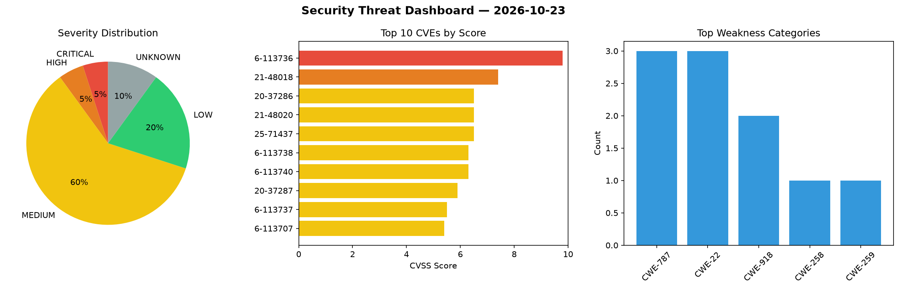
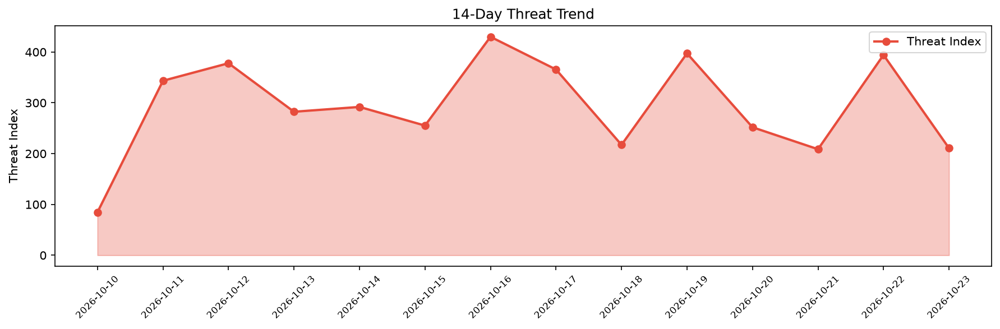

# Security Scan Report — 2026-10-23

**Scan ID:** `d1058ae470` | **CVEs:** 20 | **Threat Index:** 210.8

## Threat Overview

| Metric | Value |
|--------|-------|
| Threat Index | 210.8 |
| Critical CVEs | 1 |
| CRITICAL | 1 |
| HIGH | 1 |
| MEDIUM | 12 |
| LOW | 4 |
| UNKNOWN | 2 |

## Delta vs Yesterday

| Metric | Today | Yesterday | Change |
|--------|-------|-----------|--------|
| total_cves | 20 | 20 | ➡️ 0.0% |
| threat_index | 210.8 | 394.2 | 📉 -46.5% |
| critical_count | 1 | 3 | 📉 -66.7% |

## Top Weakness Categories

| CWE | Count |
|-----|-------|
| CWE-787 | 3 |
| CWE-22 | 3 |
| CWE-918 | 2 |
| CWE-258 | 1 |
| CWE-259 | 1 |

## CVE Details

| CVE ID | Score | Severity | Description |
|--------|-------|----------|-------------|
| CVE-2026-113736 | 9.8 | CRITICAL | A vulnerability has been found in D-Link DHP-W610AV 1.02EUb03. The impacted elem... |
| CVE-2021-48018 | 7.4 | HIGH | Vyper from 0.2.13 before 0.2.15 allocates storage slots for @nonreentrant reentr... |
| CVE-2020-37286 | 6.5 | MEDIUM | Vyper from 0.1.0b4 before 0.3.0 contains a memory corruption vulnerability cause... |
| CVE-2021-48020 | 6.5 | MEDIUM | Vyper from 0.1.0b4 before 0.3.0 contains a memory corruption vulnerability cause... |
| CVE-2025-71437 | 6.5 | MEDIUM | Astral uv before 0.8.22 contains a path traversal vulnerability in source distri... |
| CVE-2026-113738 | 6.3 | MEDIUM | A vulnerability has been found in R6410418 Jackrong-llm-finetuning-guide up to e... |
| CVE-2026-113740 | 6.3 | MEDIUM | A flaw has been found in itsourcecode Online Cake Ordering System 1.0. Affected ... |
| CVE-2020-37287 | 5.9 | MEDIUM | Vyper before 0.2.6 contains a call stack corruption vulnerability that causes in... |
| CVE-2026-113737 | 5.5 | MEDIUM | A flaw has been found in R6410418 Jackrong-llm-finetuning-guide up to ef2b17f279... |
| CVE-2026-113707 | 5.4 | MEDIUM | A security flaw has been discovered in a2aproject a2a-rs up to 0.4.4. The affect... |
| CVE-2021-48019 | 4.8 | MEDIUM | Vyper before 0.2.9 deploys forwarder proxies through the built-in create_forward... |
| CVE-2026-109681 | 4.7 | MEDIUM | The FTP client trusts the server's PASV response IP:port without validation agai... |
| CVE-2026-109682 | 4.7 | MEDIUM | Metasploit Framework versions before 6.5.7 allow HTTP requests made through send... |
| CVE-2026-113741 | 4.3 | MEDIUM | A vulnerability has been found in itsourcecode Online Cake Ordering System 1.0. ... |
| CVE-2026-113735 | 3.7 | LOW | A vulnerability was determined in D-Link DCS-6501LH 3.03.02. Affected by this vu... |