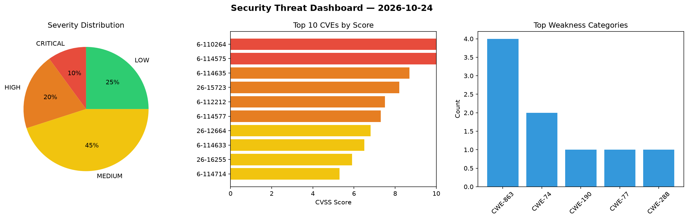
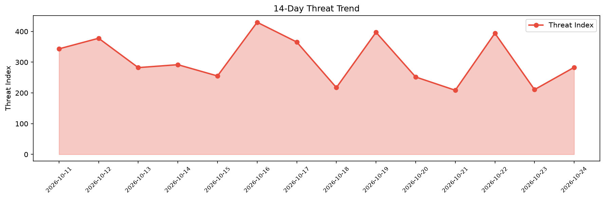

# Security Scan Report — 2026-10-24

**Scan ID:** `1e9784cce0` | **CVEs:** 20 | **Threat Index:** 283.2

## Threat Overview

| Metric | Value |
|--------|-------|
| Threat Index | 283.2 |
| Critical CVEs | 2 |
| CRITICAL | 2 |
| HIGH | 4 |
| MEDIUM | 9 |
| LOW | 5 |

## Delta vs Yesterday

| Metric | Today | Yesterday | Change |
|--------|-------|-----------|--------|
| total_cves | 20 | 20 | ➡️ 0.0% |
| threat_index | 283.2 | 210.8 | 📈 34.3% |
| critical_count | 2 | 1 | 📈 100.0% |

## Top Weakness Categories

| CWE | Count |
|-----|-------|
| CWE-863 | 4 |
| CWE-74 | 2 |
| CWE-190 | 1 |
| CWE-77 | 1 |
| CWE-288 | 1 |

## CVE Details

| CVE ID | Score | Severity | Description |
|--------|-------|----------|-------------|
| CVE-2026-110264 | 10.0 | CRITICAL | An issue has been discovered in GitLab CE/EE affecting all versions from 7.0 bef... |
| CVE-2026-114575 | 10.0 | CRITICAL | A flaw has been found in TOTOLINK A950RG 4.1.2cu.5268_B20221104. Affected by thi... |
| CVE-2026-114635 | 8.7 | HIGH | Traefik before v2.11.58 and v3.7.14 contains an authentication bypass vulnerabil... |
| CVE-2026-15723 | 8.2 | HIGH | GitLab has remediated an issue in GitLab CE/EE affecting all versions from 10.1 ... |
| CVE-2026-112212 | 7.5 | HIGH | GitLab has remediated an issue in GitLab CE/EE affecting all versions from 18.3 ... |
| CVE-2026-114577 | 7.3 | HIGH | A vulnerability was found in oretnom23 php-travel-agency-system. This vulnerabil... |
| CVE-2026-12664 | 6.8 | MEDIUM | GitLab has remediated an issue in GitLab CE/EE affecting all versions from 18.2 ... |
| CVE-2026-114633 | 6.5 | MEDIUM | WWBN AVideo before 29.4.0 contains an incorrect authorization vulnerability that... |
| CVE-2026-16255 | 5.9 | MEDIUM | GitLab has remediated an issue in GitLab EE affecting all versions from 12.0 bef... |
| CVE-2026-114714 | 5.3 | MEDIUM | Roundcube Webmail before 1.6.20 and 1.7.x before 1.7.5 is affected by a path tra... |
| CVE-2026-105777 | 4.3 | MEDIUM | GitLab has remediated an issue in GitLab CE/EE affecting all versions from 17.6.... |
| CVE-2026-112378 | 4.3 | MEDIUM | GitLab has remediated an issue in GitLab EE affecting all versions from 17.8 bef... |
| CVE-2026-114574 | 4.3 | MEDIUM | A security vulnerability has been detected in massCodeIO massCode 5.10. Affected... |
| CVE-2026-13319 | 4.3 | MEDIUM | GitLab has remediated an issue in GitLab CE/EE affecting all versions from 15.10... |
| CVE-2026-114634 | 4.3 | MEDIUM | WWBN AVideo before 29.4.0 contains a blind server-side request forgery vulnerabi... |