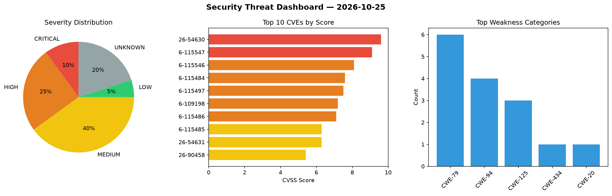
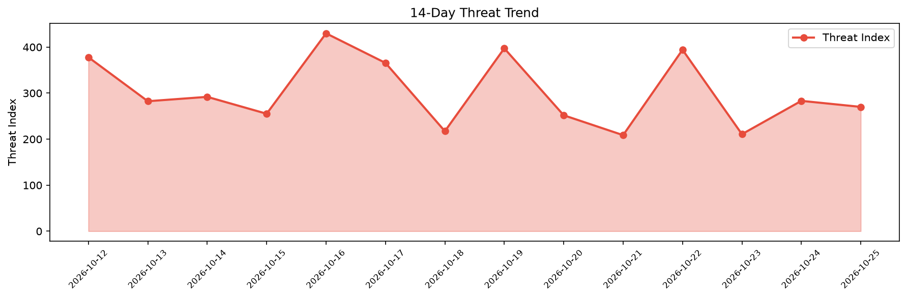

# Security Scan Report — 2026-10-25

**Scan ID:** `5e2deb1231` | **CVEs:** 20 | **Threat Index:** 270.1

## Threat Overview

| Metric | Value |
|--------|-------|
| Threat Index | 270.1 |
| Critical CVEs | 2 |
| CRITICAL | 2 |
| HIGH | 5 |
| MEDIUM | 8 |
| LOW | 1 |
| UNKNOWN | 4 |

## Delta vs Yesterday

| Metric | Today | Yesterday | Change |
|--------|-------|-----------|--------|
| total_cves | 20 | 20 | ➡️ 0.0% |
| threat_index | 270.1 | 283.2 | 📉 -4.6% |
| critical_count | 2 | 2 | ➡️ 0.0% |

## Top Weakness Categories

| CWE | Count |
|-----|-------|
| CWE-79 | 6 |
| CWE-94 | 4 |
| CWE-125 | 3 |
| CWE-434 | 1 |
| CWE-20 | 1 |

## CVE Details

| CVE ID | Score | Severity | Description |
|--------|-------|----------|-------------|
| CVE-2026-54630 | 9.6 | CRITICAL | Part-DB is an open source inventory management system for electronic components.... |
| CVE-2026-115547 | 9.1 | CRITICAL | An input validation issue in the Okta Access Gateway (OAG) Admin Console allows ... |
| CVE-2026-115546 | 8.1 | HIGH | Okta Access Gateway (OAG) does not validate the selected authentication source d... |
| CVE-2026-115484 | 7.6 | HIGH | A flaw was found in the iscsiuio component of open-iscsi. The DHCPv4 option pars... |
| CVE-2026-115497 | 7.5 | HIGH | The Music Store – WordPress eCommerce plugin for WordPress is vulnerable to Dire... |
| CVE-2026-109198 | 7.2 | HIGH | The Anti-Spam by CleanTalk – Spam Protection Without CAPTCHA plugin for WordPres... |
| CVE-2026-115486 | 7.1 | HIGH | A flaw was found in the iscsiuio component of open-iscsi. The IPv6 Neighbor Disc... |
| CVE-2026-115485 | 6.3 | MEDIUM | A flaw was found in the iscsiuio component of open-iscsi. The DHCPv6 option pars... |
| CVE-2026-54631 | 6.3 | MEDIUM | Part-DB is an open source inventory management system for electronic components.... |
| CVE-2026-90458 | 5.4 | MEDIUM | OpenStack Ironic before 39.0.1 allows DELETE and GET via vendor_passthru, e.g., ... |
| CVE-2026-89419 | 5.0 | MEDIUM | OpenStack Ironic before 39.0.1 sometimes allows a user to change the maintenance... |
| CVE-2026-115534 | 4.3 | MEDIUM | A vulnerability was determined in gedelumbung HospitalManagement up to c2d455437... |
| CVE-2026-115536 | 4.3 | MEDIUM | A security flaw has been discovered in gedelumbung HospitalManagement up to c2d4... |
| CVE-2026-115537 | 4.3 | MEDIUM | A weakness has been identified in gedelumbung HospitalManagement up to c2d455437... |
| CVE-2026-115638 | 4.3 | MEDIUM | OpenStack Ironic through 39.0.1 allows a denial of service via a configdrive tha... |