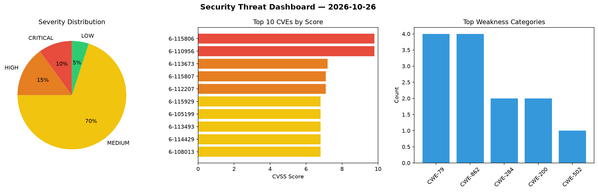
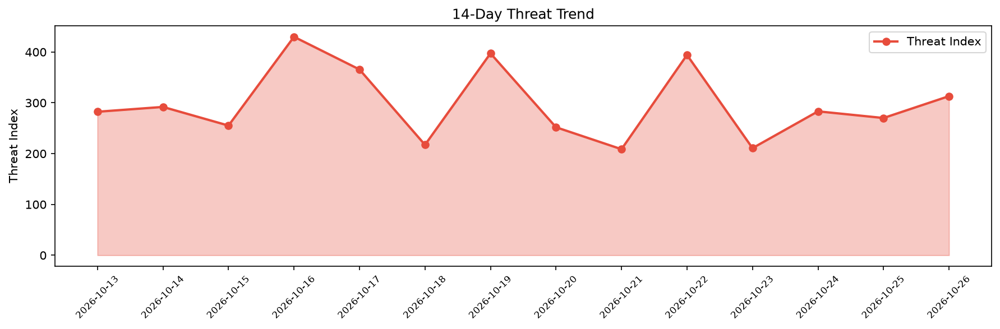

# Security Scan Report — 2026-10-26

**Scan ID:** `1dd25d0fb3` | **CVEs:** 20 | **Threat Index:** 313.1

## Threat Overview

| Metric | Value |
|--------|-------|
| Threat Index | 313.1 |
| Critical CVEs | 2 |
| CRITICAL | 2 |
| HIGH | 3 |
| MEDIUM | 14 |
| LOW | 1 |

## Delta vs Yesterday

| Metric | Today | Yesterday | Change |
|--------|-------|-----------|--------|
| total_cves | 20 | 20 | ➡️ 0.0% |
| threat_index | 313.1 | 270.1 | 📈 15.9% |
| critical_count | 2 | 2 | ➡️ 0.0% |

## Top Weakness Categories

| CWE | Count |
|-----|-------|
| CWE-79 | 4 |
| CWE-862 | 4 |
| CWE-284 | 2 |
| CWE-200 | 2 |
| CWE-502 | 1 |

## CVE Details

| CVE ID | Score | Severity | Description |
|--------|-------|----------|-------------|
| CVE-2026-115806 | 9.8 | CRITICAL | The Prime Mover – Backup and Migration plugin for WordPress is vulnerable to PHP... |
| CVE-2026-110956 | 9.8 | CRITICAL | The asVereinbase  WordPress plugin before 1.1.8 does not require a valid passwor... |
| CVE-2026-113673 | 7.2 | HIGH | The GeoDirectory  WordPress plugin before 2.8.194 does not properly escape admin... |
| CVE-2026-115807 | 7.1 | HIGH | The User Profile Builder – Beautiful User Registration Forms, User Profiles & Us... |
| CVE-2026-112207 | 7.1 | HIGH | The Download Monitor WordPress plugin before 5.3.4 does not properly validate th... |
| CVE-2026-115929 | 6.8 | MEDIUM | MongoDB Compass relies on Electron, a third-party runtime that carries its own T... |
| CVE-2026-105199 | 6.8 | MEDIUM | The Pixel Tag Manager for WooCommerce  WordPress plugin before 2.2.3 does not pe... |
| CVE-2026-113493 | 6.8 | MEDIUM | The GeoDirectory  WordPress plugin before 2.8.194 does not sanitise and escape s... |
| CVE-2026-114429 | 6.8 | MEDIUM | The WPVR  WordPress plugin before 9.0.3 does not properly sanitise and escape so... |
| CVE-2026-108013 | 6.8 | MEDIUM | BigFix Platform uses Mozilla CA certificate bundle (PEM). Versions of the bundle... |
| CVE-2026-107907 | 6.5 | MEDIUM | The MAS Videos WordPress plugin through 1.3.4 does not perform any capability or... |
| CVE-2026-87835 | 6.5 | MEDIUM | The Front End Users WordPress plugin through 3.2.35 does not restrict which acco... |
| CVE-2026-113491 | 6.4 | MEDIUM | The GeoDirectory  WordPress plugin before 2.8.194 does not validate a user-suppl... |
| CVE-2026-107887 | 5.4 | MEDIUM | The Advanced Twenty Seventeen WordPress plugin through 1.3.1 does not perform an... |
| CVE-2026-97353 | 5.4 | MEDIUM | The News Kit Addons For Elementor WordPress plugin through 1.4.7 does not perfor... |