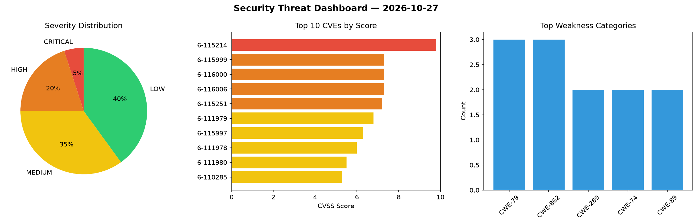
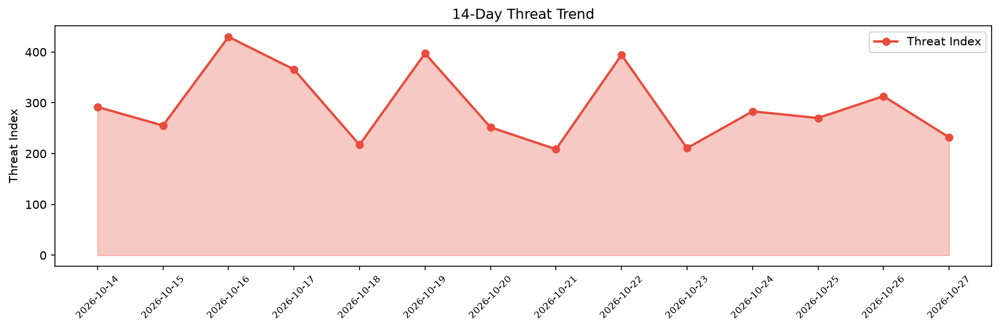

# Security Scan Report — 2026-10-27

**Scan ID:** `18a78cf86a` | **CVEs:** 20 | **Threat Index:** 232.1

## Threat Overview

| Metric | Value |
|--------|-------|
| Threat Index | 232.1 |
| Critical CVEs | 1 |
| CRITICAL | 1 |
| HIGH | 4 |
| MEDIUM | 7 |
| LOW | 8 |

## Delta vs Yesterday

| Metric | Today | Yesterday | Change |
|--------|-------|-----------|--------|
| total_cves | 20 | 20 | ➡️ 0.0% |
| threat_index | 232.1 | 313.1 | 📉 -25.9% |
| critical_count | 1 | 2 | 📉 -50.0% |

## Top Weakness Categories

| CWE | Count |
|-----|-------|
| CWE-79 | 3 |
| CWE-862 | 3 |
| CWE-269 | 2 |
| CWE-74 | 2 |
| CWE-89 | 2 |

## CVE Details

| CVE ID | Score | Severity | Description |
|--------|-------|----------|-------------|
| CVE-2026-115214 | 9.8 | CRITICAL | The Datawiza Proxy Auth Plugin  WordPress plugin before 1.1.1 does not verify th... |
| CVE-2026-115999 | 7.3 | HIGH | A vulnerability has been found in mansi-k Restaurant_IMS d7ad49f61ab7cc1ec6eb359... |
| CVE-2026-116000 | 7.3 | HIGH | A security flaw has been discovered in Zylon PrivateGPT 1.0.0/1.0.1. This vulner... |
| CVE-2026-116006 | 7.3 | HIGH | A vulnerability was detected in YunaiV/zhijiantianya ruoyi-vue-pro up to 2026.09... |
| CVE-2026-115251 | 7.2 | HIGH | The Duplicator  WordPress plugin before 5.0.0 does not restrict its one-click up... |
| CVE-2026-111979 | 6.8 | MEDIUM | The GiveWP  WordPress plugin before 4.19.0.1 does not properly sanitise and esca... |
| CVE-2026-115997 | 6.3 | MEDIUM | A flaw has been found in pig-mesh pig up to 4.1.0. This impacts the function ord... |
| CVE-2026-111978 | 6.0 | MEDIUM | The GiveWP  WordPress plugin before 4.19.0.1 does not properly validate a user-s... |
| CVE-2026-111980 | 5.5 | MEDIUM | The GiveWP  WordPress plugin before 4.19.0.1 does not correctly determine which ... |
| CVE-2026-110285 | 5.3 | MEDIUM | The WP Stripe Checkout WordPress plugin before 1.2.2.62 does not verify the Stri... |
| CVE-2026-111976 | 5.3 | MEDIUM | The GiveWP  WordPress plugin before 4.19.0.1 does not perform any status or capa... |
| CVE-2026-114740 | 4.9 | MEDIUM | The WPVR  WordPress plugin before 9.1.3 does not correctly check user capabiliti... |
| CVE-2026-114741 | 3.8 | LOW | The WPVR  WordPress plugin before 9.0.3 does not perform object-level authorizat... |
| CVE-2026-116007 | 3.7 | LOW | A flaw has been found in YunaiV/zhijiantianya ruoyi-vue-pro up to 2026.09. The i... |
| CVE-2026-116004 | 3.5 | LOW | A security vulnerability has been detected in onyx-dot-app Onyx up to 5.0.0. Imp... |