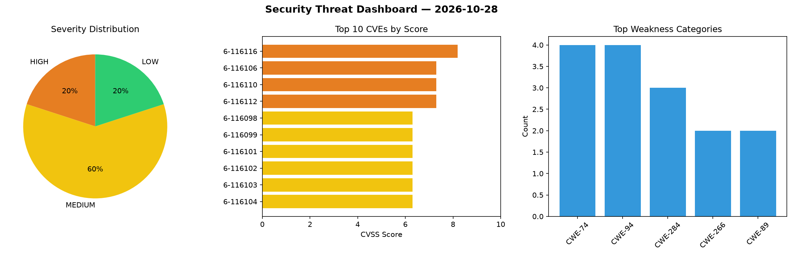
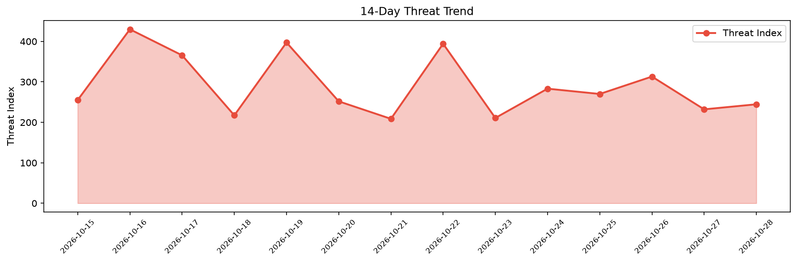

# Security Scan Report — 2026-10-28

**Scan ID:** `4f35db397b` | **CVEs:** 20 | **Threat Index:** 244.6

## Threat Overview

| Metric | Value |
|--------|-------|
| Threat Index | 244.6 |
| Critical CVEs | 0 |
| HIGH | 4 |
| MEDIUM | 12 |
| LOW | 4 |

## Delta vs Yesterday

| Metric | Today | Yesterday | Change |
|--------|-------|-----------|--------|
| total_cves | 20 | 20 | ➡️ 0.0% |
| threat_index | 244.6 | 232.1 | 📈 5.4% |
| critical_count | 0 | 1 | 📉 -100.0% |

## Top Weakness Categories

| CWE | Count |
|-----|-------|
| CWE-74 | 4 |
| CWE-94 | 4 |
| CWE-284 | 3 |
| CWE-266 | 2 |
| CWE-89 | 2 |

## CVE Details

| CVE ID | Score | Severity | Description |
|--------|-------|----------|-------------|
| CVE-2026-116116 | 8.2 | HIGH | A vulnerability was detected in Yoosee GM8135S Camera 21.00.01.36. Affected is a... |
| CVE-2026-116106 | 7.3 | HIGH | A security vulnerability has been detected in HeyCyan App 1.0.103 on Android. Af... |
| CVE-2026-116110 | 7.3 | HIGH | A vulnerability was found in GiantappMan LiveWallPaper 2.6.8.0 on Windows. This ... |
| CVE-2026-116112 | 7.3 | HIGH | A vulnerability was identified in HashenUdara edoc-doctor-appointment-system up ... |
| CVE-2026-116098 | 6.3 | MEDIUM | A vulnerability was detected in SteelRaven7 Ravenfield 25407073. This vulnerabil... |
| CVE-2026-116099 | 6.3 | MEDIUM | A flaw has been found in Fusion Creators Studio SCP Containment Breach Multiplay... |
| CVE-2026-116101 | 6.3 | MEDIUM | A vulnerability was found in itsourcecode Online Cake Ordering System 1.0. The a... |
| CVE-2026-116102 | 6.3 | MEDIUM | A vulnerability was determined in QuantGeekDev docker-mcp 0.1.0/0.2.0. The impac... |
| CVE-2026-116103 | 6.3 | MEDIUM | A vulnerability was identified in Sony Neural Network Libraries up to 1.39.0. Th... |
| CVE-2026-116104 | 6.3 | MEDIUM | A security flaw has been discovered in Sony Neural Network Libraries up to 1.39.... |
| CVE-2026-116109 | 6.3 | MEDIUM | A vulnerability has been found in continuedev Continue 2.0.0. This vulnerability... |
| CVE-2026-116111 | 6.3 | MEDIUM | A vulnerability was determined in 2K Games Civilization V 1.0.3.144. Impacted is... |
| CVE-2026-116113 | 6.3 | MEDIUM | A security flaw has been discovered in GouGuOA up to 6.1.2. The impacted element... |
| CVE-2026-116107 | 5.4 | MEDIUM | A vulnerability was detected in Datafeedr Product Sets Plugin up to 1.3.24 on Wo... |
| CVE-2026-116097 | 4.3 | MEDIUM | A security vulnerability has been detected in CloudClassroom-PHP-Project. This a... |