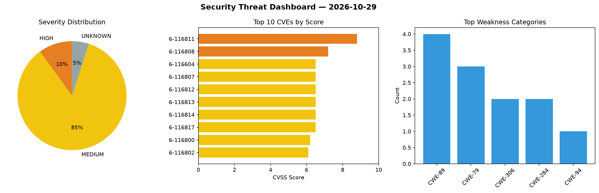
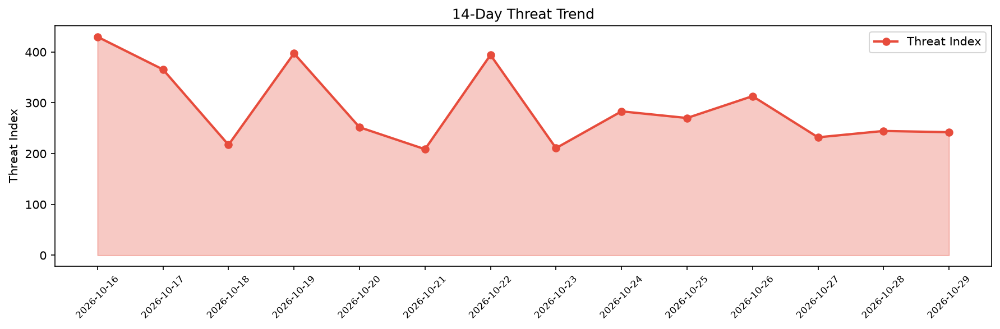

# Security Scan Report — 2026-10-29

**Scan ID:** `777f54f81b` | **CVEs:** 20 | **Threat Index:** 242.2

## Threat Overview

| Metric | Value |
|--------|-------|
| Threat Index | 242.2 |
| Critical CVEs | 0 |
| HIGH | 2 |
| MEDIUM | 17 |
| UNKNOWN | 1 |

## Delta vs Yesterday

| Metric | Today | Yesterday | Change |
|--------|-------|-----------|--------|
| total_cves | 20 | 20 | ➡️ 0.0% |
| threat_index | 242.2 | 244.6 | 📉 -1.0% |
| critical_count | 0 | 0 | ➡️ 0% |

## Top Weakness Categories

| CWE | Count |
|-----|-------|
| CWE-89 | 4 |
| CWE-79 | 3 |
| CWE-306 | 2 |
| CWE-284 | 2 |
| CWE-94 | 1 |

## CVE Details

| CVE ID | Score | Severity | Description |
|--------|-------|----------|-------------|
| CVE-2026-116811 | 8.8 | HIGH | OpenPanel before 3.0.0 contains a sandbox escape vulnerability in the js-runtime... |
| CVE-2026-116808 | 7.2 | HIGH | OpenPanel before 3.0.0 contains an sql injection vulnerability that allows authe... |
| CVE-2026-116604 | 6.5 | MEDIUM | A vulnerability has been found in SourceCodester Online Food Ordering System 1.0... |
| CVE-2026-116807 | 6.5 | MEDIUM | OpenPanel before 3.0.0 contains an sql injection vulnerability that allows authe... |
| CVE-2026-116812 | 6.5 | MEDIUM | OpenPanel before 3.0.0 contains a sql injection vulnerability in profileColumnAc... |
| CVE-2026-116813 | 6.5 | MEDIUM | OpenPanel before 3.0.0 contains an sql injection vulnerability in ConversionServ... |
| CVE-2026-116814 | 6.5 | MEDIUM | OpenPanel before 3.0.0 contains an information exposure vulnerability that write... |
| CVE-2026-116817 | 6.5 | MEDIUM | OpenPanel before 3.0.0 contains a missing authentication vulnerability that allo... |
| CVE-2026-116800 | 6.2 | MEDIUM | WWBN AVideo before 29.5.0 contains a local file inclusion vulnerability that all... |
| CVE-2026-116802 | 6.1 | MEDIUM | DOMPurify before 3.4.17 contains a cross-site scripting vulnerability that allow... |
| CVE-2026-116803 | 6.1 | MEDIUM | DOMPurify before 3.4.17 contains a cross-site scripting vulnerability that allow... |
| CVE-2026-116804 | 6.1 | MEDIUM | DOMPurify from 3.4.4 before 3.4.17 contains a SAFE_FOR_TEMPLATES bypass that let... |
| CVE-2026-116806 | 5.4 | MEDIUM | OpenPanel before 3.0.0 contains a missing authorization vulnerability in the onb... |
| CVE-2026-116809 | 5.3 | MEDIUM | OpenPanel before 3.0.0 contains a missing authorization vulnerability in the eve... |
| CVE-2026-116810 | 5.3 | MEDIUM | OpenPanel before 3.0.0 contains a missing authorization vulnerability that allow... |