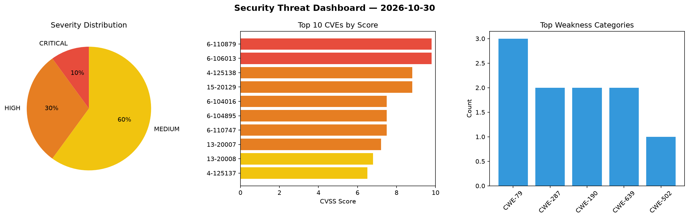
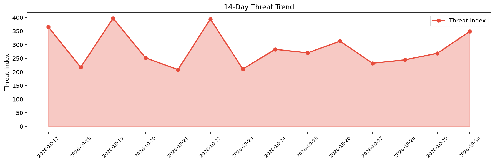

# Security Scan Report — 2026-10-30

**Scan ID:** `ca8f9e021c` | **CVEs:** 20 | **Threat Index:** 348.9

## Threat Overview

| Metric | Value |
|--------|-------|
| Threat Index | 348.9 |
| Critical CVEs | 2 |
| CRITICAL | 2 |
| HIGH | 6 |
| MEDIUM | 12 |

## Delta vs Yesterday

| Metric | Today | Yesterday | Change |
|--------|-------|-----------|--------|
| total_cves | 20 | 20 | ➡️ 0.0% |
| threat_index | 348.9 | 268.6 | 📈 29.9% |
| critical_count | 2 | 0 | ➡️ 0% |

## Top Weakness Categories

| CWE | Count |
|-----|-------|
| CWE-79 | 3 |
| CWE-287 | 2 |
| CWE-190 | 2 |
| CWE-639 | 2 |
| CWE-502 | 1 |

## CVE Details

| CVE ID | Score | Severity | Description |
|--------|-------|----------|-------------|
| CVE-2026-110879 | 9.8 | CRITICAL | jackson-databind validates the outer class of a class-name type ID but accepts a... |
| CVE-2026-106013 | 9.8 | CRITICAL | The Jupiter X Core plugin for WordPress is vulnerable to Authentication Bypass v... |
| CVE-2014-125138 | 8.8 | HIGH | C97net qEngine CMS through 6.0.0, Kemana Directory through 1.5.6, and Cart Engin... |
| CVE-2015-20129 | 8.8 | HIGH | CrushFTP before 7.3.0 contains a cross-site request forgery vulnerability that a... |
| CVE-2026-104016 | 7.5 | HIGH | ProtobufParser parses length-prefixed protobuf string and bytes fields by checki... |
| CVE-2026-104895 | 7.5 | HIGH | The asynchronous Smile parser (NonBlockingByteArrayParser) uses a raw-binary len... |
| CVE-2026-110747 | 7.5 | HIGH | ProtobufParser._readStringKey() reads the length prefix of a protobuf map entry'... |
| CVE-2013-20007 | 7.2 | HIGH | Linksys WAG200G through 1.01.06 contains an OS command injection vulnerability t... |
| CVE-2013-20008 | 6.8 | MEDIUM | Linksys WAG200G through 1.01.06 contains a weak password change mechanism that a... |
| CVE-2014-125137 | 6.5 | MEDIUM | C97net qEngine CMS through 6.0.0, Kemana Directory through 1.5.6, and Cart Engin... |
| CVE-2026-107625 | 6.4 | MEDIUM | The Ultimate Member – User Profile, Registration, Login, Member Directory, Conte... |
| CVE-2026-109209 | 6.4 | MEDIUM | The All-in-One Video Gallery – Video Player & Galleries for YouTube, Vimeo & Sel... |
| CVE-2026-118129 | 6.3 | MEDIUM | A vulnerability was found in jeremyckahn Chitchatter up to f82538633813c854a81a8... |
| CVE-2014-125136 | 5.9 | MEDIUM | C97net qEngine CMS through 6.0.0, Kemana Directory through 1.5.6, and Cart Engin... |
| CVE-2013-20009 | 4.8 | MEDIUM | Linksys WAG200G through 1.01.06 contains a stored cross-site scripting vulnerabi... |