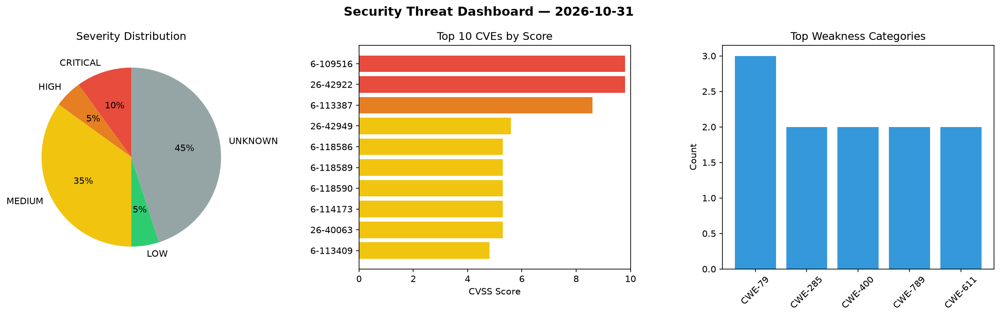
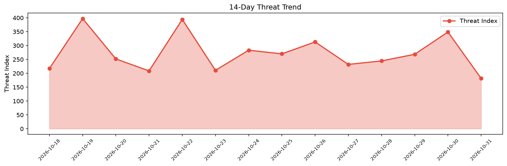

# Security Scan Report — 2026-10-31

**Scan ID:** `6f8b357736` | **CVEs:** 20 | **Threat Index:** 181.5

## Threat Overview

| Metric | Value |
|--------|-------|
| Threat Index | 181.5 |
| Critical CVEs | 2 |
| CRITICAL | 2 |
| HIGH | 1 |
| MEDIUM | 7 |
| LOW | 1 |
| UNKNOWN | 9 |

## Delta vs Yesterday

| Metric | Today | Yesterday | Change |
|--------|-------|-----------|--------|
| total_cves | 20 | 20 | ➡️ 0.0% |
| threat_index | 181.5 | 348.9 | 📉 -48.0% |
| critical_count | 2 | 2 | ➡️ 0.0% |

## Top Weakness Categories

| CWE | Count |
|-----|-------|
| CWE-79 | 3 |
| CWE-285 | 2 |
| CWE-400 | 2 |
| CWE-789 | 2 |
| CWE-611 | 2 |

## CVE Details

| CVE ID | Score | Severity | Description |
|--------|-------|----------|-------------|
| CVE-2026-109516 | 9.8 | CRITICAL | The Bot for Telegram on WooCommerce plugin for WordPress is vulnerable to Authen... |
| CVE-2026-42922 | 9.8 | CRITICAL | A authorization bypass vulnerability exists in the /nodered functionality of FUX... |
| CVE-2026-113387 | 8.6 | HIGH | The Ortto plugin for WordPress before 1.0.25 did not authenticate configuration ... |
| CVE-2026-42949 | 5.6 | MEDIUM | A authorization bypass vulnerability exists in the /api/runscript functionality ... |
| CVE-2026-118586 | 5.3 | MEDIUM | A security flaw has been discovered in dfm feedfinder2 up to 0.0.4. This issue a... |
| CVE-2026-118589 | 5.3 | MEDIUM | A weakness has been identified in nschloe meshio up to 5.3.5. Impacted is an unk... |
| CVE-2026-118590 | 5.3 | MEDIUM | A security vulnerability has been detected in nipy nibabel up to 5.4.2. The affe... |
| CVE-2026-114173 | 5.3 | MEDIUM | The Ortto plugin for WordPress before 1.0.25 did not filter the WooCommerce prod... |
| CVE-2026-40063 | 5.3 | MEDIUM | A information disclosure vulnerability exists in the /nodered/fuxa/scripts funct... |
| CVE-2026-113409 | 4.8 | MEDIUM | The Ortto plugin for WordPress before 1.0.25 did not escape stored settings on i... |
| CVE-2026-118585 | 3.5 | LOW | A vulnerability was identified in configuroweb inventariobasico c9377cdba474deb3... |
| CVE-2026-113957 | 0.0 | UNKNOWN | An attacker who controls the registry, a mirror, or the network path to it may b... |
| CVE-2026-21157 | 0.0 | UNKNOWN | Improper input validation in Bixby prior to version 4.0.85.6 allows privileged l... |
| CVE-2026-16889 | 0.0 | UNKNOWN | In openEQUELLA before 2026.1, the pre-login notice image upload endpoint (PUT /a... |
| CVE-2026-66088 | 0.0 | UNKNOWN | In openEQUELLA before 2026.1, the system.execute() function available to the scr... |