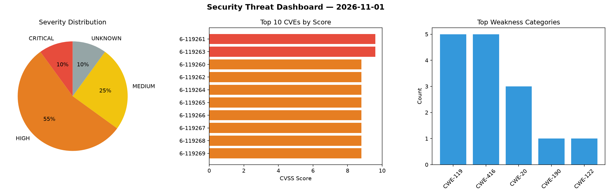
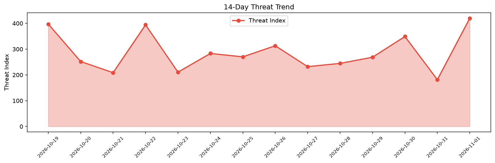

# Security Scan Report — 2026-11-01

**Scan ID:** `6c3cabacde` | **CVEs:** 20 | **Threat Index:** 419.8

## Threat Overview

| Metric | Value |
|--------|-------|
| Threat Index | 419.8 |
| Critical CVEs | 2 |
| CRITICAL | 2 |
| HIGH | 11 |
| MEDIUM | 5 |
| UNKNOWN | 2 |

## Delta vs Yesterday

| Metric | Today | Yesterday | Change |
|--------|-------|-----------|--------|
| total_cves | 20 | 20 | ➡️ 0.0% |
| threat_index | 419.8 | 181.5 | 📈 131.3% |
| critical_count | 2 | 2 | ➡️ 0.0% |

## Top Weakness Categories

| CWE | Count |
|-----|-------|
| CWE-119 | 5 |
| CWE-416 | 5 |
| CWE-20 | 3 |
| CWE-190 | 1 |
| CWE-122 | 1 |

## CVE Details

| CVE ID | Score | Severity | Description |
|--------|-------|----------|-------------|
| CVE-2026-119261 | 9.6 | CRITICAL | Improper input validation in Skia in Google Chrome prior to 156.0.8078.79 allowe... |
| CVE-2026-119263 | 9.6 | CRITICAL | Memory corruption in GarbageCollection in Google Chrome prior to 156.0.8078.79 a... |
| CVE-2026-119260 | 8.8 | HIGH | Use after free in Frames in Google Chrome prior to 156.0.8078.79 allowed a remot... |
| CVE-2026-119262 | 8.8 | HIGH | Improper input validation in V8 in Google Chrome prior to 156.0.8078.79 allowed ... |
| CVE-2026-119264 | 8.8 | HIGH | Memory corruption in Dawn in Google Chrome prior to 156.0.8078.79 allowed a remo... |
| CVE-2026-119265 | 8.8 | HIGH | Memory corruption in Quota in Google Chrome prior to 156.0.8078.79 allowed a rem... |
| CVE-2026-119266 | 8.8 | HIGH | Use after free in Quota in Google Chrome prior to 156.0.8078.79 allowed a remote... |
| CVE-2026-119267 | 8.8 | HIGH | Memory corruption in DOM in Google Chrome prior to 156.0.8078.79 allowed a remot... |
| CVE-2026-119268 | 8.8 | HIGH | Integer overflow in Editing in Google Chrome prior to 156.0.8078.79 allowed a re... |
| CVE-2026-119269 | 8.8 | HIGH | Use after free in Blink in Google Chrome prior to 156.0.8078.79 allowed a remote... |
| CVE-2026-119270 | 8.8 | HIGH | Improper input validation in CacheStorage in Google Chrome prior to 156.0.8078.7... |
| CVE-2026-119271 | 8.8 | HIGH | Use after free in Skia in Google Chrome prior to 156.0.8078.79 allowed a remote ... |
| CVE-2026-76025 | 8.8 | HIGH | Use after free in FileSystem in Google Chrome prior to 156.0.8078.79 allowed a r... |
| CVE-2026-76024 | 6.5 | MEDIUM | Memory corruption in MediaStream in Google Chrome prior to 156.0.8078.79 allowed... |
| CVE-2026-110133 | 5.8 | MEDIUM | A flaw was found in Ghostscript. When processing a specially crafted TrueType fo... |