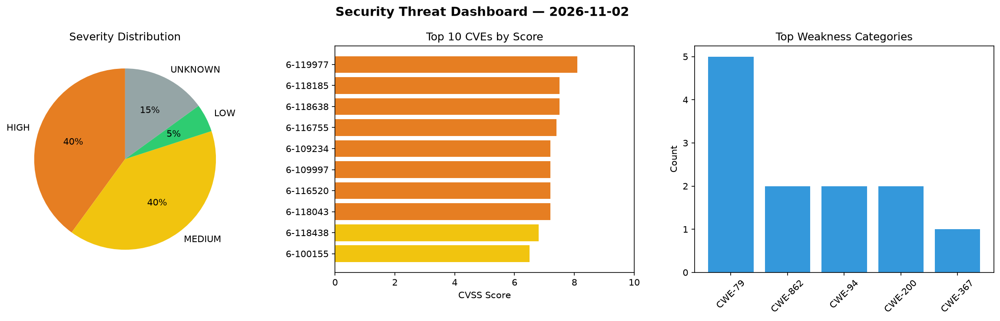
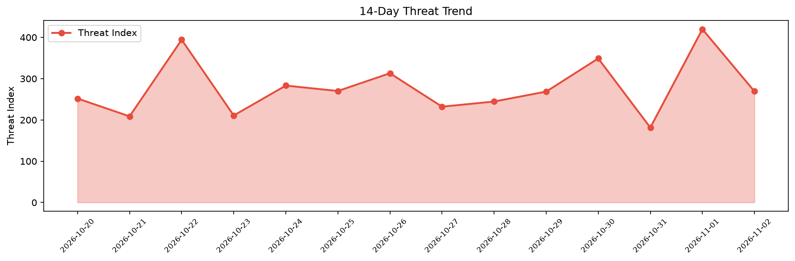

# Security Scan Report — 2026-11-02

**Scan ID:** `95b29e9ca7` | **CVEs:** 20 | **Threat Index:** 269.2

## Threat Overview

| Metric | Value |
|--------|-------|
| Threat Index | 269.2 |
| Critical CVEs | 0 |
| HIGH | 8 |
| MEDIUM | 8 |
| LOW | 1 |
| UNKNOWN | 3 |

## Delta vs Yesterday

| Metric | Today | Yesterday | Change |
|--------|-------|-----------|--------|
| total_cves | 20 | 20 | ➡️ 0.0% |
| threat_index | 269.2 | 419.8 | 📉 -35.9% |
| critical_count | 0 | 2 | 📉 -100.0% |

## Top Weakness Categories

| CWE | Count |
|-----|-------|
| CWE-79 | 5 |
| CWE-862 | 2 |
| CWE-94 | 2 |
| CWE-200 | 2 |
| CWE-367 | 1 |

## CVE Details

| CVE ID | Score | Severity | Description |
|--------|-------|----------|-------------|
| CVE-2026-119977 | 8.1 | HIGH | WordPress Core is vulnerable to Remote Code Execution in versions 4.7 through 7.... |
| CVE-2026-118185 | 7.5 | HIGH | The Security Optimizer  WordPress plugin before 1.6.9 does not limit the number ... |
| CVE-2026-118638 | 7.5 | HIGH | The Mapster WP Maps WordPress plugin before 2.0.6 does not perform any authoriza... |
| CVE-2026-116755 | 7.4 | HIGH | Improper Neutralization of Special Elements used in a Command ('Command Injectio... |
| CVE-2026-109234 | 7.2 | HIGH | The Meow Lightbox plugin for WordPress is vulnerable to Stored Cross-Site Script... |
| CVE-2026-109997 | 7.2 | HIGH | The Ninja Forms – Contact Form Builder with Calculators, Quizzes, Signatures & A... |
| CVE-2026-116520 | 7.2 | HIGH | The PPWP – Password Protect Pages plugin for WordPress is vulnerable to Stored C... |
| CVE-2026-118043 | 7.2 | HIGH | The Bulk Media Register WordPress plugin before 2.01 does not properly validate ... |
| CVE-2026-118438 | 6.8 | MEDIUM | The Firelight Lightbox WordPress plugin before 2.3.24 does not properly escape i... |
| CVE-2026-100155 | 6.5 | MEDIUM | The The Ninja Forms – Contact Form Builder with Calculators, Quizzes, Signatures... |
| CVE-2026-101326 | 5.4 | MEDIUM | The The Ninja Forms – Contact Form Builder with Calculators, Quizzes, Signatures... |
| CVE-2026-116563 | 5.4 | MEDIUM | The Photo Gallery, Sliders, Proofing and Themes – NextGEN Gallery plugin for Wor... |
| CVE-2026-118184 | 5.3 | MEDIUM | The Premium Packages  WordPress plugin before 7.2.2 does not prevent unauthentic... |
| CVE-2026-118629 | 5.3 | MEDIUM | The All-in-One Video Gallery  WordPress plugin before 5.0.0 does not check a vid... |
| CVE-2026-110042 | 4.9 | MEDIUM | The Payment Forms for Paystack WordPress plugin before 4.0.6 does not properly r... |