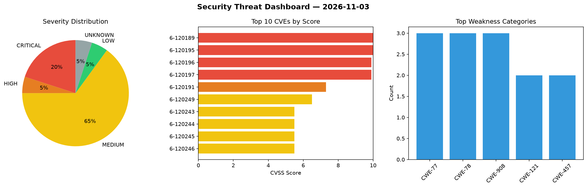
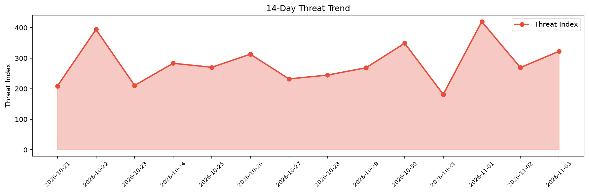

# Security Scan Report — 2026-11-03

**Scan ID:** `811898d8bd` | **CVEs:** 20 | **Threat Index:** 322.6

## Threat Overview

| Metric | Value |
|--------|-------|
| Threat Index | 322.6 |
| Critical CVEs | 4 |
| CRITICAL | 4 |
| HIGH | 1 |
| MEDIUM | 13 |
| LOW | 1 |
| UNKNOWN | 1 |

## Delta vs Yesterday

| Metric | Today | Yesterday | Change |
|--------|-------|-----------|--------|
| total_cves | 20 | 20 | ➡️ 0.0% |
| threat_index | 322.6 | 269.2 | 📈 19.8% |
| critical_count | 4 | 0 | ➡️ 0% |

## Top Weakness Categories

| CWE | Count |
|-----|-------|
| CWE-77 | 3 |
| CWE-78 | 3 |
| CWE-908 | 3 |
| CWE-121 | 2 |
| CWE-457 | 2 |

## CVE Details

| CVE ID | Score | Severity | Description |
|--------|-------|----------|-------------|
| CVE-2026-120189 | 10.0 | CRITICAL | A vulnerability was identified in D-Link DIR-505 1.10B02. Affected is the functi... |
| CVE-2026-120195 | 10.0 | CRITICAL | A security vulnerability has been detected in WAVLINK WL-WN579A3-A 2026-03-10-94... |
| CVE-2026-120196 | 9.9 | CRITICAL | A vulnerability was detected in WAVLINK WN579X3-D V250402. This affects the func... |
| CVE-2026-120197 | 9.9 | CRITICAL | A flaw has been found in WAVLINK WL-WN530HG4B M_V260724. This impacts the functi... |
| CVE-2026-120191 | 7.3 | HIGH | A weakness has been identified in Presenton up to 0.9.11-beta. Affected by this ... |
| CVE-2026-120249 | 6.5 | MEDIUM | Thelia Back-office Default Twig Template before 1.1.1 contains a cross-site requ... |
| CVE-2026-120243 | 5.5 | MEDIUM | FFmpeg 2.0 through 9.0.2 contains a use of uninitialized variable vulnerability ... |
| CVE-2026-120244 | 5.5 | MEDIUM | FFmpeg 2.1 through 9.0.2 contains a use of uninitialized resource vulnerability ... |
| CVE-2026-120245 | 5.5 | MEDIUM | FFmpeg 0.10 through 9.0.2 contains a use of uninitialized resource vulnerability... |
| CVE-2026-120246 | 5.5 | MEDIUM | FFmpeg 4.4 through 9.0.2 contains a use of uninitialized variable vulnerability ... |
| CVE-2026-120247 | 5.5 | MEDIUM | FFmpeg 2.3 through 9.0.2 contains a use of uninitialized resource vulnerability ... |
| CVE-2026-120251 | 5.5 | MEDIUM | imagecodecs 2026.3.6 through 2026.10.10 contains an infinite loop vulnerability ... |
| CVE-2026-120252 | 5.5 | MEDIUM | imagecodecs 2023.1.23 through 2026.10.10 contains a stack-based buffer overflow ... |
| CVE-2026-120250 | 5.3 | MEDIUM | OpenAlgo 1.0.0.29 before 2.0.3.1 contains an improper certificate validation vul... |
| CVE-2026-120192 | 5.3 | MEDIUM | A security vulnerability has been detected in Presenton up to 0.9.11-beta. This ... |