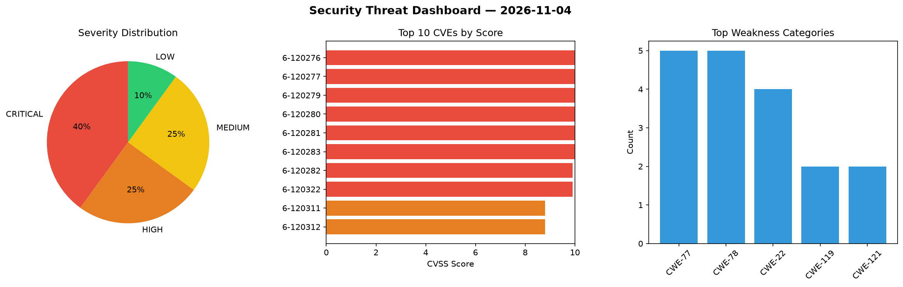
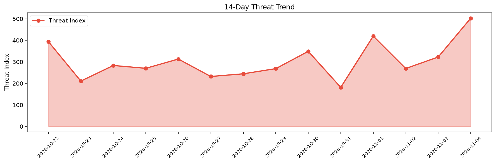

# Security Scan Report — 2026-11-04

**Scan ID:** `99f2ffe82b` | **CVEs:** 20 | **Threat Index:** 502.6

## Threat Overview

| Metric | Value |
|--------|-------|
| Threat Index | 502.6 |
| Critical CVEs | 8 |
| CRITICAL | 8 |
| HIGH | 5 |
| MEDIUM | 5 |
| LOW | 2 |

## Delta vs Yesterday

| Metric | Today | Yesterday | Change |
|--------|-------|-----------|--------|
| total_cves | 20 | 20 | ➡️ 0.0% |
| threat_index | 502.6 | 322.6 | 📈 55.8% |
| critical_count | 8 | 4 | 📈 100.0% |

## Top Weakness Categories

| CWE | Count |
|-----|-------|
| CWE-77 | 5 |
| CWE-78 | 5 |
| CWE-22 | 4 |
| CWE-119 | 2 |
| CWE-121 | 2 |

## CVE Details

| CVE ID | Score | Severity | Description |
|--------|-------|----------|-------------|
| CVE-2026-120276 | 10.0 | CRITICAL | A weakness has been identified in WAVLINK WN536AX6-A V260507_2.0.0. This vulnera... |
| CVE-2026-120277 | 10.0 | CRITICAL | A security vulnerability has been detected in WAVLINK WN536AX6-A V260507_2.0.0. ... |
| CVE-2026-120279 | 10.0 | CRITICAL | A flaw has been found in WAVLINK WN536AX6-A V260507. The affected element is an ... |
| CVE-2026-120280 | 10.0 | CRITICAL | A vulnerability has been found in WAVLINK WN536AX6-A V260507. The impacted eleme... |
| CVE-2026-120281 | 10.0 | CRITICAL | A vulnerability was found in WAVLINK WN536AX6-A V260507. This affects the functi... |
| CVE-2026-120283 | 10.0 | CRITICAL | A vulnerability was identified in Linksys E8450 1.2.00.360516. Affected is the f... |
| CVE-2026-120282 | 9.9 | CRITICAL | A vulnerability was determined in WAVLINK WN536AX6-A V260507. This impacts the f... |
| CVE-2026-120322 | 9.9 | CRITICAL | A vulnerability was identified in Termix-SSH Termix up to 2.9.2. This issue affe... |
| CVE-2026-120311 | 8.8 | HIGH | Network-AI from 5.13.4 before 5.15.5 contains a path traversal vulnerability in ... |
| CVE-2026-120312 | 8.8 | HIGH | Network-AI from 5.13.4 before 5.15.5 contains a path traversal vulnerability in ... |
| CVE-2026-120315 | 8.8 | HIGH | LobeHub Chat from 1.84.26 before 2.1.49 contains a path traversal vulnerability ... |
| CVE-2026-120313 | 7.5 | HIGH | Network-AI before 5.15.5 contains a path traversal vulnerability in InputSanitiz... |
| CVE-2026-120314 | 7.3 | HIGH | Network-AI from 5.14.0 before 5.15.5 contains a missing authentication vulnerabi... |
| CVE-2026-120319 | 6.3 | MEDIUM | A vulnerability was found in Sanluan PublicCMS 4.x/5.x/6.x. This affects the fun... |
| CVE-2026-120316 | 5.9 | MEDIUM | http4k before 6.62.0.0-ee contains a path traversal vulnerability in ThymeleafTe... |