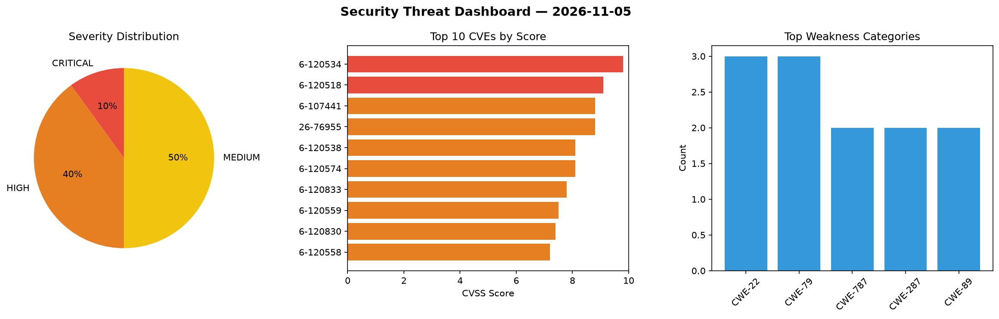
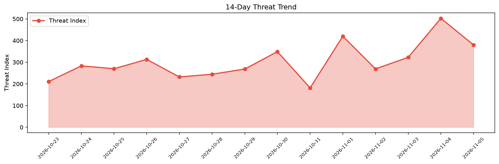

# Security Scan Report — 2026-11-05

**Scan ID:** `13f0888505` | **CVEs:** 20 | **Threat Index:** 380.1

## Threat Overview

| Metric | Value |
|--------|-------|
| Threat Index | 380.1 |
| Critical CVEs | 2 |
| CRITICAL | 2 |
| HIGH | 8 |
| MEDIUM | 10 |

## Delta vs Yesterday

| Metric | Today | Yesterday | Change |
|--------|-------|-----------|--------|
| total_cves | 20 | 20 | ➡️ 0.0% |
| threat_index | 380.1 | 502.6 | 📉 -24.4% |
| critical_count | 2 | 8 | 📉 -75.0% |

## Top Weakness Categories

| CWE | Count |
|-----|-------|
| CWE-22 | 3 |
| CWE-79 | 3 |
| CWE-787 | 2 |
| CWE-287 | 2 |
| CWE-89 | 2 |

## CVE Details

| CVE ID | Score | Severity | Description |
|--------|-------|----------|-------------|
| CVE-2026-120534 | 9.8 | CRITICAL | The Advanced Custom Fields: Extended PRO plugin for WordPress is vulnerable to L... |
| CVE-2026-120518 | 9.1 | CRITICAL | The BuddyPress XProfile Image Field plugin for WordPress is vulnerable to arbitr... |
| CVE-2026-107441 | 8.8 | HIGH | An out-of-bounds write vulnerability in the CGI program of Zyxel GS1900-24E firm... |
| CVE-2026-76955 | 8.8 | HIGH | A buffer overflow vulnerability in the zdp_wtp binary in Zyxel NWA110AX firmware... |
| CVE-2026-120538 | 8.1 | HIGH | The Easy Digital Downloads plugin for WordPress is vulnerable to authentication ... |
| CVE-2026-120574 | 8.1 | HIGH | The SureCart plugin for WordPress is vulnerable to unauthenticated account takeo... |
| CVE-2026-120833 | 7.8 | HIGH | labbench before 0.46.1 contains a deserialization of untrusted data vulnerabilit... |
| CVE-2026-120559 | 7.5 | HIGH | The Contact Form Extender for Divi Builder plugin for WordPress is vulnerable to... |
| CVE-2026-120830 | 7.4 | HIGH | A flaw was found in libslirp in icmp_forward_error(). When building an ICMP erro... |
| CVE-2026-120558 | 7.2 | HIGH | The Advanced Shipment Tracking for WooCommerce plugin for WordPress is vulnerabl... |
| CVE-2026-120831 | 6.5 | MEDIUM | A flaw was found in libslirp in if_output(). When moving a session from the fast... |
| CVE-2026-120524 | 6.4 | MEDIUM | The News Kit Addons For Elementor plugin for WordPress is vulnerable to Stored C... |
| CVE-2026-120552 | 6.4 | MEDIUM | The SEO Engine – Smart SEO with AI, Schema & Redirection for WordPress plugin fo... |
| CVE-2026-120575 | 6.4 | MEDIUM | The Photo Engine (Media Organizer & Lightroom) plugin for WordPress is vulnerabl... |
| CVE-2026-111464 | 5.9 | MEDIUM | The WP Fastest Cache plugin for WordPress is vulnerable to Sensitive Information... |