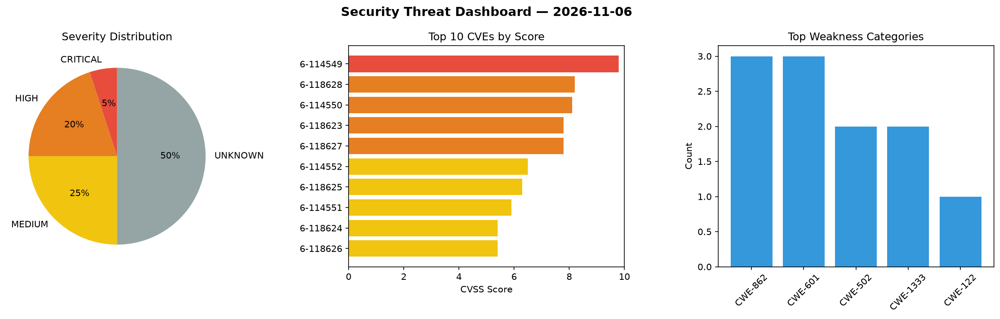
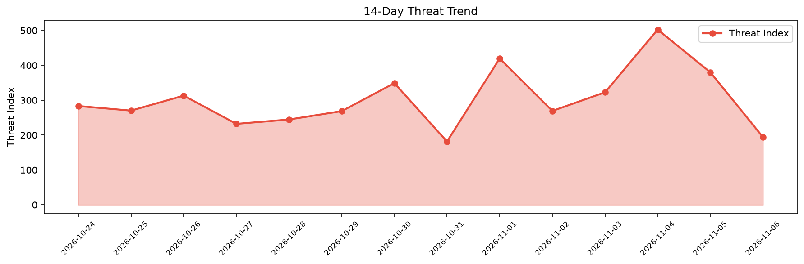

# Security Scan Report — 2026-11-06

**Scan ID:** `47f214b74d` | **CVEs:** 20 | **Threat Index:** 193.9

## Threat Overview

| Metric | Value |
|--------|-------|
| Threat Index | 193.9 |
| Critical CVEs | 1 |
| CRITICAL | 1 |
| HIGH | 4 |
| MEDIUM | 5 |
| UNKNOWN | 10 |

## Delta vs Yesterday

| Metric | Today | Yesterday | Change |
|--------|-------|-----------|--------|
| total_cves | 20 | 20 | ➡️ 0.0% |
| threat_index | 193.9 | 380.1 | 📉 -49.0% |
| critical_count | 1 | 2 | 📉 -50.0% |

## Top Weakness Categories

| CWE | Count |
|-----|-------|
| CWE-862 | 3 |
| CWE-601 | 3 |
| CWE-502 | 2 |
| CWE-1333 | 2 |
| CWE-122 | 1 |

## CVE Details

| CVE ID | Score | Severity | Description |
|--------|-------|----------|-------------|
| CVE-2026-114549 | 9.8 | CRITICAL | NoMachine nxwebrunner Heap-based Buffer Overflow Remote Code Execution Vulnerabi... |
| CVE-2026-118628 | 8.2 | HIGH | MLflow get-artifacts Server-Side Request Forgery Information Disclosure Vulnerab... |
| CVE-2026-114550 | 8.1 | HIGH | libwebsockets MQTT Protocol PUBACK Packet Handling Out-Of-Bounds Write Remote Co... |
| CVE-2026-118623 | 7.8 | HIGH | MLflow PickleEvaluationArtifact Deserialization of Untrusted Data Remote Code Ex... |
| CVE-2026-118627 | 7.8 | HIGH | MLflow SHAP load_explainer Deserialization of Untrusted Data Remote Code Executi... |
| CVE-2026-114552 | 6.5 | MEDIUM | MailEnable parseObjectResponse XML External Entity Processing Information Disclo... |
| CVE-2026-118625 | 6.3 | MEDIUM | MLflow Tracking Server Missing Authorization Privilege Escalation Vulnerability.... |
| CVE-2026-114551 | 5.9 | MEDIUM | MailEnable Auth Cleartext Storage Information Disclosure Vulnerability. This vul... |
| CVE-2026-118624 | 5.4 | MEDIUM | MLflow Tracking Server Jobs Missing Authorization Information Disclosure Vulnera... |
| CVE-2026-118626 | 5.4 | MEDIUM | MLflow Tracking Server Issues Missing Authorization Privilege Escalation Vulnera... |
| CVE-2026-120631 | 0.0 | UNKNOWN | CGI::Cookie versions from 4.67 before 5.00 for Perl allow denial of service via ... |
| CVE-2026-120632 | 0.0 | UNKNOWN | CGI versions before 5.00 for Perl allow CPU exhaustion via a backtracking regex ... |
| CVE-2026-120633 | 0.0 | UNKNOWN | CGI versions before 5.00 for Perl trust the client X-Forwarded-Host header in ur... |
| CVE-2026-120634 | 0.0 | UNKNOWN | CGI::Carp versions before 5.00 for Perl leak warnings across requests in persist... |
| CVE-2026-120635 | 0.0 | UNKNOWN | CGI versions before 5.00 for Perl allow form fields to be smuggled past proxies ... |