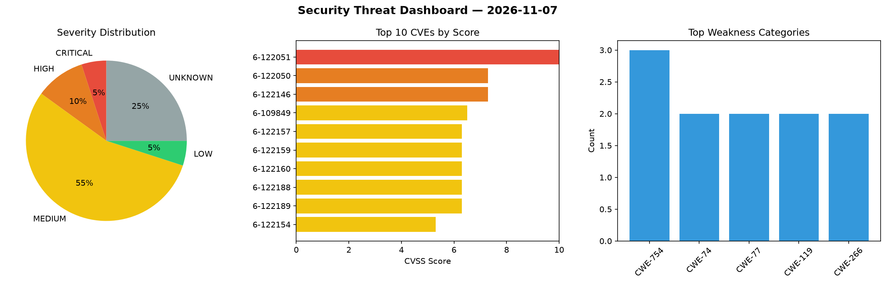
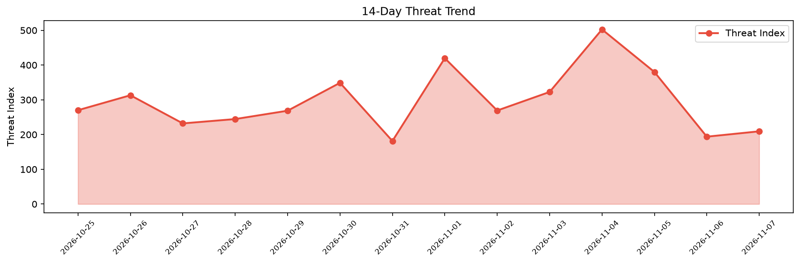

# Security Scan Report — 2026-11-07

**Scan ID:** `98b5427f40` | **CVEs:** 20 | **Threat Index:** 209.3

## Threat Overview

| Metric | Value |
|--------|-------|
| Threat Index | 209.3 |
| Critical CVEs | 1 |
| CRITICAL | 1 |
| HIGH | 2 |
| MEDIUM | 11 |
| LOW | 1 |
| UNKNOWN | 5 |

## Delta vs Yesterday

| Metric | Today | Yesterday | Change |
|--------|-------|-----------|--------|
| total_cves | 20 | 20 | ➡️ 0.0% |
| threat_index | 209.3 | 193.9 | 📈 7.9% |
| critical_count | 1 | 1 | ➡️ 0.0% |

## Top Weakness Categories

| CWE | Count |
|-----|-------|
| CWE-754 | 3 |
| CWE-74 | 2 |
| CWE-77 | 2 |
| CWE-119 | 2 |
| CWE-266 | 2 |

## CVE Details

| CVE ID | Score | Severity | Description |
|--------|-------|----------|-------------|
| CVE-2026-122051 | 10.0 | CRITICAL | A flaw has been found in Edimax BR-6208AC 1.32. Affected by this vulnerability i... |
| CVE-2026-122050 | 7.3 | HIGH | A vulnerability was found in Campcodes Complete Sales and Inventory System with ... |
| CVE-2026-122146 | 7.3 | HIGH | A weakness has been identified in 101arrowz fflate up to 0.8.3. This issue affec... |
| CVE-2026-109849 | 6.5 | MEDIUM | Incorrect privilege assignment issue exists in Hinemos. If this vulnerability is... |
| CVE-2026-122157 | 6.3 | MEDIUM | A vulnerability was identified in Purocean Yank Note 3.93.0. Affected by this vu... |
| CVE-2026-122159 | 6.3 | MEDIUM | A weakness has been identified in Edge0-AI Audio8_TTS up to 1d64afcc2da56222b41d... |
| CVE-2026-122160 | 6.3 | MEDIUM | A security vulnerability has been detected in myshell-ai AIlice up to 0.4.0. Thi... |
| CVE-2026-122188 | 6.3 | MEDIUM | A flaw has been found in DeepGraphLearning KnowledgeGraphEmbedding up to 2e440e0... |
| CVE-2026-122189 | 6.3 | MEDIUM | A vulnerability has been found in OpenPPL ppl.nn up to bb84dc9952809b3a5a0036858... |
| CVE-2026-122154 | 5.3 | MEDIUM | A vulnerability was found in purocean Yank Note 3.93.0. This impacts the functio... |
| CVE-2026-122158 | 4.7 | MEDIUM | A security flaw has been discovered in InvoiceShelf up to 2.4.3/3.0.0-alpha.3. A... |
| CVE-2026-122052 | 4.3 | MEDIUM | A vulnerability has been found in laspy up to 2.7.0. Affected by this issue is s... |
| CVE-2026-122144 | 4.3 | MEDIUM | A security flaw has been discovered in nliautaud pico-content-editor up to 02d5a... |
| CVE-2026-122151 | 4.3 | MEDIUM | A security vulnerability has been detected in Presenton up to 0.9.11-beta. Impac... |
| CVE-2026-122049 | 3.7 | LOW | A flaw has been found in Campcodes Bitcoin Wallet System 1.0. This affects the f... |