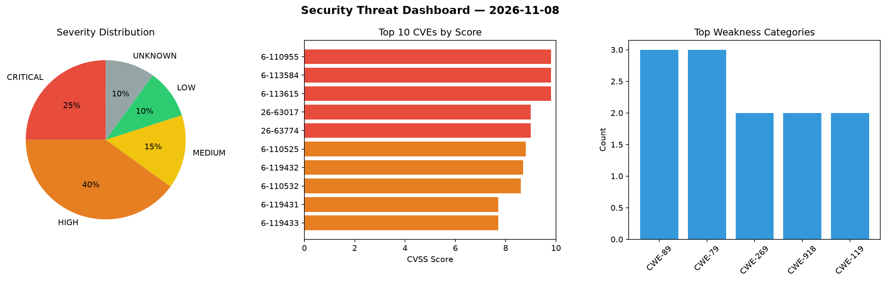
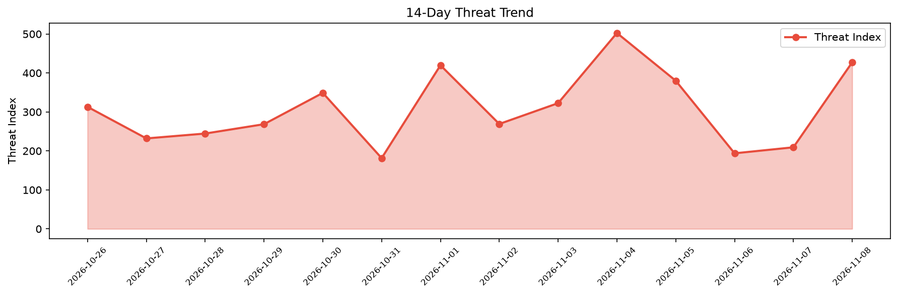

# Security Scan Report — 2026-11-08

**Scan ID:** `ed583a3c6c` | **CVEs:** 20 | **Threat Index:** 427.4

## Threat Overview

| Metric | Value |
|--------|-------|
| Threat Index | 427.4 |
| Critical CVEs | 5 |
| CRITICAL | 5 |
| HIGH | 8 |
| MEDIUM | 3 |
| LOW | 2 |
| UNKNOWN | 2 |

## Delta vs Yesterday

| Metric | Today | Yesterday | Change |
|--------|-------|-----------|--------|
| total_cves | 20 | 20 | ➡️ 0.0% |
| threat_index | 427.4 | 209.3 | 📈 104.2% |
| critical_count | 5 | 1 | 📈 400.0% |

## Top Weakness Categories

| CWE | Count |
|-----|-------|
| CWE-89 | 3 |
| CWE-79 | 3 |
| CWE-269 | 2 |
| CWE-918 | 2 |
| CWE-119 | 2 |

## CVE Details

| CVE ID | Score | Severity | Description |
|--------|-------|----------|-------------|
| CVE-2026-110955 | 9.8 | CRITICAL | The Wurdey WordPress plugin through 1.0.0 does not verify a request signature be... |
| CVE-2026-113584 | 9.8 | CRITICAL | The placester WordPress plugin through 1.4.3 does not perform any capability, no... |
| CVE-2026-113615 | 9.8 | CRITICAL | The GS JWT Authentication for WP REST API WordPress plugin through 1.0.0 does no... |
| CVE-2026-63017 | 9.0 | CRITICAL | Incorrect authorization in PowerSYSTEM Center allows a low-privileged, authentic... |
| CVE-2026-63774 | 9.0 | CRITICAL | Insufficient input validation in the PowerSYSTEM Center report designer allows a... |
| CVE-2026-110525 | 8.8 | HIGH | The MCB  WordPress plugin through 1.0.0 does not sanitise or escape request head... |
| CVE-2026-119432 | 8.7 | HIGH | A stored cross-site scripting (XSS) vulnerability exists in the Foxit Workspace'... |
| CVE-2026-110532 | 8.6 | HIGH | The Mail Mage WordPress plugin through 0.0.25 does not properly sanitise and esc... |
| CVE-2026-119431 | 7.7 | HIGH | A server-side request forgery (SSRF) vulnerability exists in Foxit Workspace's f... |
| CVE-2026-119433 | 7.7 | HIGH | A server-side request forgery (SSRF) vulnerability exists in an undocumented API... |
| CVE-2025-71458 | 7.5 | HIGH | FTS3 Web Monitoring (fts-monitoring) versions 3.12.0 through 3.13.2 and 3.14.0 c... |
| CVE-2026-77299 | 7.5 | HIGH | Regexp2 is a feature-rich RegExp engine for Go. Prior to version 2.3.0, when reg... |
| CVE-2026-110813 | 7.5 | HIGH | The Advanced Custom Fields (ACF®) WordPress plugin before 6.8.11 does not proper... |
| CVE-2026-109081 | 6.8 | MEDIUM | A flaw was found in Keycloak. The Dynamic Client Registration (DCR) endpoint doe... |
| CVE-2026-107124 | 6.4 | MEDIUM | A flaw was found in the OIDC logout endpoint of the keycloak-services component,... |