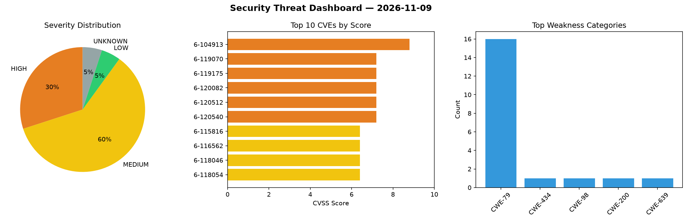
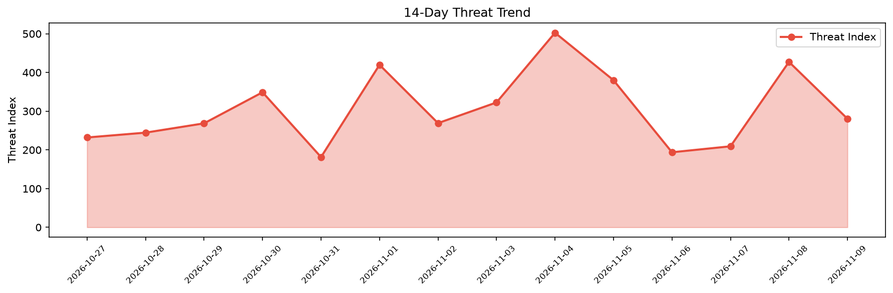

# Security Scan Report — 2026-11-09

**Scan ID:** `40aa775ca9` | **CVEs:** 20 | **Threat Index:** 280.5

## Threat Overview

| Metric | Value |
|--------|-------|
| Threat Index | 280.5 |
| Critical CVEs | 0 |
| HIGH | 6 |
| MEDIUM | 12 |
| LOW | 1 |
| UNKNOWN | 1 |

## Delta vs Yesterday

| Metric | Today | Yesterday | Change |
|--------|-------|-----------|--------|
| total_cves | 20 | 20 | ➡️ 0.0% |
| threat_index | 280.5 | 427.4 | 📉 -34.4% |
| critical_count | 0 | 5 | 📉 -100.0% |

## Top Weakness Categories

| CWE | Count |
|-----|-------|
| CWE-79 | 16 |
| CWE-434 | 1 |
| CWE-98 | 1 |
| CWE-200 | 1 |
| CWE-639 | 1 |

## CVE Details

| CVE ID | Score | Severity | Description |
|--------|-------|----------|-------------|
| CVE-2026-104913 | 8.8 | HIGH | The Interactive Real Estate – Floor Plan & Building Visualizer plugin for WordPr... |
| CVE-2026-119070 | 7.2 | HIGH | The Optimole – Optimize Images / Convert WebP & AVIF / CDN & Lazy Load / Image O... |
| CVE-2026-119175 | 7.2 | HIGH | The Flying Images: Optimize and Lazy Load Images for Faster Page Speed plugin fo... |
| CVE-2026-120082 | 7.2 | HIGH | The GeoDirectory – WP Business Directory Plugin and Classified Listings Director... |
| CVE-2026-120512 | 7.2 | HIGH | The Form Maker by 10Web – Mobile-Friendly Drag & Drop Contact Form Builder plugi... |
| CVE-2026-120540 | 7.2 | HIGH | The iubenda / All-in-one Compliance for GDPR / CCPA Cookie Consent + more plugin... |
| CVE-2026-115816 | 6.4 | MEDIUM | The Kubio AI Page Builder plugin for WordPress is vulnerable to Stored Cross-Sit... |
| CVE-2026-116562 | 6.4 | MEDIUM | The Motors – Car Dealership & Classified Listings Plugin plugin for WordPress is... |
| CVE-2026-118046 | 6.4 | MEDIUM | The JS Help Desk – AI-Powered Support & Ticketing System plugin for WordPress is... |
| CVE-2026-118054 | 6.4 | MEDIUM | The LearnPress – Course Review plugin for WordPress is vulnerable to Stored DOM-... |
| CVE-2026-119098 | 6.4 | MEDIUM | The LifterLMS – WP LMS for eLearning, Online Courses, & Quizzes plugin for WordP... |
| CVE-2026-119165 | 6.4 | MEDIUM | The WPBakery Page Builder plugin for WordPress is vulnerable to Stored Cross-Sit... |
| CVE-2026-119616 | 5.9 | MEDIUM | The Noptin – Newsletter, New Post Notifications & Email Automation plugin for Wo... |
| CVE-2026-118067 | 5.4 | MEDIUM | The Form Maker by 10Web – Mobile-Friendly Drag & Drop Contact Form Builder plugi... |
| CVE-2026-119152 | 5.4 | MEDIUM | The Appointment Booking Plugin – LatePoint / Calendar & Scheduling for WordPress... |