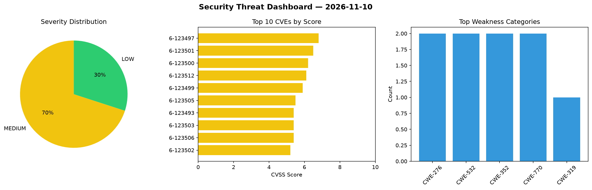
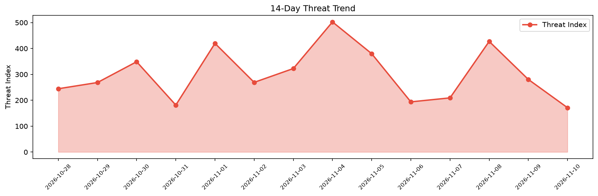

# Security Scan Report — 2026-11-10

**Scan ID:** `be6e56ffc3` | **CVEs:** 20 | **Threat Index:** 171.4

## Threat Overview

| Metric | Value |
|--------|-------|
| Threat Index | 171.4 |
| Critical CVEs | 0 |
| MEDIUM | 14 |
| LOW | 6 |

## Delta vs Yesterday

| Metric | Today | Yesterday | Change |
|--------|-------|-----------|--------|
| total_cves | 20 | 20 | ➡️ 0.0% |
| threat_index | 171.4 | 280.5 | 📉 -38.9% |
| critical_count | 0 | 0 | ➡️ 0% |

## Top Weakness Categories

| CWE | Count |
|-----|-------|
| CWE-276 | 2 |
| CWE-532 | 2 |
| CWE-352 | 2 |
| CWE-770 | 2 |
| CWE-319 | 1 |

## CVE Details

| CVE ID | Score | Severity | Description |
|--------|-------|----------|-------------|
| CVE-2026-123497 | 6.8 | MEDIUM | Vikunja veans before 2.7.1 contains a protocol downgrade vulnerability in server... |
| CVE-2026-123501 | 6.5 | MEDIUM | Vikunja before 2.7.1 contains an uncontrolled resource consumption vulnerability... |
| CVE-2026-123500 | 6.2 | MEDIUM | Vikunja before 2.7.1 contains an insecure file permissions vulnerability that al... |
| CVE-2026-123512 | 6.1 | MEDIUM | Vikunja before 2.7.1 embeds live password-reset, email-confirmation and account-... |
| CVE-2026-123499 | 5.9 | MEDIUM | Vikunja veans before 2.7.1 contains a credential exposure vulnerability that all... |
| CVE-2026-123505 | 5.5 | MEDIUM | Vikunja before 2.7.1 contains an insecure file permissions vulnerability that al... |
| CVE-2026-123493 | 5.4 | MEDIUM | Vikunja from 2.4.0 before 2.7.1 contains an authentication bypass vulnerability ... |
| CVE-2026-123503 | 5.4 | MEDIUM | Vikunja before 2.7.1 contains an improper authorization vulnerability in canDoBu... |
| CVE-2026-123506 | 5.4 | MEDIUM | Vikunja from 2.2.0 before 2.7.1 contains an authorization bypass vulnerability t... |
| CVE-2026-123502 | 5.2 | MEDIUM | Vikunja before 2.7.1 contains an information exposure vulnerability that allows ... |
| CVE-2026-123495 | 4.6 | MEDIUM | Vikunja 2.0.0 before 2.7.1 accepts form-encoded bodies on the /api/v2 login and ... |
| CVE-2026-123504 | 4.3 | MEDIUM | Vikunja from 0.22.0 before 2.7.1 contains an information disclosure vulnerabilit... |
| CVE-2026-123509 | 4.3 | MEDIUM | Vikunja before 2.7.1 contains an uncontrolled resource consumption vulnerability... |
| CVE-2026-123511 | 4.3 | MEDIUM | Vikunja before 2.7.1 contains an uncontrolled resource consumption vulnerability... |
| CVE-2026-123498 | 3.7 | LOW | Vikunja veans before 2.7.1 contains a prompt injection vulnerability that allows... |