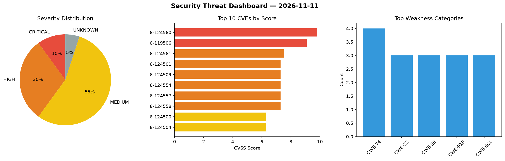
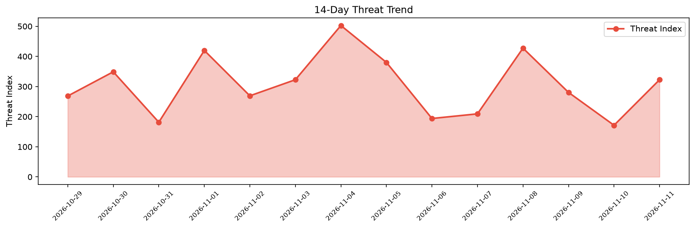

# Security Scan Report — 2026-11-11

**Scan ID:** `34f0407b16` | **CVEs:** 20 | **Threat Index:** 322.6

## Threat Overview

| Metric | Value |
|--------|-------|
| Threat Index | 322.6 |
| Critical CVEs | 2 |
| CRITICAL | 2 |
| HIGH | 6 |
| MEDIUM | 11 |
| UNKNOWN | 1 |

## Delta vs Yesterday

| Metric | Today | Yesterday | Change |
|--------|-------|-----------|--------|
| total_cves | 20 | 20 | ➡️ 0.0% |
| threat_index | 322.6 | 171.4 | 📈 88.2% |
| critical_count | 2 | 0 | ➡️ 0% |

## Top Weakness Categories

| CWE | Count |
|-----|-------|
| CWE-74 | 4 |
| CWE-22 | 3 |
| CWE-89 | 3 |
| CWE-918 | 3 |
| CWE-601 | 3 |

## CVE Details

| CVE ID | Score | Severity | Description |
|--------|-------|----------|-------------|
| CVE-2026-124560 | 9.8 | CRITICAL | A vulnerability was found in D-Link DIR-878 1.20B05. This affects the function G... |
| CVE-2026-119506 | 9.1 | CRITICAL | Incorrect Privilege Assignment vulnerability in DynamiApps Frontend Admin by Dyn... |
| CVE-2026-124561 | 7.5 | HIGH | A vulnerability was determined in D-Link DIR-878 1.20B05. This impacts the funct... |
| CVE-2026-124501 | 7.3 | HIGH | A weakness has been identified in Tidelift moto up to 5.2.4. Affected is an unkn... |
| CVE-2026-124509 | 7.3 | HIGH | A vulnerability was identified in floci-io Floci up to 2.1.0. The affected eleme... |
| CVE-2026-124554 | 7.3 | HIGH | A security flaw has been discovered in JeecgBoot 3.9.5. This affects an unknown ... |
| CVE-2026-124557 | 7.3 | HIGH | A vulnerability was detected in OtterMind Chat2DB up to 5.3.8. Impacted is the f... |
| CVE-2026-124558 | 7.3 | HIGH | A vulnerability has been found in DataLinkDC Dinky up to 1.2.5. The impacted ele... |
| CVE-2026-124500 | 6.3 | MEDIUM | A security flaw has been discovered in Fengoffice Feng Office up to 3.11.13.11/4... |
| CVE-2026-124504 | 6.3 | MEDIUM | A vulnerability was detected in erupts erupt up to 2.3.0. Affected by this issue... |
| CVE-2026-124555 | 6.3 | MEDIUM | A weakness has been identified in JeecgBoot 3.9.5. This vulnerability affects th... |
| CVE-2026-121825 | 6.1 | MEDIUM | OpenAM (OpenAM Consortium Edition) 14.0.5 and earlier contains an open redirect ... |
| CVE-2026-124507 | 5.3 | MEDIUM | A vulnerability was found in conductor-oss conductor up to 3.32.4/3.33.0/3.34.0-... |
| CVE-2026-124508 | 5.3 | MEDIUM | A vulnerability was determined in floci-io Floci up to 2.4.0. Impacted is the fu... |
| CVE-2026-124499 | 4.7 | MEDIUM | A vulnerability was identified in Fengoffice Feng Office up to 3.11.13.11/4.2.1.... |