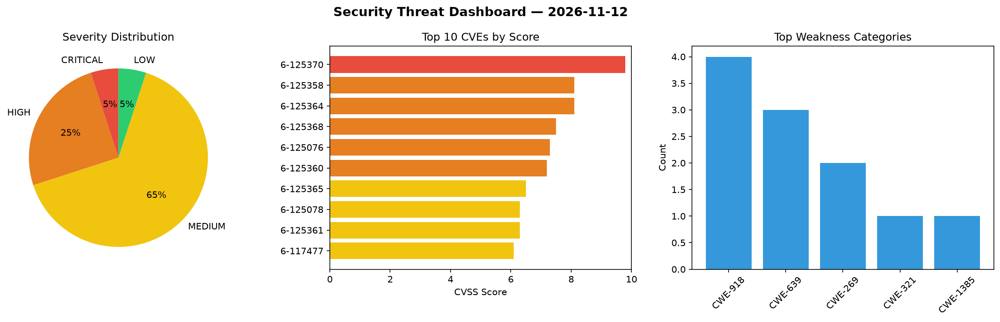
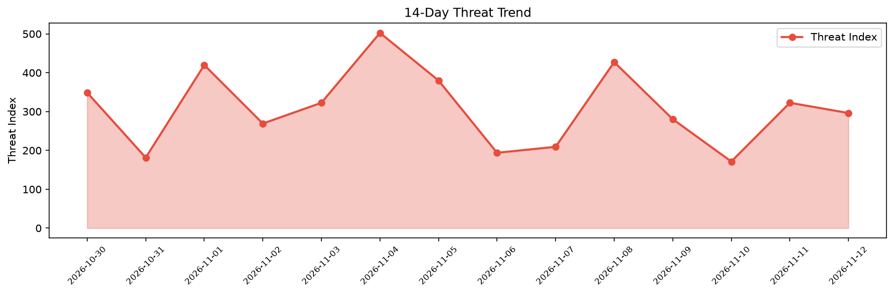

# Security Scan Report — 2026-11-12

**Scan ID:** `796ccdc26d` | **CVEs:** 20 | **Threat Index:** 296.3

## Threat Overview

| Metric | Value |
|--------|-------|
| Threat Index | 296.3 |
| Critical CVEs | 1 |
| CRITICAL | 1 |
| HIGH | 5 |
| MEDIUM | 13 |
| LOW | 1 |

## Delta vs Yesterday

| Metric | Today | Yesterday | Change |
|--------|-------|-----------|--------|
| total_cves | 20 | 20 | ➡️ 0.0% |
| threat_index | 296.3 | 322.6 | 📉 -8.2% |
| critical_count | 1 | 2 | 📉 -50.0% |

## Top Weakness Categories

| CWE | Count |
|-----|-------|
| CWE-918 | 4 |
| CWE-639 | 3 |
| CWE-269 | 2 |
| CWE-321 | 1 |
| CWE-1385 | 1 |

## CVE Details

| CVE ID | Score | Severity | Description |
|--------|-------|----------|-------------|
| CVE-2026-125370 | 9.8 | CRITICAL | Kubero 3.0.0 through 3.1.1 contains an authentication bypass vulnerability that ... |
| CVE-2026-125358 | 8.1 | HIGH | Universal-modder before commit e88f6876745427321eb755ebc98276063a962d8a contains... |
| CVE-2026-125364 | 8.1 | HIGH | frab through 0.9.1 contains a privilege escalation vulnerability that allows aut... |
| CVE-2026-125368 | 7.5 | HIGH | OmniAgent through commit 12b98c5 contains an approval bypass vulnerability in Re... |
| CVE-2026-125076 | 7.3 | HIGH | A vulnerability was found in SourceCodester Smart Attendance System with QR Code... |
| CVE-2026-125360 | 7.2 | HIGH | Storyden through 1.26.16 contains a privilege escalation vulnerability that allo... |
| CVE-2026-125365 | 6.5 | MEDIUM | DollarDollar through 4.4 contains a missing authorization vulnerability in add_e... |
| CVE-2026-125078 | 6.3 | MEDIUM | A security flaw has been discovered in SourceCodester Smart Attendance System wi... |
| CVE-2026-125361 | 6.3 | MEDIUM | Tencent BrowserSkill through 0.4.2 contains a missing authentication vulnerabili... |
| CVE-2026-117477 | 6.1 | MEDIUM | KUSANAGI provided by GMO Prime Strategy Co., Ltd. contains an HTTP header inject... |
| CVE-2026-125363 | 5.4 | MEDIUM | MikroDash before 0.8.79 contains a server-side request forgery vulnerability tha... |
| CVE-2026-125366 | 5.4 | MEDIUM | Omnom through 0.9.0 contains a server-side request forgery vulnerability that al... |
| CVE-2026-125367 | 5.4 | MEDIUM | Pico through 4.1.2 contains a server-side request forgery vulnerability in the f... |
| CVE-2026-125357 | 5.3 | MEDIUM | Munin munin-httpd 2.99.1 through 2.999.18 contains a path traversal vulnerabilit... |
| CVE-2026-125369 | 5.3 | MEDIUM | Bitpoll through 0.11.0 contains an insecure direct object reference vulnerabilit... |