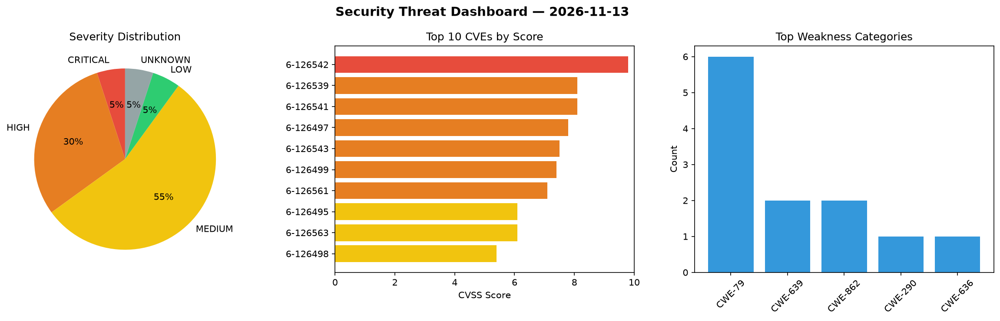
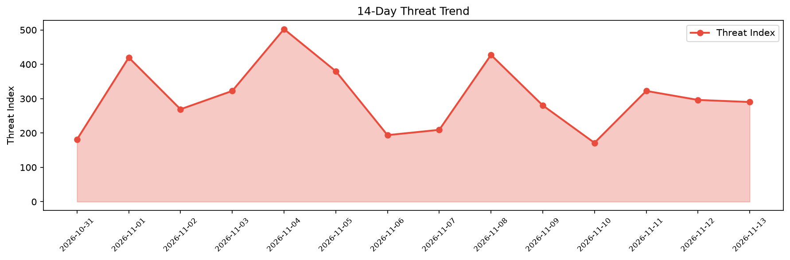

# Security Scan Report — 2026-11-13

**Scan ID:** `9c7670d965` | **CVEs:** 20 | **Threat Index:** 290.3

## Threat Overview

| Metric | Value |
|--------|-------|
| Threat Index | 290.3 |
| Critical CVEs | 1 |
| CRITICAL | 1 |
| HIGH | 6 |
| MEDIUM | 11 |
| LOW | 1 |
| UNKNOWN | 1 |

## Delta vs Yesterday

| Metric | Today | Yesterday | Change |
|--------|-------|-----------|--------|
| total_cves | 20 | 20 | ➡️ 0.0% |
| threat_index | 290.3 | 296.3 | 📉 -2.0% |
| critical_count | 1 | 1 | ➡️ 0.0% |

## Top Weakness Categories

| CWE | Count |
|-----|-------|
| CWE-79 | 6 |
| CWE-639 | 2 |
| CWE-862 | 2 |
| CWE-290 | 1 |
| CWE-636 | 1 |

## CVE Details

| CVE ID | Score | Severity | Description |
|--------|-------|----------|-------------|
| CVE-2026-126542 | 9.8 | CRITICAL | WWBN AVideo 6.5 through 29.7.1 contains an authentication bypass vulnerability t... |
| CVE-2026-126539 | 8.1 | HIGH | Directus before 12.1.0 contains an authorization bypass vulnerability that allow... |
| CVE-2026-126541 | 8.1 | HIGH | WWBN AVideo through 29.7.1 contains a missing authorization vulnerability in Liv... |
| CVE-2026-126497 | 7.8 | HIGH | LibreCAD through 2.2.1.6 contains a heap-based out-of-bounds write vulnerability... |
| CVE-2026-126543 | 7.5 | HIGH | WWBN AVideo through 29.7.1 contains an improper payment verification vulnerabili... |
| CVE-2026-126499 | 7.4 | HIGH | Jellyfin before 12.0 contains a path traversal vulnerability in the DELETE /Libr... |
| CVE-2026-126561 | 7.1 | HIGH | Semantic MediaWiki 2.5.0 before 7.4.1 contains a missing authorization vulnerabi... |
| CVE-2026-126495 | 6.1 | MEDIUM | MQTTX desktop through 1.13.3 contains a stored cross-site scripting vulnerabilit... |
| CVE-2026-126563 | 6.1 | MEDIUM | Semantic MediaWiki 2.4.0 before 7.4.1 contains a reflected cross-site scripting ... |
| CVE-2026-126498 | 5.4 | MEDIUM | WriteFreely before 0.17.3 contains a stored cross-site scripting vulnerability t... |
| CVE-2026-126560 | 5.4 | MEDIUM | Semantic MediaWiki 3.0.0 before 7.4.1 contains a stored cross-site scripting vul... |
| CVE-2026-126564 | 5.4 | MEDIUM | Semantic MediaWiki 2.5.0 before 7.4.1 contains a stored cross-site scripting vul... |
| CVE-2026-126559 | 4.8 | MEDIUM | Semantic MediaWiki 4.2.0 before 7.4.1 contains a stored cross-site scripting vul... |
| CVE-2026-126496 | 4.3 | MEDIUM | 1Panel-dev CordysCRM before 1.9.6 contains an authorization bypass vulnerability... |
| CVE-2026-126544 | 4.3 | MEDIUM | WWBN AVideo 6.5 through 29.7.1 contains an email verification bypass vulnerabili... |