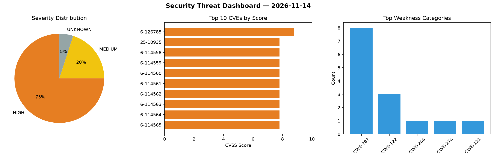
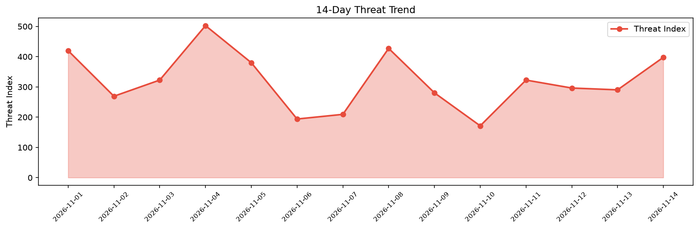

# Security Scan Report — 2026-11-14

**Scan ID:** `344fe86abc` | **CVEs:** 20 | **Threat Index:** 397.8

## Threat Overview

| Metric | Value |
|--------|-------|
| Threat Index | 397.8 |
| Critical CVEs | 0 |
| HIGH | 15 |
| MEDIUM | 4 |
| UNKNOWN | 1 |

## Delta vs Yesterday

| Metric | Today | Yesterday | Change |
|--------|-------|-----------|--------|
| total_cves | 20 | 20 | ➡️ 0.0% |
| threat_index | 397.8 | 290.3 | 📈 37.0% |
| critical_count | 0 | 1 | 📉 -100.0% |

## Top Weakness Categories

| CWE | Count |
|-----|-------|
| CWE-787 | 8 |
| CWE-122 | 3 |
| CWE-266 | 1 |
| CWE-276 | 1 |
| CWE-121 | 1 |

## CVE Details

| CVE ID | Score | Severity | Description |
|--------|-------|----------|-------------|
| CVE-2026-126785 | 8.8 | HIGH | A vulnerability has been found in rmalright TR-VISION HOME 2.0.5. Impacted is th... |
| CVE-2025-10935 | 7.8 | HIGH | libilbm ILBM File Parsing Heap-based Buffer Overflow Remote Code Execution Vulne... |
| CVE-2026-114558 | 7.8 | HIGH | OriginLab Origin Viewer OPJU File Parsing Out-Of-Bounds Write Remote Code Execut... |
| CVE-2026-114559 | 7.8 | HIGH | OriginLab Origin Viewer OGG File Parsing Out-Of-Bounds Write Remote Code Executi... |
| CVE-2026-114560 | 7.8 | HIGH | OriginLab Origin Viewer OPJ File Parsing Out-Of-Bounds Write Remote Code Executi... |
| CVE-2026-114561 | 7.8 | HIGH | OriginLab Origin Viewer OPJU File Parsing Out-Of-Bounds Write Remote Code Execut... |
| CVE-2026-114562 | 7.8 | HIGH | OriginLab Origin Viewer OGWU File Parsing Out-Of-Bounds Write Remote Code Execut... |
| CVE-2026-114563 | 7.8 | HIGH | OriginLab Origin Viewer OGWU File Parsing Stack-based Buffer Overflow Remote Cod... |
| CVE-2026-114564 | 7.8 | HIGH | OriginLab Origin Viewer OGG File Parsing Out-Of-Bounds Write  Remote Code Execut... |
| CVE-2026-114565 | 7.8 | HIGH | OriginLab Origin Viewer OGG File Parsing Out-Of-Bounds Write Remote Code Executi... |
| CVE-2026-114566 | 7.8 | HIGH | OriginLab Origin Viewer OGM File Parsing Memory Corruption Remote Code Execution... |
| CVE-2026-114567 | 7.8 | HIGH | OriginLab Origin Viewer OGWU File Parsing Out-Of-Bounds Write Remote Code Execut... |
| CVE-2026-114568 | 7.8 | HIGH | OriginLab Origin Viewer OPJ File Parsing Heap-based Buffer Overflow Remote Code ... |
| CVE-2026-114569 | 7.8 | HIGH | OriginLab Origin Viewer OGWU File Parsing Heap-based Buffer Overflow Remote Code... |
| CVE-2026-114556 | 7.4 | HIGH | MailEnable Save Directory Traversal Arbitrary File Creation Vulnerability. This ... |