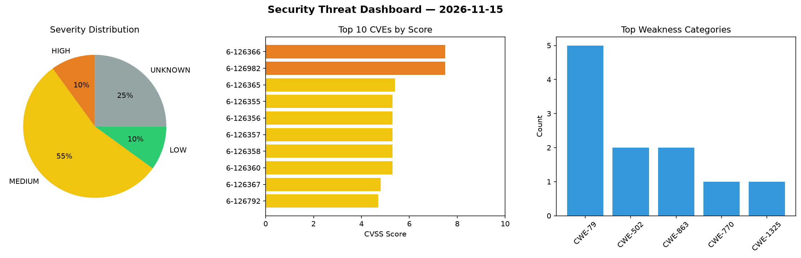
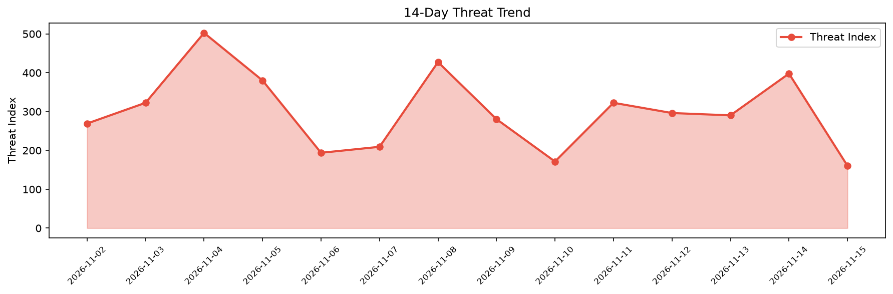

# Security Scan Report — 2026-11-15

**Scan ID:** `8927a850a9` | **CVEs:** 20 | **Threat Index:** 160.5

## Threat Overview

| Metric | Value |
|--------|-------|
| Threat Index | 160.5 |
| Critical CVEs | 0 |
| HIGH | 2 |
| MEDIUM | 11 |
| LOW | 2 |
| UNKNOWN | 5 |

## Delta vs Yesterday

| Metric | Today | Yesterday | Change |
|--------|-------|-----------|--------|
| total_cves | 20 | 20 | ➡️ 0.0% |
| threat_index | 160.5 | 397.8 | 📉 -59.7% |
| critical_count | 0 | 0 | ➡️ 0% |

## Top Weakness Categories

| CWE | Count |
|-----|-------|
| CWE-79 | 5 |
| CWE-502 | 2 |
| CWE-863 | 2 |
| CWE-770 | 1 |
| CWE-1325 | 1 |

## CVE Details

| CVE ID | Score | Severity | Description |
|--------|-------|----------|-------------|
| CVE-2026-126366 | 7.5 | HIGH | MessagePack for Ruby is an implementation of the MessagePack binary serializatio... |
| CVE-2026-126982 | 7.5 | HIGH | A type allow-list bypass in the BSON serialization library of the MongoDB C# Dri... |
| CVE-2026-126365 | 5.4 | MEDIUM | Astro is a web framework for content-driven websites. Prior to @astrojs/prism 4.... |
| CVE-2026-126355 | 5.3 | MEDIUM | Hono is a Web application framework that provides support for any JavaScript run... |
| CVE-2026-126356 | 5.3 | MEDIUM | Hono is a Web application framework that provides support for any JavaScript run... |
| CVE-2026-126357 | 5.3 | MEDIUM | Hono is a Web application framework that provides support for any JavaScript run... |
| CVE-2026-126358 | 5.3 | MEDIUM | Hono is a Web application framework that provides support for any JavaScript run... |
| CVE-2026-126360 | 5.3 | MEDIUM | OpenTelemetry Python provides the Python API and SDK for OpenTelemetry. Prior to... |
| CVE-2026-126367 | 4.8 | MEDIUM | @grpc/grpc-js implements the core functionality of gRPC purely in JavaScript, wi... |
| CVE-2026-126792 | 4.7 | MEDIUM | A memory-safety flaw in the key-management request-building component of the lib... |
| CVE-2026-127212 | 4.3 | MEDIUM | Dokploy before 0.31.1 contains a missing ownership check vulnerability in the re... |
| CVE-2026-127273 | 4.3 | MEDIUM | A vulnerability has been found in Linksys EA8100 1.0.3.216940. This affects the ... |
| CVE-2026-126839 | 4.2 | MEDIUM | A deserialization type-restriction control in the BSON serialization component c... |
| CVE-2026-127274 | 3.7 | LOW | A vulnerability was found in Linksys EA8100 1.0.3.216940. This vulnerability aff... |
| CVE-2026-126359 | 3.4 | LOW | Hono is a Web application framework that provides support for any JavaScript run... |