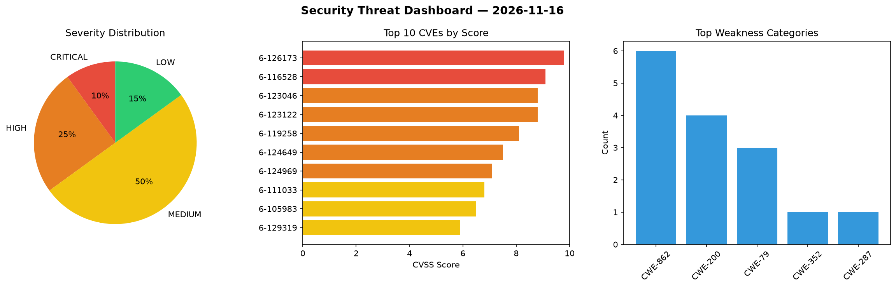
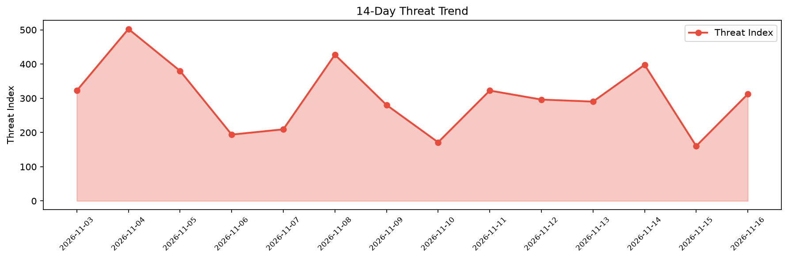

# Security Scan Report — 2026-11-16

**Scan ID:** `194a8aa377` | **CVEs:** 20 | **Threat Index:** 312.4

## Threat Overview

| Metric | Value |
|--------|-------|
| Threat Index | 312.4 |
| Critical CVEs | 2 |
| CRITICAL | 2 |
| HIGH | 5 |
| MEDIUM | 10 |
| LOW | 3 |

## Delta vs Yesterday

| Metric | Today | Yesterday | Change |
|--------|-------|-----------|--------|
| total_cves | 20 | 20 | ➡️ 0.0% |
| threat_index | 312.4 | 160.5 | 📈 94.6% |
| critical_count | 2 | 0 | ➡️ 0% |

## Top Weakness Categories

| CWE | Count |
|-----|-------|
| CWE-862 | 6 |
| CWE-200 | 4 |
| CWE-79 | 3 |
| CWE-352 | 1 |
| CWE-287 | 1 |

## CVE Details

| CVE ID | Score | Severity | Description |
|--------|-------|----------|-------------|
| CVE-2026-126173 | 9.8 | CRITICAL | The AutomatorWP Pro plugin for WordPress' webhook addon is vulnerable to authori... |
| CVE-2026-116528 | 9.1 | CRITICAL | The Chargely Free Subscriptions For Woocommernce WordPress plugin through 1.0 do... |
| CVE-2026-123046 | 8.8 | HIGH | The SEOJuice WordPress plugin before 2.12.0 does not correctly restrict a REST A... |
| CVE-2026-123122 | 8.8 | HIGH | The Checkout Files Upload for WooCommerce WordPress plugin before 2.4.1 does not... |
| CVE-2026-119258 | 8.1 | HIGH | The Swipe WordPress plugin through 1.4 does not properly authenticate a login re... |
| CVE-2026-124649 | 7.5 | HIGH | The Lightbox with PhotoSwipe WordPress plugin before 5.19.0 does not properly sa... |
| CVE-2026-124969 | 7.1 | HIGH | The Optimole – Optimize Images / Convert WebP & AVIF / CDN & Lazy Load / Image O... |
| CVE-2026-111033 | 6.8 | MEDIUM | The Countdown, Coming Soon, Maintenance  WordPress plugin through 3.0.8 does not... |
| CVE-2026-105983 | 6.5 | MEDIUM | The Email Marketing 4Dem WordPress plugin through 2.0.5 does not perform authori... |
| CVE-2026-129319 | 5.9 | MEDIUM | create-ecdh is a browserifiable implementation of Node.js crypto.createECDH. In ... |
| CVE-2026-126697 | 5.4 | MEDIUM | The Quick Page/Post Redirect Plugin WordPress plugin before 5.2.4 was distribute... |
| CVE-2026-105984 | 5.3 | MEDIUM | The Email Marketing 4Dem WordPress plugin through 2.0.5 does not perform authori... |
| CVE-2026-117487 | 5.3 | MEDIUM | The Flatsome WordPress theme before 3.20.13 does not perform a capability or non... |
| CVE-2026-126640 | 4.9 | MEDIUM | The WP Ultimate CSV Importer  WordPress plugin before 9.3 does not escape values... |
| CVE-2026-118182 | 4.4 | MEDIUM | The Duplicate Post WordPress plugin before 1.5.8 does not check that a user dupl... |