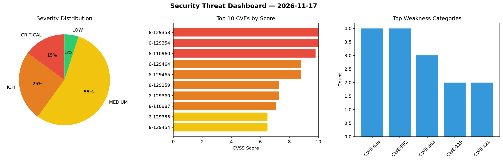
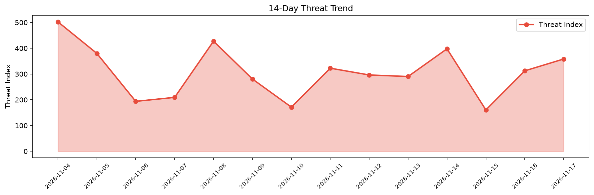

# Security Scan Report — 2026-11-17

**Scan ID:** `3703402ae3` | **CVEs:** 20 | **Threat Index:** 358.3

## Threat Overview

| Metric | Value |
|--------|-------|
| Threat Index | 358.3 |
| Critical CVEs | 3 |
| CRITICAL | 3 |
| HIGH | 5 |
| MEDIUM | 11 |
| LOW | 1 |

## Delta vs Yesterday

| Metric | Today | Yesterday | Change |
|--------|-------|-----------|--------|
| total_cves | 20 | 20 | ➡️ 0.0% |
| threat_index | 358.3 | 312.4 | 📈 14.7% |
| critical_count | 3 | 2 | 📈 50.0% |

## Top Weakness Categories

| CWE | Count |
|-----|-------|
| CWE-639 | 4 |
| CWE-862 | 4 |
| CWE-863 | 3 |
| CWE-119 | 2 |
| CWE-121 | 2 |

## CVE Details

| CVE ID | Score | Severity | Description |
|--------|-------|----------|-------------|
| CVE-2026-129353 | 10.0 | CRITICAL | A vulnerability was detected in D-Link DIR-600L 2.17/2.17b02. Affected by this v... |
| CVE-2026-129354 | 10.0 | CRITICAL | A flaw has been found in D-Link DIR-600L 2.17b02. Affected by this issue is the ... |
| CVE-2026-110960 | 9.8 | CRITICAL | The Auth Armor  WordPress plugin through 1.0.3 does not require authentication o... |
| CVE-2026-129464 | 8.8 | HIGH | Zr.Admin.NET commit 0ee1ab8 through commit eb9228a contains a path traversal vul... |
| CVE-2026-129465 | 8.8 | HIGH | Zr.Admin.NET commit af07ffc through commit eb9228a contains an insecure direct o... |
| CVE-2026-129359 | 7.3 | HIGH | A security flaw has been discovered in Linux Foundation Magma up to 1.9.0. The a... |
| CVE-2026-129360 | 7.3 | HIGH | A weakness has been identified in Linux Foundation Magma up to 1.9.0. The impact... |
| CVE-2026-110987 | 7.1 | HIGH | The RegistrationMagic  WordPress plugin before 6.1.0.4 does not properly escape ... |
| CVE-2026-129355 | 6.5 | MEDIUM | A vulnerability has been found in sigoden dufs up to 0.46.0. This affects an unk... |
| CVE-2026-129454 | 6.5 | MEDIUM | Zr.Admin.NET commit 85cff6a through commit eb9228a contains an insecure direct o... |
| CVE-2026-129357 | 6.3 | MEDIUM | A vulnerability was determined in Linux Foundation Magma up to 1.9.0. This issue... |
| CVE-2026-129455 | 5.4 | MEDIUM | Zr.Admin.NET commit e6ceaf4 through commit eb9228a contains an insecure direct o... |
| CVE-2026-114452 | 5.4 | MEDIUM | The Membership Plugin  WordPress plugin before 4.0.6 does not verify that the me... |
| CVE-2026-103361 | 5.3 | MEDIUM | The Payment Gateway via Valitor for WooCommerce WordPress plugin before 1.9.41 d... |
| CVE-2026-110989 | 5.3 | MEDIUM | The RegistrationMagic  WordPress plugin before 6.1.0.4 does not verify ownership... |