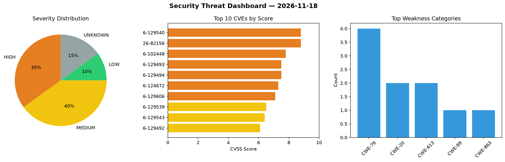
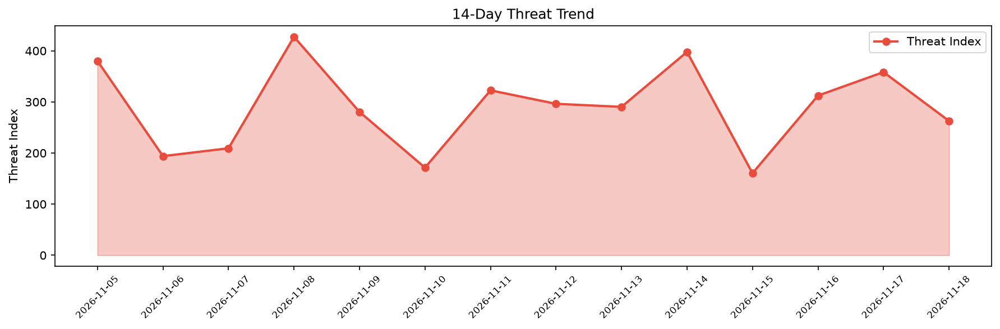

# Security Scan Report — 2026-11-18

**Scan ID:** `5d37c7b02e` | **CVEs:** 20 | **Threat Index:** 262.8

## Threat Overview

| Metric | Value |
|--------|-------|
| Threat Index | 262.8 |
| Critical CVEs | 0 |
| HIGH | 7 |
| MEDIUM | 8 |
| LOW | 2 |
| UNKNOWN | 3 |

## Delta vs Yesterday

| Metric | Today | Yesterday | Change |
|--------|-------|-----------|--------|
| total_cves | 20 | 20 | ➡️ 0.0% |
| threat_index | 262.8 | 358.3 | 📉 -26.7% |
| critical_count | 0 | 3 | 📉 -100.0% |

## Top Weakness Categories

| CWE | Count |
|-----|-------|
| CWE-79 | 4 |
| CWE-20 | 2 |
| CWE-613 | 2 |
| CWE-89 | 1 |
| CWE-863 | 1 |

## CVE Details

| CVE ID | Score | Severity | Description |
|--------|-------|----------|-------------|
| CVE-2026-129540 | 8.8 | HIGH | VoAPI 1.0.0 through 1.2.0 contains a sql injection vulnerability that allows aut... |
| CVE-2026-82156 | 8.8 | HIGH | Dell PowerStore contains an authorization-bypass vulnerability. A low-privileged... |
| CVE-2026-102448 | 7.8 | HIGH | A vulnerability has been identified in Rexroth IndraWorks. This flaw allows an a... |
| CVE-2026-129493 | 7.5 | HIGH | Bolo (bolo-solo) 1.7 through 2.6.4 contains an information disclosure vulnerabil... |
| CVE-2026-129494 | 7.5 | HIGH | CloudPaste 1.1.0 through 1.9.1 contains an information disclosure vulnerability ... |
| CVE-2026-124672 | 7.3 | HIGH | The Burst Statistics WordPress plugin before 3.7.5 does not verify that a reques... |
| CVE-2026-129606 | 7.1 | HIGH | Buffer Copy without Checking Size of Input ('Classic Buffer Overflow') vulnerabi... |
| CVE-2026-129539 | 6.5 | MEDIUM | SSCMS 7.2.0 through 7.4.0 contains an arbitrary file read vulnerability that all... |
| CVE-2026-129543 | 6.4 | MEDIUM | Access of resource using incompatible type ('type confusion') vulnerability in S... |
| CVE-2026-129492 | 6.1 | MEDIUM | Bolo (bolo-solo) 1.7 through 2.6.4 contains a stored cross-site scripting vulner... |
| CVE-2026-129491 | 5.4 | MEDIUM | Qbian61 forum-java commit 20f7e68 through commit 63152c4 contains a stored cross... |
| CVE-2026-129541 | 5.4 | MEDIUM | EdgeChat 2.5.0 through 2.21.0 contains a cross-site scripting vulnerability that... |
| CVE-2026-107520 | 5.4 | MEDIUM | Dell PowerStore contains a stored cross-site scripting (XSS) vulnerability. A lo... |
| CVE-2026-121786 | 5.3 | MEDIUM | The Social Viral Downloader WordPress plugin through 2.0.3 does not have authori... |
| CVE-2026-121787 | 5.3 | MEDIUM | The Social Viral Downloader WordPress plugin through 2.0.3 does not have authori... |