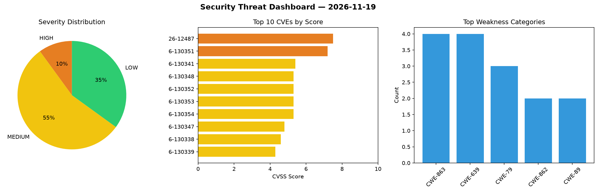
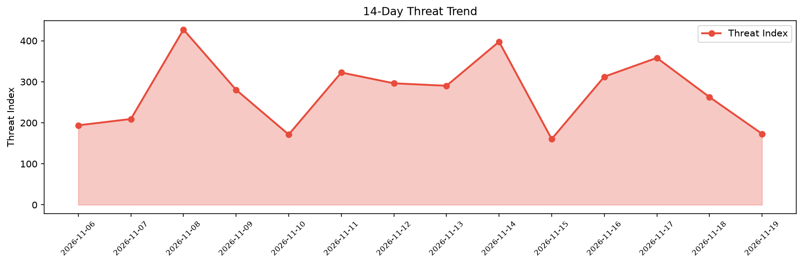

# Security Scan Report — 2026-11-19

**Scan ID:** `aab07e475b` | **CVEs:** 20 | **Threat Index:** 173.1

## Threat Overview

| Metric | Value |
|--------|-------|
| Threat Index | 173.1 |
| Critical CVEs | 0 |
| HIGH | 2 |
| MEDIUM | 11 |
| LOW | 7 |

## Delta vs Yesterday

| Metric | Today | Yesterday | Change |
|--------|-------|-----------|--------|
| total_cves | 20 | 20 | ➡️ 0.0% |
| threat_index | 173.1 | 262.8 | 📉 -34.1% |
| critical_count | 0 | 0 | ➡️ 0% |

## Top Weakness Categories

| CWE | Count |
|-----|-------|
| CWE-863 | 4 |
| CWE-639 | 4 |
| CWE-79 | 3 |
| CWE-862 | 2 |
| CWE-89 | 2 |

## CVE Details

| CVE ID | Score | Severity | Description |
|--------|-------|----------|-------------|
| CVE-2026-12487 | 7.5 | HIGH | An incorrect authorization vulnerability in the SNMP parameter of Zyxel EE5301-0... |
| CVE-2026-130351 | 7.2 | HIGH | phpMyFAQ from 4.2.0-alpha before 4.2.0-RC.2 contains an authorization bypass vul... |
| CVE-2026-130341 | 5.4 | MEDIUM | phpMyFAQ before 4.1.12 and 4.2.0-alpha before 4.2.0-RC.2 contains a stored cross... |
| CVE-2026-130348 | 5.3 | MEDIUM | phpMyFAQ 4.1.0 before 4.1.12 and 4.2.0-alpha before 4.2.0-RC.2 contains a missin... |
| CVE-2026-130352 | 5.3 | MEDIUM | phpMyFAQ before 4.1.12 and 4.2.0-alpha before 4.2.0-RC.2 contains an information... |
| CVE-2026-130353 | 5.3 | MEDIUM | phpMyFAQ before 4.1.12 and 4.2.0-alpha before 4.2.0-RC.2 contains an information... |
| CVE-2026-130354 | 5.3 | MEDIUM | phpMyFAQ 4.1.0 before 4.1.12 and 4.2.0-alpha before 4.2.0-RC.2 contains an authe... |
| CVE-2026-130347 | 4.8 | MEDIUM | phpMyFAQ before 4.1.12 and 4.2.0-alpha before 4.2.0-RC.2 contains an authenticat... |
| CVE-2026-130338 | 4.6 | MEDIUM | AdminNeo before 5.9.1 contains a stored sql injection vulnerability in the MySQL... |
| CVE-2026-130339 | 4.3 | MEDIUM | phpMyFAQ before 4.1.12 and 4.2.0-alpha before 4.2.0-RC.2 contains an information... |
| CVE-2026-130349 | 4.3 | MEDIUM | phpMyFAQ from 4.2.0-alpha.2 before 4.2.0-RC.2 contains an incorrect authorizatio... |
| CVE-2026-130355 | 4.3 | MEDIUM | phpMyFAQ from 4.2.0-alpha.2 before 4.2.0-RC.2 contains an incorrect authorizatio... |
| CVE-2026-130342 | 4.2 | MEDIUM | phpMyFAQ before 4.1.12 and 4.2.0-alpha before 4.2.0-RC.2 contains an improper re... |
| CVE-2026-130350 | 3.8 | LOW | phpMyFAQ before 4.1.12 and 4.2.0-alpha before 4.2.0-RC.2 contains an incorrect a... |
| CVE-2026-130343 | 3.5 | LOW | phpMyFAQ 3.2.5 before 4.1.12 and 4.2.0-alpha before 4.2.0-RC.2 contains an autho... |