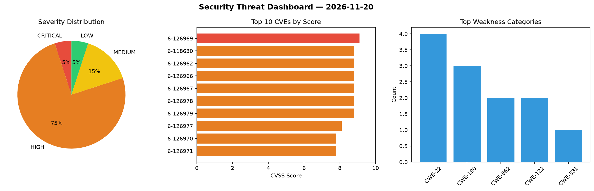
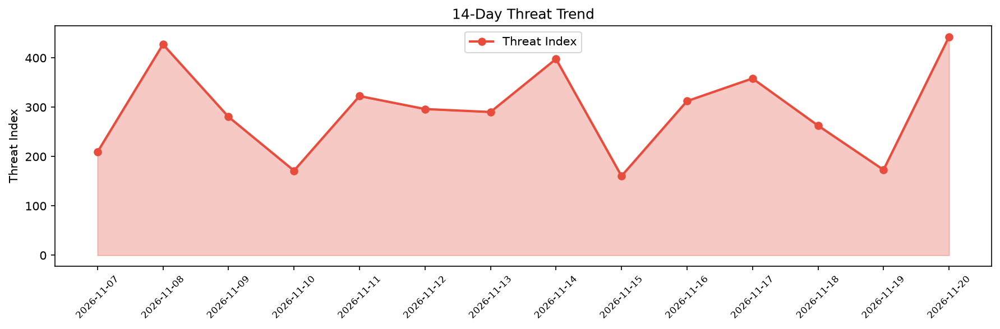

# Security Scan Report — 2026-11-20

**Scan ID:** `5df816e2ec` | **CVEs:** 20 | **Threat Index:** 442.7

## Threat Overview

| Metric | Value |
|--------|-------|
| Threat Index | 442.7 |
| Critical CVEs | 1 |
| CRITICAL | 1 |
| HIGH | 15 |
| MEDIUM | 3 |
| LOW | 1 |

## Delta vs Yesterday

| Metric | Today | Yesterday | Change |
|--------|-------|-----------|--------|
| total_cves | 20 | 20 | ➡️ 0.0% |
| threat_index | 442.7 | 173.1 | 📈 155.7% |
| critical_count | 1 | 0 | ➡️ 0% |

## Top Weakness Categories

| CWE | Count |
|-----|-------|
| CWE-22 | 4 |
| CWE-190 | 3 |
| CWE-862 | 2 |
| CWE-122 | 2 |
| CWE-331 | 1 |

## CVE Details

| CVE ID | Score | Severity | Description |
|--------|-------|----------|-------------|
| CVE-2026-126969 | 9.1 | CRITICAL | SmarterTools SmarterMail Insufficient Entropy Authentication Bypass Vulnerabilit... |
| CVE-2026-118630 | 8.8 | HIGH | Winmate HotTab Exposed Dangerous Function Local Privilege Escalation Vulnerabili... |
| CVE-2026-126962 | 8.8 | HIGH | open62541 Subscription Use-After-Free Remote Code Execution Vulnerability. This ... |
| CVE-2026-126966 | 8.8 | HIGH | SmarterTools SmarterMail Missing Authorization Privilege Escalation Vulnerabilit... |
| CVE-2026-126967 | 8.8 | HIGH | SmarterTools SmarterMail File Edit API Directory Traversal Remote Code Execution... |
| CVE-2026-126978 | 8.8 | HIGH | Philips Hue Bridge hap_pair_setup_handler Heap-based Buffer Overflow Remote Code... |
| CVE-2026-126979 | 8.8 | HIGH | Philips Hue Bridge HomeKit Accessory Protocol chacha20_decrypt Integer Underflow... |
| CVE-2026-126977 | 8.1 | HIGH | Philips Hue Bridge HomeKit Pair-Setup Default Password Authentication Bypass Vul... |
| CVE-2026-126970 | 7.8 | HIGH | KiCad Altium SCHLIB File Parsing Out-Of-Bounds Write Remote Code Execution Vulne... |
| CVE-2026-126971 | 7.8 | HIGH | KiCad Project Archive File Handling Directory Traversal Remote Code Execution Vu... |
| CVE-2026-126972 | 7.8 | HIGH | KiCad Plugin Directory Traversal Remote Code Execution   Vulnerability. This vul... |
| CVE-2026-126973 | 7.8 | HIGH | KDE Gwenview PNG File Parsing Integer Overflow Remote Code Execution Vulnerabili... |
| CVE-2026-126974 | 7.8 | HIGH | llama.cpp GGUF File Parsing Integer Overflow Remote Code Execution Vulnerability... |
| CVE-2026-126975 | 7.8 | HIGH | llama.cpp GGUF File Parsing Heap-based Buffer Overflow Remote Code Execution Vul... |
| CVE-2026-126963 | 7.5 | HIGH | Hinemos Agent Improper Certificate Validation Remote Code Execution Vulnerabilit... |