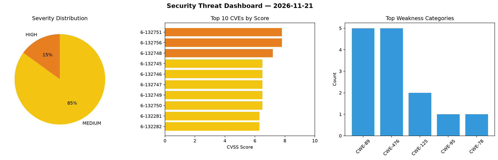
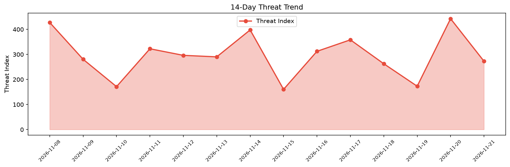

# Security Scan Report — 2026-11-21

**Scan ID:** `ee6072175b` | **CVEs:** 20 | **Threat Index:** 272.8

## Threat Overview

| Metric | Value |
|--------|-------|
| Threat Index | 272.8 |
| Critical CVEs | 0 |
| HIGH | 3 |
| MEDIUM | 17 |

## Delta vs Yesterday

| Metric | Today | Yesterday | Change |
|--------|-------|-----------|--------|
| total_cves | 20 | 20 | ➡️ 0.0% |
| threat_index | 272.8 | 442.7 | 📉 -38.4% |
| critical_count | 0 | 1 | 📉 -100.0% |

## Top Weakness Categories

| CWE | Count |
|-----|-------|
| CWE-89 | 5 |
| CWE-476 | 5 |
| CWE-125 | 2 |
| CWE-95 | 1 |
| CWE-78 | 1 |

## CVE Details

| CVE ID | Score | Severity | Description |
|--------|-------|----------|-------------|
| CVE-2026-132751 | 7.8 | HIGH | yt through 4.4.4 contains a code injection vulnerability that allows attackers t... |
| CVE-2026-132756 | 7.8 | HIGH | Geany through 2.1.0 contains an OS command injection vulnerability that allows a... |
| CVE-2026-132748 | 7.2 | HIGH | Vtiger CRM through 8.4.0 contains a PHP code injection vulnerability that allows... |
| CVE-2026-132745 | 6.5 | MEDIUM | Vtiger CRM through 8.4.0 contains a blind SQL injection vulnerability that allow... |
| CVE-2026-132746 | 6.5 | MEDIUM | Vtiger CRM through 8.4.0 contains a blind SQL injection vulnerability that allow... |
| CVE-2026-132747 | 6.5 | MEDIUM | Vtiger CRM through 8.4.0 contains an SQL injection vulnerability that allows aut... |
| CVE-2026-132749 | 6.5 | MEDIUM | Vtiger CRM through 8.4.0 contains a blind SQL injection vulnerability in ReportR... |
| CVE-2026-132750 | 6.5 | MEDIUM | Meilisearch before 1.55.1 and 1.56.x before 1.56.1 contains a quadratic memory c... |
| CVE-2026-132281 | 6.3 | MEDIUM | A vulnerability was found in elunez eladmin up to 2.7. This affects the function... |
| CVE-2026-132282 | 6.3 | MEDIUM | A vulnerability was determined in elunez eladmin up to 2.7. This vulnerability a... |
| CVE-2026-132754 | 6.1 | MEDIUM | MediaInfoLib before 26.10 contains an out-of-bounds read vulnerability in File_M... |
| CVE-2026-132755 | 6.1 | MEDIUM | MediaInfoLib before 26.10 contains a heap-based buffer over-read vulnerability i... |
| CVE-2026-127039 | 5.9 | MEDIUM | The certificate authentication info handling in gnutls from 2.5.9 up to 3.8.13 d... |
| CVE-2026-127040 | 5.9 | MEDIUM | The RSA-PSK ClientKeyExchange handler in gnutls before 3.8.14 does not return af... |
| CVE-2026-127231 | 5.9 | MEDIUM | A double free in the X.509 name constraints enforcement of GnuTLS 3.8.13 on all ... |