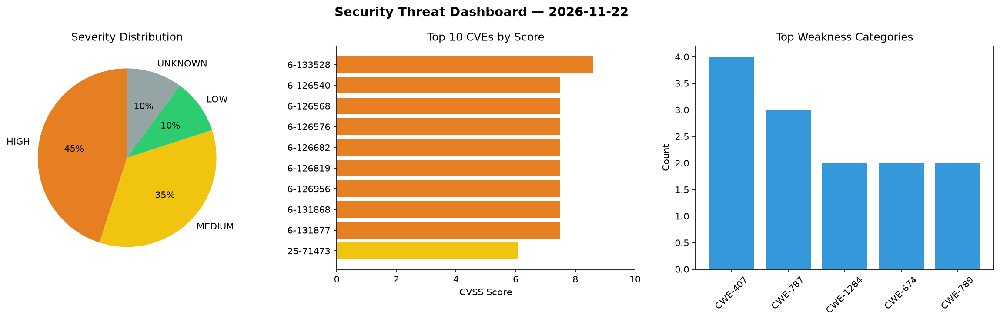
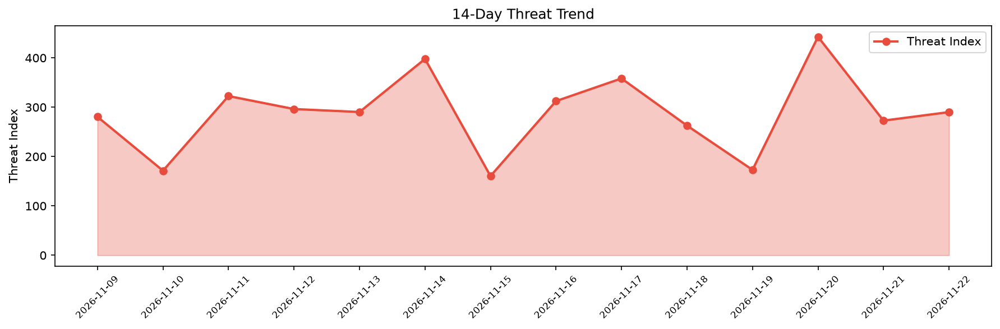

# Security Scan Report — 2026-11-22

**Scan ID:** `b865a88f3e` | **CVEs:** 20 | **Threat Index:** 290.1

## Threat Overview

| Metric | Value |
|--------|-------|
| Threat Index | 290.1 |
| Critical CVEs | 0 |
| HIGH | 9 |
| MEDIUM | 7 |
| LOW | 2 |
| UNKNOWN | 2 |

## Delta vs Yesterday

| Metric | Today | Yesterday | Change |
|--------|-------|-----------|--------|
| total_cves | 20 | 20 | ➡️ 0.0% |
| threat_index | 290.1 | 272.8 | 📈 6.3% |
| critical_count | 0 | 0 | ➡️ 0% |

## Top Weakness Categories

| CWE | Count |
|-----|-------|
| CWE-407 | 4 |
| CWE-787 | 3 |
| CWE-1284 | 2 |
| CWE-674 | 2 |
| CWE-789 | 2 |

## CVE Details

| CVE ID | Score | Severity | Description |
|--------|-------|----------|-------------|
| CVE-2026-133528 | 8.6 | HIGH | BeamNG.drive before 0.40.6 contains an out-of-bounds write vulnerability because... |
| CVE-2026-126540 | 7.5 | HIGH | Convert::ASN1 versions before 0.37 for Perl allow CPU exhaustion via quadratic b... |
| CVE-2026-126568 | 7.5 | HIGH | Convert::ASN1 versions before 0.37 for Perl allow memory exhaustion via unbounde... |
| CVE-2026-126576 | 7.5 | HIGH | Convert::ASN1 versions before 0.37 for Perl allow CPU exhaustion via unchecked e... |
| CVE-2026-126682 | 7.5 | HIGH | Convert::ASN1 versions before 0.37 for Perl allow CPU exhaustion via exponent-no... |
| CVE-2026-126819 | 7.5 | HIGH | Convert::ASN1 versions before 0.37 for Perl allow memory exhaustion via zero-len... |
| CVE-2026-126956 | 7.5 | HIGH | Convert::ASN1 versions before 0.37 for Perl allow memory exhaustion via unlimite... |
| CVE-2026-131868 | 7.5 | HIGH | Convert::ASN1 versions before 0.37 for Perl allow memory exhaustion via a declar... |
| CVE-2026-131877 | 7.5 | HIGH | Convert::ASN1 versions before 0.37 for Perl allow CPU exhaustion via unbounded a... |
| CVE-2025-71473 | 6.1 | MEDIUM | lwext4 through 1.0.0 contains a heap buffer overflow in ext4_fs_init_inode_bitma... |
| CVE-2025-71474 | 6.1 | MEDIUM | lwext4 through 1.0.0 contains an out-of-bounds write vulnerability in ext4_fs_in... |
| CVE-2026-133519 | 5.5 | MEDIUM | FFmpeg 7.0 through 9.0.2 contains an out-of-bounds read vulnerability in dvdvide... |
| CVE-2026-133521 | 5.4 | MEDIUM | Bar Assistant 3.0.0 before 6.11.0 contains an authorization bypass vulnerability... |
| CVE-2026-133224 | 5.4 | MEDIUM | A flaw was found in Keycloak. When an administrator revokes tokens by setting a ... |
| CVE-2026-133225 | 5.4 | MEDIUM | A flaw was found in Keycloak. When processing token requests using the User-Mana... |