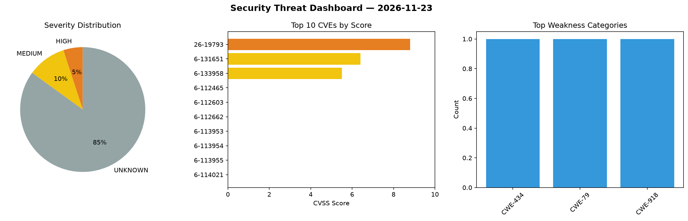
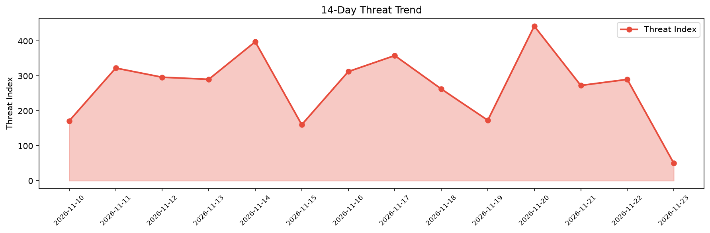

# Security Scan Report — 2026-11-23

**Scan ID:** `c872ff4912` | **CVEs:** 20 | **Threat Index:** 50.2

## Threat Overview

| Metric | Value |
|--------|-------|
| Threat Index | 50.2 |
| Critical CVEs | 0 |
| HIGH | 1 |
| MEDIUM | 2 |
| UNKNOWN | 17 |

## Delta vs Yesterday

| Metric | Today | Yesterday | Change |
|--------|-------|-----------|--------|
| total_cves | 20 | 20 | ➡️ 0.0% |
| threat_index | 50.2 | 290.1 | 📉 -82.7% |
| critical_count | 0 | 0 | ➡️ 0% |

## Top Weakness Categories

| CWE | Count |
|-----|-------|
| CWE-434 | 1 |
| CWE-79 | 1 |
| CWE-918 | 1 |

## CVE Details

| CVE ID | Score | Severity | Description |
|--------|-------|----------|-------------|
| CVE-2026-19793 | 8.8 | HIGH | The WP Import Export Lite plugin for WordPress is vulnerable to Limited Code Inj... |
| CVE-2026-131651 | 6.4 | MEDIUM | The rtMedia for WordPress, BuddyPress and bbPress plugin for WordPress is vulner... |
| CVE-2026-133958 | 5.5 | MEDIUM | A flaw was found in Quay. Insufficient validation of repository notification web... |
| CVE-2026-112465 | 0.0 | UNKNOWN | An out-of-bounds read was addressed with improved bounds checking. This issue is... |
| CVE-2026-112603 | 0.0 | UNKNOWN | A logic issue was addressed with improved checks. This issue is fixed in Xcode 2... |
| CVE-2026-112662 | 0.0 | UNKNOWN | A race condition was addressed with additional validation. This issue is fixed i... |
| CVE-2026-113953 | 0.0 | UNKNOWN | An integer overflow was addressed with improved input validation. This issue is ... |
| CVE-2026-113954 | 0.0 | UNKNOWN | A use-after-free issue was addressed with improved memory management. This issue... |
| CVE-2026-113955 | 0.0 | UNKNOWN | A cross-origin issue was addressed with improved tracking of security origins. T... |
| CVE-2026-114021 | 0.0 | UNKNOWN | An out-of-bounds write issue was addressed with improved bounds checking. This i... |
| CVE-2026-114022 | 0.0 | UNKNOWN | An out-of-bounds write issue was addressed with improved bounds checking. This i... |
| CVE-2026-114023 | 0.0 | UNKNOWN | A path handling issue was addressed with improved validation. This issue is fixe... |
| CVE-2026-114024 | 0.0 | UNKNOWN | This issue was addressed with improved checks. This issue is fixed in iOS 27.2 a... |
| CVE-2026-114025 | 0.0 | UNKNOWN | An out-of-bounds write was addressed with improved input validation. This issue ... |
| CVE-2026-114026 | 0.0 | UNKNOWN | An out-of-bounds read was addressed with improved bounds checking. This issue is... |