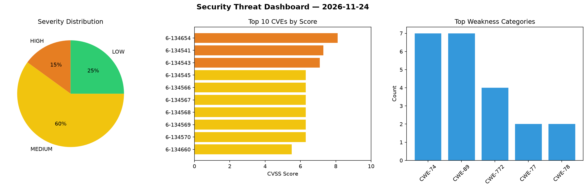
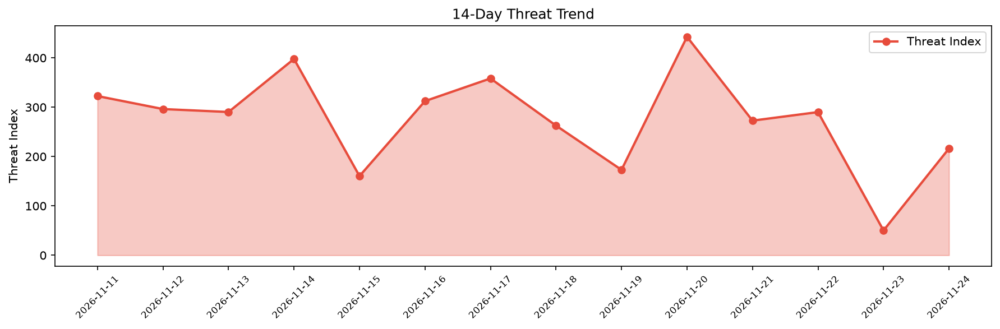

# Security Scan Report — 2026-11-24

**Scan ID:** `8fc23715ba` | **CVEs:** 20 | **Threat Index:** 216.4

## Threat Overview

| Metric | Value |
|--------|-------|
| Threat Index | 216.4 |
| Critical CVEs | 0 |
| HIGH | 3 |
| MEDIUM | 12 |
| LOW | 5 |

## Delta vs Yesterday

| Metric | Today | Yesterday | Change |
|--------|-------|-----------|--------|
| total_cves | 20 | 20 | ➡️ 0.0% |
| threat_index | 216.4 | 50.2 | 📈 331.1% |
| critical_count | 0 | 0 | ➡️ 0% |

## Top Weakness Categories

| CWE | Count |
|-----|-------|
| CWE-74 | 7 |
| CWE-89 | 7 |
| CWE-772 | 4 |
| CWE-77 | 2 |
| CWE-78 | 2 |

## CVE Details

| CVE ID | Score | Severity | Description |
|--------|-------|----------|-------------|
| CVE-2026-134654 | 8.1 | HIGH | Mailflare before 48957fb contains a host header injection vulnerability in the p... |
| CVE-2026-134541 | 7.3 | HIGH | A vulnerability was detected in Surya2Developer Online Shopping System 1.0. This... |
| CVE-2026-134543 | 7.1 | HIGH | A flaw has been found in jprocms up to 1.7.7. Affected is the function StrUtil.f... |
| CVE-2026-134545 | 6.3 | MEDIUM | A vulnerability was found in Xinchen Technology Huangjintong Second-level System... |
| CVE-2026-134566 | 6.3 | MEDIUM | A security vulnerability has been detected in itsourcecode Document Management S... |
| CVE-2026-134567 | 6.3 | MEDIUM | A vulnerability was detected in itsourcecode Document Management System 1.0. The... |
| CVE-2026-134568 | 6.3 | MEDIUM | A flaw has been found in itsourcecode E-Logbook with Health Monitoring System 1.... |
| CVE-2026-134569 | 6.3 | MEDIUM | A vulnerability has been found in itsourcecode Banking Management System 1.0. Th... |
| CVE-2026-134570 | 6.3 | MEDIUM | A vulnerability was found in itsourcecode Banking Management System 1.0. Affecte... |
| CVE-2026-134660 | 5.5 | MEDIUM | GPAC MP4Box through 26.07.0 contains a type confusion vulnerability in xmt_parse... |
| CVE-2026-134661 | 5.5 | MEDIUM | GPAC MP4Box through 26.07.0 contains a NULL pointer dereference vulnerability in... |
| CVE-2026-134544 | 4.7 | MEDIUM | A vulnerability has been found in jprocms up to 1.7.7. Affected by this vulnerab... |
| CVE-2026-134553 | 4.3 | MEDIUM | A vulnerability was determined in wiroai Wiro-MCP up to 1.3.0. This affects the ... |
| CVE-2026-134656 | 4.3 | MEDIUM | OpenAirInterface CN5G SMF through 2.2.2 contains a missing resource release vuln... |
| CVE-2026-134657 | 4.3 | MEDIUM | OpenAirInterface CN5G PCF through 2.2.2 contains a memory leak vulnerability in ... |