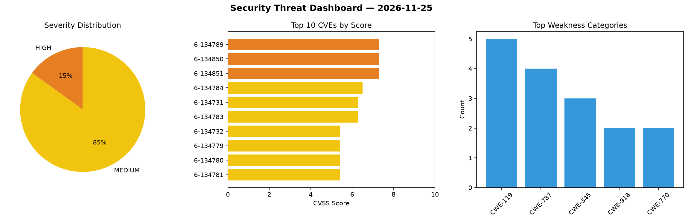
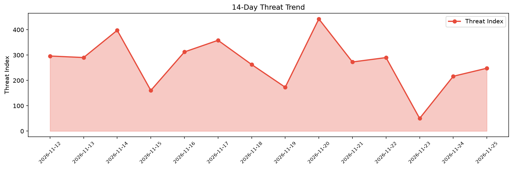

# Security Scan Report — 2026-11-25

**Scan ID:** `723762312c` | **CVEs:** 20 | **Threat Index:** 248.1

## Threat Overview

| Metric | Value |
|--------|-------|
| Threat Index | 248.1 |
| Critical CVEs | 0 |
| HIGH | 3 |
| MEDIUM | 17 |

## Delta vs Yesterday

| Metric | Today | Yesterday | Change |
|--------|-------|-----------|--------|
| total_cves | 20 | 20 | ➡️ 0.0% |
| threat_index | 248.1 | 216.4 | 📈 14.6% |
| critical_count | 0 | 0 | ➡️ 0% |

## Top Weakness Categories

| CWE | Count |
|-----|-------|
| CWE-119 | 5 |
| CWE-787 | 4 |
| CWE-345 | 3 |
| CWE-918 | 2 |
| CWE-770 | 2 |

## CVE Details

| CVE ID | Score | Severity | Description |
|--------|-------|----------|-------------|
| CVE-2026-134789 | 7.3 | HIGH | A weakness has been identified in DumbWareio DumbAssets up to 1.0.11. Affected b... |
| CVE-2026-134850 | 7.3 | HIGH | A security vulnerability has been detected in aceberg WatchYourLAN up to 2.1.4. ... |
| CVE-2026-134851 | 7.3 | HIGH | A vulnerability was detected in leonkhoo123 self-hosting-file-uploader up to 473... |
| CVE-2026-134784 | 6.5 | MEDIUM | A vulnerability was found in DumbWareio DumbDrop up to ff8f813f493e89c7da056e7a3... |
| CVE-2026-134731 | 6.3 | MEDIUM | A vulnerability was detected in itsourcecode Insurance Management System 1.0. Th... |
| CVE-2026-134783 | 6.3 | MEDIUM | A vulnerability has been found in xuxueli xxl-job 3.5.0/3.5.1-SNAPSHOT. Affected... |
| CVE-2026-134732 | 5.4 | MEDIUM | A flaw has been found in Open Asset Import Library Assimp up to 6.0.5. This affe... |
| CVE-2026-134779 | 5.4 | MEDIUM | A weakness has been identified in Open Asset Import Library Assimp up to 6.0.6. ... |
| CVE-2026-134780 | 5.4 | MEDIUM | A security vulnerability has been detected in Open Asset Import Library Assimp u... |
| CVE-2026-134781 | 5.4 | MEDIUM | A vulnerability was detected in Open Asset Import Library Assimp up to 6.0.5. Th... |
| CVE-2026-134786 | 5.4 | MEDIUM | A vulnerability has been found in Xuxueli xxl-job 3.5.0/3.5.1-SNAPSHOT. The affe... |
| CVE-2026-134734 | 5.3 | MEDIUM | A vulnerability was found in Webkul Bagisto up to 2.4.13. Affected is the functi... |
| CVE-2026-134735 | 5.3 | MEDIUM | A vulnerability was determined in Webkul Bagisto up to 2.4.12. Affected by this ... |
| CVE-2026-134785 | 5.3 | MEDIUM | A vulnerability was identified in Bagisto MangoPay Payment Gateway up to c061edc... |
| CVE-2026-134787 | 5.3 | MEDIUM | A vulnerability was identified in code-projects Intern Record System 1.0. This i... |