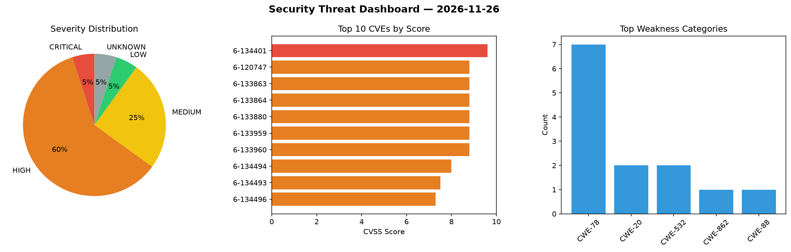
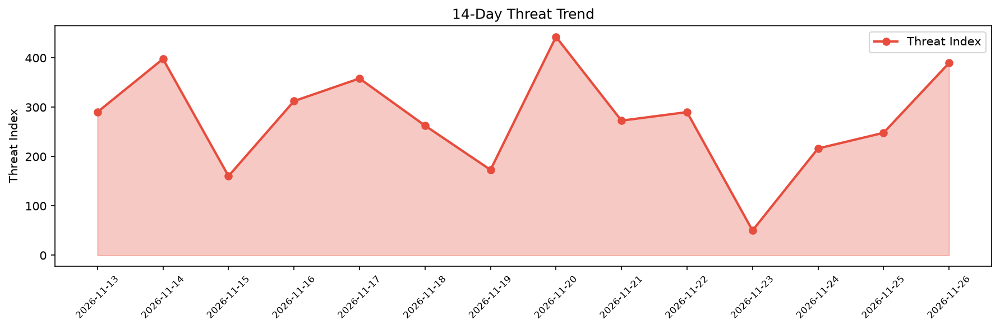

# Security Scan Report — 2026-11-26

**Scan ID:** `106470a68c` | **CVEs:** 20 | **Threat Index:** 389.5

## Threat Overview

| Metric | Value |
|--------|-------|
| Threat Index | 389.5 |
| Critical CVEs | 1 |
| CRITICAL | 1 |
| HIGH | 12 |
| MEDIUM | 5 |
| LOW | 1 |
| UNKNOWN | 1 |

## Delta vs Yesterday

| Metric | Today | Yesterday | Change |
|--------|-------|-----------|--------|
| total_cves | 20 | 20 | ➡️ 0.0% |
| threat_index | 389.5 | 248.1 | 📈 57.0% |
| critical_count | 1 | 0 | ➡️ 0% |

## Top Weakness Categories

| CWE | Count |
|-----|-------|
| CWE-78 | 7 |
| CWE-20 | 2 |
| CWE-532 | 2 |
| CWE-862 | 1 |
| CWE-88 | 1 |

## CVE Details

| CVE ID | Score | Severity | Description |
|--------|-------|----------|-------------|
| CVE-2026-134401 | 9.6 | CRITICAL | Improper input validation in Variations in Google Chrome prior to 158.0.8127.88 ... |
| CVE-2026-120747 | 8.8 | HIGH | Tanium addressed a command injection vulnerability in Comply.... |
| CVE-2026-133863 | 8.8 | HIGH | Tanium addressed an improper access controls vulnerability in Tanium Server.... |
| CVE-2026-133864 | 8.8 | HIGH | Tanium addressed a command injection vulnerability in Default Content.... |
| CVE-2026-133880 | 8.8 | HIGH | Tanium addressed a command injection vulnerability in Threat Response.... |
| CVE-2026-133959 | 8.8 | HIGH | Tanium addressed a command injection vulnerability in Core Content - Enhanced Ta... |
| CVE-2026-133960 | 8.8 | HIGH | Tanium addressed an unauthorized code execution vulnerability in the Tanium Defa... |
| CVE-2026-134494 | 8.0 | HIGH | Tanium addressed an argument injection vulnerability in Core Content.... |
| CVE-2026-134493 | 7.5 | HIGH | Tanium addressed a path traversal vulnerability in Core Content.... |
| CVE-2026-134496 | 7.3 | HIGH | Tanium addressed an improper input validation vulnerability in Core Content.... |
| CVE-2026-134618 | 7.3 | HIGH | Tanium addressed a local privilege escalation vulnerability in Emerging Issues C... |
| CVE-2026-133961 | 7.2 | HIGH | Tanium addressed an unauthorized code execution vulnerability in the Tanium Defa... |
| CVE-2026-133955 | 7.1 | HIGH | Tanium addressed an improper input validation vulnerability in Core Content.... |
| CVE-2026-133877 | 6.6 | MEDIUM | Tanium addressed an insertion of sensitive information into log file vulnerabili... |
| CVE-2026-131650 | 6.5 | MEDIUM | Tanium addressed an information disclosure vulnerability.... |