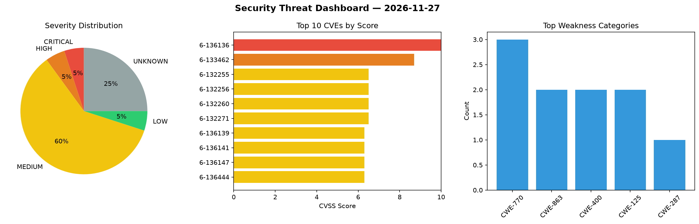
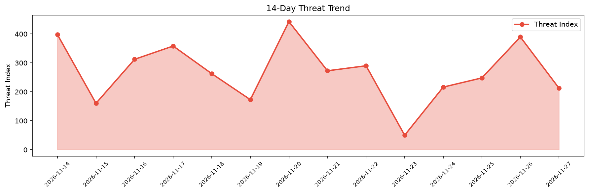

# Security Scan Report — 2026-11-27

**Scan ID:** `92e9cc5109` | **CVEs:** 20 | **Threat Index:** 212.9

## Threat Overview

| Metric | Value |
|--------|-------|
| Threat Index | 212.9 |
| Critical CVEs | 1 |
| CRITICAL | 1 |
| HIGH | 1 |
| MEDIUM | 12 |
| LOW | 1 |
| UNKNOWN | 5 |

## Delta vs Yesterday

| Metric | Today | Yesterday | Change |
|--------|-------|-----------|--------|
| total_cves | 20 | 20 | ➡️ 0.0% |
| threat_index | 212.9 | 389.5 | 📉 -45.3% |
| critical_count | 1 | 1 | ➡️ 0.0% |

## Top Weakness Categories

| CWE | Count |
|-----|-------|
| CWE-770 | 3 |
| CWE-863 | 2 |
| CWE-400 | 2 |
| CWE-125 | 2 |
| CWE-287 | 1 |

## CVE Details

| CVE ID | Score | Severity | Description |
|--------|-------|----------|-------------|
| CVE-2026-136136 | 10.0 | CRITICAL | A vulnerability was identified in Netis WF2409E up to 20261026. Affected by this... |
| CVE-2026-133462 | 8.7 | HIGH | AutoGPT is a workflow automation platform for creating, deploying, and managing ... |
| CVE-2026-132255 | 6.5 | MEDIUM | AutoGPT is a workflow automation platform for creating, deploying, and managing ... |
| CVE-2026-132256 | 6.5 | MEDIUM | AutoGPT is a workflow automation platform for creating, deploying, and managing ... |
| CVE-2026-132260 | 6.5 | MEDIUM | AutoGPT is a workflow automation platform for creating, deploying, and managing ... |
| CVE-2026-132271 | 6.5 | MEDIUM | AutoGPT is a workflow automation platform for creating, deploying, and managing ... |
| CVE-2026-136139 | 6.3 | MEDIUM | A vulnerability was determined in Zefan-Cai R-KV up to 6715468b9872442be72e5c973... |
| CVE-2026-136141 | 6.3 | MEDIUM | A vulnerability was identified in Backdrop CMS up to 1.35.2. Affected is the fun... |
| CVE-2026-136147 | 6.3 | MEDIUM | A weakness has been identified in DWS Antik Browser 1.17.0. Affected by this iss... |
| CVE-2026-136444 | 6.3 | MEDIUM | A vulnerability was detected in JaguarJack catch-admin up to 5.4.1. The affected... |
| CVE-2026-16667 | 6.2 | MEDIUM | The Cypress/PSoC6 flash-map backend in boot/cypress/cy_flash_pal/cy_flash_map.c ... |
| CVE-2026-16666 | 5.7 | MEDIUM | When MCUboot resumes an interrupted image swap it takes the number of bytes to m... |
| CVE-2026-136146 | 5.3 | MEDIUM | A security flaw has been discovered in vanna-ai vanna 2.0.0/2.0.1/2.0.2. Affecte... |
| CVE-2026-16670 | 4.0 | MEDIUM | MCUboot's PSA-crypto ECDSA adapter parses the RFC 5480 DER signature with parse_... |
| CVE-2026-16669 | 2.0 | LOW | MCUboot's Espressif port omits zeroization of two sensitive stack buffers in boo... |