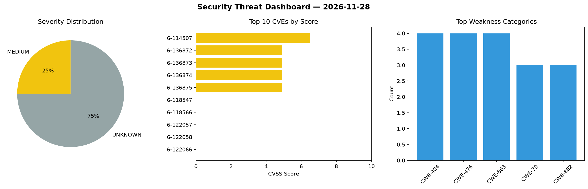
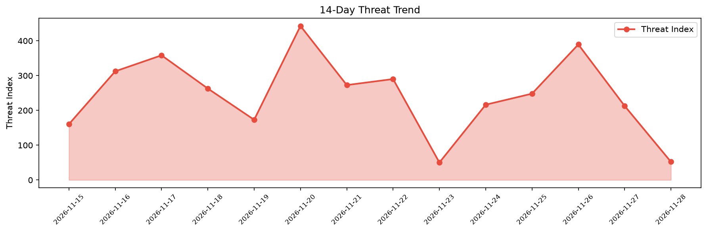

# Security Scan Report — 2026-11-28

**Scan ID:** `2804943cd4` | **CVEs:** 20 | **Threat Index:** 52.2

## Threat Overview

| Metric | Value |
|--------|-------|
| Threat Index | 52.2 |
| Critical CVEs | 0 |
| MEDIUM | 5 |
| UNKNOWN | 15 |

## Delta vs Yesterday

| Metric | Today | Yesterday | Change |
|--------|-------|-----------|--------|
| total_cves | 20 | 20 | ➡️ 0.0% |
| threat_index | 52.2 | 212.9 | 📉 -75.5% |
| critical_count | 0 | 1 | 📉 -100.0% |

## Top Weakness Categories

| CWE | Count |
|-----|-------|
| CWE-404 | 4 |
| CWE-476 | 4 |
| CWE-863 | 4 |
| CWE-79 | 3 |
| CWE-862 | 3 |

## CVE Details

| CVE ID | Score | Severity | Description |
|--------|-------|----------|-------------|
| CVE-2026-114507 | 6.5 | MEDIUM | LightRAG provides simple and fast retrieval-augmented generation. Prior to 1.5.5... |
| CVE-2026-136872 | 4.9 | MEDIUM | A vulnerability was found in GL.iNet GL-A1300, GL-AR300M, GL-AR300M16, GL-AX1800... |
| CVE-2026-136873 | 4.9 | MEDIUM | A vulnerability was determined in GL.iNet GL-A1300, GL-AR300M, GL-AR300M16, GL-A... |
| CVE-2026-136874 | 4.9 | MEDIUM | A vulnerability was identified in GL.iNet GL-A1300, GL-AR300M, GL-AR300M16, GL-A... |
| CVE-2026-136875 | 4.9 | MEDIUM | A security flaw has been discovered in GL.iNet GL-A1300, GL-AR300M, GL-AR300M16,... |
| CVE-2026-118547 | 0.0 | UNKNOWN | Deserialization of Untrusted Data vulnerability in Drupal Content Synchronizer a... |
| CVE-2026-118566 | 0.0 | UNKNOWN | Improper Neutralization of Input During Web Page Generation ("Cross-site Scripti... |
| CVE-2026-122057 | 0.0 | UNKNOWN | Missing Authorization vulnerability in Drupal S3 File System CORS Upload allows ... |
| CVE-2026-122058 | 0.0 | UNKNOWN | Incorrect Authorization vulnerability in Drupal Simple OAuth (OAuth2) & OpenID C... |
| CVE-2026-122066 | 0.0 | UNKNOWN | Missing Authorization vulnerability in Drupal Workflow Notifications allows Forc... |
| CVE-2026-122067 | 0.0 | UNKNOWN | Authentication Bypass Using an Alternate Path or Channel vulnerability in Drupal... |
| CVE-2026-122068 | 0.0 | UNKNOWN | Improper Neutralization of Input During Web Page Generation ("Cross-site Scripti... |
| CVE-2026-122069 | 0.0 | UNKNOWN | Improper Verification of Cryptographic Signature vulnerability in Drupal Alterna... |
| CVE-2026-122070 | 0.0 | UNKNOWN | Missing Authorization vulnerability in Drupal Commerce Product Alternative allow... |
| CVE-2026-122071 | 0.0 | UNKNOWN | Improper Verification of Cryptographic Signature vulnerability in Drupal Commerc... |